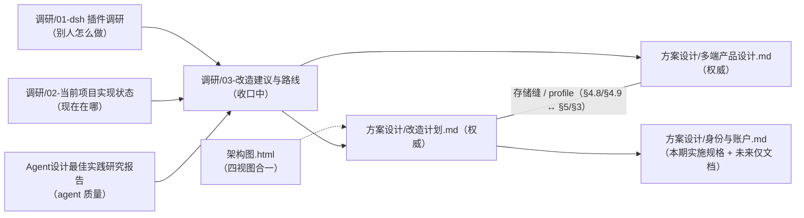

# docs 文档地图与治理规则

> 本文件是文档层的「装配点」：谁权威、谁引用、决策怎么编号、什么时候刷新。架构本身的权威是《改造计划》与《多端产品设计》。

## 文档地图

| 文档 | 角色 | 权威性 |
| --- | --- | --- |
| `agents/issue-tracker.md`、`agents/triage-labels.md`、`agents/domain.md` | 已确认的工程技能工单、标签与领域文档配置 | **配置**：技能消费规则；领域/架构权威仍按既有文档地图 |
| `../packages/third-party/zcode/来源清单.json`（**不在 docs 下**，2026-10-16 移出） | 清单声明的 ZCode 提交、真实源文件、副本校验和与偏差记录（参考仓 HEAD 可独立更新） | **生成清单**：移植来源核对；UI 可用性仍需完整验收 |
| `方案设计/改造计划.md` | 服务端插件内核 + BYOK + design/code 双模式的分阶段蓝图 | **权威**：ctx key 表（§4.2）、扩展点速查表（§4.10）、路线图（§7，P0–P8）的唯一属主 |
| `方案设计/统一模型体系.md` | Code／Design 共用模型管理、实例默认、严格生成候选及原编辑器扩展 | **实施规格**：2026-10-08 用户确认；旧模型 UI 退役，Design 画布和其他设置保持原风格 |
| `方案设计/现有能力接线与入口统一.md` | 原管理 UI、插件来源／图标／侧栏、实例能力、双模式子定义消费、共用管理文档与顶部模式切换 | **实施规格**：2026-10-09 用户确认；确实未接入的既有业务保留原页面并标状态，未来模式不提前显示 |
| `方案设计/工作台融合兼容计划.md` | ZCode 壳融合后原版功能找回：三次退役 git 考古、布局差异清单（布局按原版、风格用 ZCode；含设置页 T1~T18 差异表）、缺口 G1~G11 逐项方案、三阶段实施、清理面/恢复面分列 | **方案稿**：2026-10-11 Q1~Q20 拍板定稿；未开工，S3（Code 列表呈现回退）待确认；回执记《日志》一百六十 |
| `方案设计/多端产品设计.md` | 桌面/自托管/Web/移动形态与存储迁移设计 | **权威**：存储/认证/blob/队列/凭证/toolsGateway 缝（§5）、沙箱执行后端（§7）；多端阶段编号 D1–D7 + Spike S1–S4 + OS-0 的属主（§13）。§5 缝表是落地清单，其中的 key 落地时写入《改造计划》§4.2（key 表只此一份） |
| `方案设计/身份与账户.md` | 单本地实例免账户、LocalActor、本机接入、旧身份/计费退役与目录迁移恢复的完整验收规格；官方身份/服务权益、自部署独立身份、资源来源与远端任务生命周期的边界 | **实施规格 + 基础设施规格（仅文档）**：2026-10-05 批准，本期本地实现与验收完成、远端服务不实现；方向/理由以《改造计划》决策为准，回执见《日志》 |
| `方案设计/CI-CD与发版方案.md` | GitHub Actions 的分工口径（`ci.yml` 门禁 / `build-debug.yml` 双平台出包 / `codeql.yml` 扫描面 / `dependabot.yml`）、托管 runner 的体积预算与清理缓存策略、可复现性四件套（`.nvmrc` + SEA 宿主对账、`runtime-lock.json`、版本四处一致、`dist-manifest.json`）、无付费开发者身份时 macOS 未签名包的交付机制、签名 secrets/variables 的三档口径与「现在不要建」清单、发版三档（debug / rc / 正式）与未完成项 | **实施口径**：出包与发版的自动化按本稿执行；产品形态与阶段仍以《多端产品设计》为准，服务端架构以《改造计划》为准，回执记《日志》 |
| `方案设计/运行形态与启动方式.md` | 运行形态与启动方式清单（桌面打包 / 桌面 dev / Web dev / 自托管·SaaS）：身份（auth driver）、数据与端口口径、3001/内嵌 PG 互斥踩坑记录 | **参考**：改启动链路（dev.sh / 桌面壳 / 健康检查）前先读；改完同步更新 |
| `方案设计/子代理与后台任务设计.md` | 子代理 / 多 agent 体系 v1 的实施方案与落地记录：分阶段架构（`DEC-14`）、统一后台任务原语（`DEC-15`）、内置清单（`DEC-16`）、治理档（`DEC-17`）、tunables 纪律（`DEC-18`）、事件归因（`DEC-19`），附文件接线图与验证门 | **方案稿**：v1 已按本稿落地；v2（独立子 run/continuable/面包屑）另立项 |
| `方案设计/Code模式移植与交接.md` | Code 模式 ZCode 全量移植的四合一：移植方案（照搬边界=UI 逐文件照搬 / 数据经 `zcode-adapter` 接 DeepAgents 事件、逐区域差距表、P0–P8 计划、许可证 attribution）、执行手册（进度快照、import 路径映射、逐文件 source→target 施工单、阶段验收门禁、风险登记）、界面阶段同步记录（来源 SHA 与公开操作回归）、内核实施交接（当前施工接口与审批阻断） | **移植方案 + 历史施工回执 + 临时交接**：源码移植边界与阶段记录的属主；现行 Code/Design 统一口径与 2026-10-16 本轮完成状态见《Code工作域与工具内核实施规格》「Code/Design 统一实施」及《日志》「Code/Design 统一工作台本轮最终验收」，旧检查点不覆盖该账本 |
| `方案设计/ComputerUse集成设计.md` | Computer Use 集成方案稿（依据《调研/07》+ 本机实测）：工具面走内核 `ctx.tools`（scope: code、`mcp__computer-use__<action>` 命名点亮已照搬 UI）、观察协议（a11y 文本树优先 + raster 帧绑定 + 预算）、执行层 `ComputerUseExecutor` 缝三档（nut-js+JXA 过渡 → 独立 helper broker 目标态）、权限/lease/actionSent 安全语义、P0–P3 分阶段验收与待拍板 CU-A…G | **方案稿**：待拍板；决策走《改造计划》§6 |
| `方案设计/模式能力分离方案.md` | Code/Design 双模式能力分离（`DEC-2` 收敛实现）：问题诊断（四处混装 + 双 canvasId 口径）、用户拍板、落地架构（工具双通路=注册表服务型/装配点运行态、提示 base+模式段互斥、canvas_state 仅 design）、远期打通前置条件与遗留项 | **已落地记录**：两模式能力边界的唯一参考；方向属主仍是《改造计划》§6 `DEC-2` |
| `方案设计/Code工作域与工具内核实施规格.md` | 本 Goal 的 Code 工作域、内置工具、真实沙箱、Task 后台任务、提示/Skills 与原 ZCode UI 契约实施及验收规格 | **实施规格**：2026-10-03 用户拍板；方向属主仍是《改造计划》《多端产品设计》，实施回执在本稿与《日志》 |
| `方案设计/Harness稳定性与Goal实施规格.md` | 本地桌面运行稳定性、项目普通文件、上下文、Provider 与 Task 内 Goal 的完整验收范围 | **实施规格**：2026-10-11 用户确认；服务 key 与扩展点仍由《改造计划》持有，阶段证据与未完成项写《日志》 |
| `插件/flow插件集成规划.md` | flow 第三模式（futureFlow 子系统）集成改造方案：已拍板决策（`DEC-10`…`DEC-13`）、双模式架构（内嵌/独立 + 宿主适配层 + `ff-embed/v1` 契约）、接缝清单、合并方式三选项、分阶段路线、许可证合规与开放问题 | **方案稿**：flow 子系统实施蓝图；决策结论与理由以《改造计划》§6 为准，上游以根级 `flow/` 子模块为准（见《日志》五十四） |
| `插件/work模式集成规划.md` | Work 第四模式（办公/生产力创作：原生 Office 三件套 + 图片/视频编辑）集成方案：模式壳进内核 + 编辑引擎按需下载（ArtCraft 系列 `storytold/*craft`，纯 Rust，MIT OR Apache-2.0，Word/Excel/PPT 三件套齐备）两档分层、WASM iframe / 原生窗口内嵌 + 编辑器 MCP/CLI 驱动面、`WD-1`…`WD-7` 待拍板决策、分阶段路线与开放问题 | **方案稿**：Work 模式实施蓝图；决策结论拍板后以《改造计划》§6 为准；外部仓库与许可证以各上游为准 |
| `插件/opendesgin集成规划.md` | OpenDesign（Figma 类似物、写代码/原型用的设计引擎，`nexu-io/open-design`，Apache-2.0）集成方案：**不作独立模式**、作为 Code 模式右侧画布面板（与浏览器面板同位互斥）、插件形态交付 + 本地自托管/Electron 承载 + BYOK、`OD-1`…`OD-6` 待拍板决策、分阶段路线与开放问题 | **方案稿**：OpenDesign 集成蓝图；决策结论拍板后以《改造计划》§6 为准；上游以 `nexu-io/open-design` 为准 |
| `插件/CAD控制插件规划.md` | FreeCAD 后台工程、共享工具与 Python、权限、产物和分阶段验收 | **实施规格**：2026-10-18 用户确认；方向见 `DEC-22`，实际验证状态见《日志》与研究矩阵 |
| `调研/CAD官方接口与插件接入调研.md` | FreeCAD／AutoCAD／Blender 官方控制接口、平台差异、工作流风险与本机证据 | **调研**：官方接口可行性、后端实测和 KFW 接线验收分别登记，不以模块导入或单件样例声称覆盖所有工作台 |
| `调研/02-当前项目实现状态.md` | 代码现状快照（组件/路由/features/迁移盘点） | **权威**：全部现状数字（行数/import/路由/组件/迁移计数/provider 数量）；允许滞后于代码，刷新规则见下 |
| `调研/01-deepseek-harness插件调研.md` | dsh 插件架构调研记录 | 调研：结论已被权威文档吸收，只读 |
| `调研/10-目标与完成判定源码核对.md` | ZCode / Kimi 与 DSH / Codex 三份同次核对合并：固定参考源码的持久 Goal、完成判定、独立评估及用户控制对照 | **调研**：2026-10-13 源码核对；不等同于桌面验收，产品选择归《Harness稳定性与Goal实施规格》 |
| `调研/ZCode-3.15.1界面更新源码分析.md` | 3.14.3 与 3.15.1 固定源码的 UI 装配与移植影响对照 | **调研**：原移植清单仍固定 3.14.3，不代表宿主已升级或新版已发布 |
| `调研/Code与Design共享Harness对标核验.md` | Codex、ZCode、Claude Code、DSH 与 TapNow、Lovart、LibTV 的一手行为依据及 Excalidraw 同步边界 | **调研**：2026-10-16 对标验收映射；待 grilling 问题在文内登记，不新增架构决策 |
| `调研/本地媒体写入限制与同类工具核验.md` | 本地图片生成保存、单次上传/下载、真实磁盘空间与 Agent 补丁预算的区别；Cherry Studio、ComfyUI、Jaaz、TapNow、Lovart 一手核验 | **调研**：2026-10-17 固定源码与官方文档快照；不以其它类型上限解释媒体保存错误 |
| `调研/Toonflow本地画布与媒体落盘源码分析.md` | Toonflow 本地项目、媒体原片落盘、画布引用、100 MiB 下载边界、任务恢复与并发保存源码链 | **调研**：2026-10-17 固定 d2e94aca；只读参考，保留本项目 Task 授权、CAS 与代际边界 |
| `调研/Code权限与模型审批源码对照.md` | ZCode、Kimi、DSH、Codex 的全权直通、确定性规则、模型审批、工具循环与取消消费边界 | **调研**：固定源码核验，不等同于发布版 GUI 验收；独立 BYOK 审批实施归 Code 工作域规格与日志 |
| `调研/04-模型Provider调研.md` | 参考项目（cherry-studio / kimi-code / nomifun / dsh / jaaz / jellyfish / futureFlow）的模型 Provider 调研：LLM / IGM（图像生成）/ VGM（视频生成 + 视觉输入）三维度对比与本项目可学习点 | 调研：只作方向参考，落地结论写入《改造计划》§4.8/§4.10 与 《日志》四十六 |
| `调研/媒体驱动接入协议核验.md` | GRSAI、小北API与APIMart官方协议、驱动接入边界及证据限制 | **调研**：不代表所有模型或真实网关已验收，实施回执见《日志》 |
| `调研/05-生成通道轮子选型.md` | 生成通道生态尽调结论（已闭环）：AI SDK 生态本地实测（video 三段式 / edits 缝 / bytedance 包 / 反向适配不存在）、models.dev 能力库 vendor（快照 + 刷新脚本，实测 220 providers）、视频直连 poll 5/5 自含、`/v1/videos` 借形状不绑路径、视频词表借 fal 形状、中转 4 探测项、队列维持 PGMQ（否证理由勘误）；含触发器 T1–T3 与实现期确证点 | 调研结论：落地走《日志》台账；生成通道引 AI SDK 包，chat 层边界以 §4.8 为准 |
| `调研/媒体生成供应商适配核验.md` | GPT Image、Gemini Image、Seedream、Seedance、MiniMax H3 官方协议与安装 SDK 核验；实例工厂和共享 Job 链路缺口 | 核验：真实模型验收由用户暂缓；修复与自动化证据见《日志》 |
| `调研/03-改造建议与路线.md` | 双模式改造建议稿（v3） | **收口中**：§0–§7 为冻结区（`<!-- frozen:start/end -->` + `docs/frozen-lock.json` 校验，禁改）；**仅 §8 可编辑**；P0 定稿后整篇归档 |
| `调研/05-Ruflo调研与可借鉴点.md` | Ruflo（原 claude-flow）形态核对与取舍：不引入依赖；可借鉴项（编排原语 / 记忆检索模式 / 角色清单）与落点、开工前待拍板口径 | 调研：结论按现有缝落地，落点以《改造计划》§4.2/§4.10 为准 |
| `调研/06-参考项目Agent设计机制调研.md` | `references/` 下 9 个项目（zcode / dsh / codex / nomifun / kimi-code / cherry-studio / jaaz / loomic / langgraph）的 subagent、Agent 间协作、多模态读取、工具设计四主题源码级调研，结论带 `文件:行号` 引用可回源核对；文末附待拍板参照点清单 | 调研：只作方向参考；参照点拍板后写入《改造计划》§6 |
| `调研/07-ComputerUse调研.md` | Computer Use 两篇同主题调研合并：① 集成选型（浅克隆 UI-TARS Desktop / Agent-S / OpenAdapt / Anthropic computer-use-demo 四仓源码级深读 + `references/zcode` CUA 全链精读（开源壳/闭 core 边界）+ 本项目集成面盘点 + P0–P3 方案与待拍板 CU-A…F）；② 桌面后端与跨平台补足（2026-10-05 三平台一手 SDK/源码核对与坐标实测） | 调研：只作方向参考；待拍板项走《改造计划》§6 决策流程；实机红项与待复验项如实记录，不能替代完整验收 |
| `调研/08-TencentOctop机制级调研.md` | `references/octop`（TencentCloud/Octop，自托管多用户多 Agent AI 助手平台，Python/FastAPI + Wails 壳）的机制级调研：多用户认证与 BYOK 密钥存储、AgentTeams 多 Agent 编排、工具治理目录、MCP 双向、cache-aware 计量与回合前 token 配额硬拒、桌面绿色运行时产线——含可借鉴点清单（10 项带成本估计）与不适用清单（明文密钥/无会话吊销等反面教材），与 KFW 现状逐板块对照 | 调研：只作方向参考；可借鉴点进入《改造计划》§6 决策流程 |
| `调研/09-DeepAgents与开源CodingAgent对比.md` | DeepAgents JS 与 Codex / ZCode / deepseek-harness 的源码和官方资料比较，补充其它开源 coding Agent；区分 SDK、完整产品与执行环境，按用途评价优劣并核对 KenFutWork 当前接线 | 调研：固定版本事实与工程判断分开；未执行同条件编码基准，后续选型仍走既有架构决策流程 |
| `历史文档/Agent设计最佳实践研究报告.md` | agent 质量最佳实践 | 参考 |
| `历史文档/产品需求规格.md` | 2026-09 需求访谈沉淀（产品定位 / 领域模型 / 北极星场景 / 各缝行为测试清单）——**已归档**，文头列出归档时核出的 6 条与现状的漂移 | **历史**：不作依据；定位与契约以 `AGENTS.md`、《改造计划》《多端产品设计》与 `packages/shared` 的 zod 契约为准 |
| `历史文档/` 其余 | 历史留档（被取代的规格 / 定稿后归档的建议稿） | 历史：只在回看当时的判断时读 |
| `历史文档/Loomic原版文档/` | 原版产品文档（Loomic 时代，品牌改名前的原文） | 历史参考 |
| `视觉设计/旧版/品牌Logo说明.md` | 品牌 logo 规范（旧版留档：定稿 KF-2 骨架版 C · 岚配色：几何/色值/应用位置） | 参考 |
| `视觉设计/logo/字体/字体说明.md` | 字标字体清单（在用 Momo Trust Display + 候选样张的来源与许可状态）与第三方字体免责声明 | 参考 |
| `日志.md` | **施工日志 + 变更台账**：历轮回执（§九 ~ §四十五，按轮次记「用户口径 → 做了什么 → 证据 / 验证 / 遗留」）+ 迁移台账（§四十六，《改造计划》§4.13 移入的逐里程碑/PR 回执与 Supabase 专有对象底账）；编号是稳定引用锚点 | 参考：台账看现状、日志看过程；编号不重排不改写（原「参考图需求台账」`未做需求.md` 于 2026-10-09 收口退役；2026-10-09 重建的现行台账亦于 2026-10-13 全表清空后退役——两轮收口清单见《日志》一百四十一 / 一百八十七） |
| `api/openapi.json` | 服务端 HTTP API 的 OpenAPI 3.1 规范（145 端点）：由中央路由表 `apps/server/src/openapi/registry.ts` 经 `pnpm api:spec` 生成，也是 Apifox「KenFutWork-Community」项目的导入源 | **快照（生成产物）**：勿手改；与源码路由的漂移由 `tests/api-spec-consistency.test.mjs` 门禁拦截；契约唯一属主仍是 `packages/shared` 的 zod schema |
| `api/ws-protocol.md` | WebSocket 端点 `/api/ws` 的协议导读：客户端命令（agent.run / agent.cancel / canvas.resume / terminal.*）与服务端帧（event / rpc / command.ack / terminal.*） | 参考：契约唯一属主 `packages/shared/src/ws-protocol.ts`，本文不复制结构定义 |
| `api/job-events.md` | 服务端事件契约导读：`streamEventSchema` 16 型 run/job 流事件清单与投递通道（WS 实时推送 + jobs 轮询兜底） | 参考：契约唯一属主 `packages/shared/src/events.ts` |
| `api/smoke-scenarios.md` | 只读冒烟场景清单（15 端点 × 状态码 + 响应核心字段断言，实测回执与 Apifox 场景 `8814394` 的维护方式） | 参考：断言字段以 `docs/api/openapi.json` 响应 schema 顶层字段为准 |
| `插件/语音助手插件规划.md` | 语音助手的方案规划：内建插件与「默认开启」机制实测、听/想/说三段的模型选型（CPU/GPU/远端可混搭）、两套模式（默认只转文本）、按需下载与性能检测、能力缝与分阶段落地 | 参考：结论拍板后按该文档落地，并在《日志》记账 |
| `插件/米家和HA插件规划.md` | HA（Home Assistant）插件方案：以用户自建 HA 为生态枢纽同时覆盖米家（官方/社区小米集成）与华为（社区 `xiasi0/ha-huawei-smarthome`；HA 核心无该集成已实测），自带 bundle 形态（面板 + 私有路由 + `ha_entities`/`ha_control` 工具 + 插件存储）、写工具审批与发布包 `plugins/` 缺口、MCP 零代码替代、`HA-*` 待拍板决策、分阶段路线与风险；文末「附：米家插件规划」章＝并入前的原独立文档（现成方案调研、三条落地路线、已知限制），2026-10-16 合并 | **方案稿**：HA 接入实施蓝图；决策结论拍板后以《改造计划》§6 为准；外部事实以各上游仓库/官方文档为准 |
| `架构图.html` | 四张架构视图合一的单文件（整体组件架构 / BYOK 凭证数据流 / AgentRun 请求时序 / AgentRun 生命周期）：图内自带图例与要点卡，页底内嵌 archify 源规格与源码证据，可离线打开 | **生成产物**：由 archify 产物合并，四份源规格已内嵌于文件内 `<script type="application/json">`；改图先改规格再重出，不在 HTML 上手绘 |

## 治理规则

1. **单源原则**：同一契约只允许一份权威副本，其余文档引用不复制。**属主登记表**（新增属主只能在此登记，禁止在消费文档就地维护副本）：

| 契约 | 唯一属主 | 消费文档的写法 |
| --- | --- | --- |
| ctx key 表 | 《改造计划》§4.2 | 只引用 §4.2，不列 key 清单 |
| 扩展点机制表 | 《改造计划》§4.10 | `AGENTS.md` 速查表是**改造期过渡摘要**，冲突时以 §4.10 为准 |
| 现状数字（行数 / import / 路由 / 组件 / 迁移 / provider 计数） | `调研/02` | 权威文档只写「见《02》§X」，不写死数字 |
| 阶段编号 | 改造 P0–P8 = 《改造计划》§7；多端 D1–D7 + Spike S1–S4 + OS-0 = 《多端》§13 | 只引用编号 |
| 决策 ID | 本文「决策 ID 登记表」 | 只引用 ID，不复述、不重编号 |
| BYOK 凭据边界 | 《改造计划》§4.8 | `AGENTS.md`、`多端` §11 及身份实施规格引用；以 `DEC-7` 2026-10-05 修订为准 |
| 本地实例身份、接入及数据目录操作验收 | 《身份与账户》「用户与账户系统重构」章 | 权威方向/决策见《改造计划》《多端》，消费者引用具体行为，不另造旧身份兼容规格 |
| 官方账户/远端连接边界 | 《官方账户与远端连接基础设施》 | 本期仅文档；未来服务按边界另立具体 API/商业规格 |
| 存储 / 认证 / blob / 队列 / 凭证 / toolsGateway 缝 | 《多端》§5 | 《改造计划》§4.8 只引用 |
| 插件目录约定与 profile 机制 | 《改造计划》§4.9 | 《多端》§3 只引用 |
| 沙箱执行后端（三档 + 平台后端） | 《多端》§7 | 《改造计划》§4.6 只引用 |
| 第三方许可与素材归属 | 根 `THIRD-PARTY-NOTICES.md` | `README.md` §13、根 `NOTICE.md`、`AGENTS.md` 只引用不复制；新增 vendored 资产须同 PR 登记，产物内的副本装配点见该文件 §G1 |
| 授权边界、商标与免责 | 根 `EULA.md` | 其余文档与界面只给链接，不复述条款；本文件不得用于缩减 GPL-3.0 授予的权利 |
| 数据行为与隐私缺口 | 根 `PRIVACY.md` | 按当前代码实现撰写；实现变化时同轮刷新（与《日志》回执对齐） |

2. **决策稳定 ID**：跨文档引用决策一律用 ID，不复述、不重编号。**一个决策只有一个 ID**（同一决策若已出现在两张清单，登记表标注别名，引用必须用主 ID）。拍板后把**结论与理由**写进《改造计划》§6（`DEC-*`）或《多端》§14/《改造计划》§6.1（`FORM-*`），并在本登记表标注状态与日期；**不再单独维护 ADR 文件或 decisions/ 目录**（2026-09-13 起，含历史 `DEC-1`…`DEC-9` 的理由已并入§6）。

| ID | 决策 | 定义处 | 状态 |
| --- | --- | --- | --- |
| `DEC-1` | 事件缝（3 个 agent-run 事件） | 《改造计划》§6 | 已拍板（2026-09-12） |
| `DEC-2` | 模式承载（preset vs 独立 profile） | 《改造计划》§6 | 已拍板（2026-09-12） |
| `DEC-3` | 执行模式边界（v1 做几个） | 《改造计划》§6 | 已拍板（2026-09-12） |
| `DEC-4` | 权限默认档 | 《改造计划》§6 | 已拍板（2026-09-12） |
| `DEC-5` | 本地计费退役、usage 保留 | 《改造计划》§6 | 已拍板（2026-09-12；2026-10-05 修订） |
| `DEC-6` | 用量统计范围 | 《改造计划》§6 | 已拍板（2026-09-12） |
| `DEC-7` | 本地明文凭据文件与授权设置读取 | 《改造计划》§6 | 已拍板（2026-09-12；2026-10-05 修订） |
| `DEC-8` | 第三方插件生态 | 《改造计划》§6 | 已拍板（2026-09-12） |
| `DEC-9` | 存量生成/目录路径退役随 BYOK 切换（D3） | 《改造计划》§6 | 已拍板（2026-09-12） |
| `FORM-1` | Sidecar 方案 | 《多端》§14 | 待拍板 |
| `FORM-2` | 桌面 Postgres 供给与数据目录 | 《多端》§14 | 已拍板（2026-09-13；2026-10-05 修订目录归属） |
| `FORM-3` | 自部署接入档位 | 《多端》§14 | 后续待拍板，本期不实施 |
| `FORM-4` | 许可证组合 | 《多端》§14 | 待拍板 |
| `FORM-5` | *别名*：计费口径 → 见 `DEC-5` | — | 已并入 `DEC-5` |
| `FORM-6` | 移动 Worker 能力边界 | 《多端》§14 | 待拍板 |
| `FORM-7` | 商业化形态 | 《多端》§14 | 待拍板 |
| `FORM-8` | 存量云端退役节奏 | 《多端》§14 | 待拍板 |
| `FORM-9` | 应用层作用域隔离 | 《多端》§14 | 已拍板（2026-09-13；2026-10-05 主体修订为实例） |
| `FORM-10` | 平台管理后台退役 | 《多端》§14 | 已拍板（2026-09-13；2026-10-05 修订为退役） |
| `FORM-11` | 桌面 flow 引擎承载（flow 插件形态 + 引擎按需下载 + `engineRuntime` 双 Provider：WSL2 / 本机容器） | 《多端》§14 | 已拍板（2026-09-20，结论与理由见《改造计划》§6.1） |
| `DEC-10` | flow 子系统双形态：内嵌模式（可嵌入任意宿主应用）+ 独立模式（保证单独可运行） | 《改造计划》§6 | 已拍板（2026-09-17，2026-09-20 复核补充） |
| `DEC-11` | flow 执行引擎 = 本地 Dify 无头栈（唯一方向，不引远程引擎） | 《改造计划》§6 | 已拍板（2026-09-17，2026-09-20 复核补充） |
| `DEC-12` | flow 计费/凭证网关缝可插拔三选（自带网关 / 宿主·主仓网关 / 第三方网关） | 《改造计划》§6 | 已拍板（2026-09-17，2026-09-20 复核补充） |
| `DEC-13` | Dify 版本策略 = 保持可升级（MVP 阶段不锁版本）+ 升级回归门禁 | 《改造计划》§6 | 已拍板（2026-09-17，2026-09-20 复核补充） |
| `DEC-14` | 子代理分阶段架构：v1 in-process 深化（并行/后台/通知/轮末闸门），v2 独立子 run 另立项 | 《改造计划》§6 | 已拍板（2026-09-26） |
| `DEC-15` | 统一后台任务原语：注册表 + 完成通知注入 + run 持有至全部结算 | 《改造计划》§6 | 已拍板（2026-09-26） |
| `DEC-16` | 内置子代理清单按 preset（声明注册表同源：界面/派发/白名单） | 《改造计划》§6 | 已拍板（2026-09-26） |
| `DEC-17` | 治理默认档：深度1/并发4/plan 放行只读派发/usage 归父/失败带指引 | 《改造计划》§6 | 已拍板（2026-09-26） |
| `DEC-18` | 运行时 tunables 禁止硬编码（属主 shared governance.ts，设置+env 两入口） | 《改造计划》§6 | 已拍板（2026-09-26；2026-10-05 修订实例设置归属） |
| `DEC-19` | 子代理事件归因以 metadata.lc_agent_name 为准（含嵌套流泄漏修复） | 《改造计划》§6 | 已拍板（2026-09-26） |
| `DEC-20` | 单一本地实例、接入客户端与数据目录迁移恢复 | 《改造计划》§6 | 已拍板（2026-10-05），实施及验收待完成 |
| `DEC-21` | 官方账户与远端服务独立边界 | 《改造计划》§6 | 已拍板（2026-10-05），本期仅规格 |
| `DEC-22` | 外部 CAD 由共享 Agent 插件控制 | 《改造计划》§6 | 已拍板（2026-10-18），FreeCAD 后台工程优先 |

> 2026-09-13：决策（结论 + 理由 + 后果）统一维护在《改造计划》§6——`DEC-*` 见 §6 条目，`FORM-2`/`FORM-9`/`FORM-10` 见 §6.1；`FORM-*` 的问题定义仍在《多端》§14。**不再维护 `docs/decisions/` 目录与 ADR 文件**。跨文档引用一律用 ID。

3. **冻结区（建议稿收口）**：`调研/03` 的 §0–§7 是历史快照，修订一律改权威文档；**仅 §8 可编辑**。冻结区用 `<!-- frozen:start -->` / `<!-- frozen:end -->` 标出，其 SHA-256 记录在 `docs/frozen-lock.json`，由 `scripts/check-docs.mjs` 校验（改冻结区必然失败）。确需变更冻结区时，在 PR 描述说明理由并跑 `node scripts/check-docs.mjs --update-lock` 同步锁文件。《改造计划》P0（定稿 + DEC 拍板）完成后整篇归档。
4. **现状盘点刷新**：`调研/02-当前项目实现状态.md` 在改造各阶段（P1–P8、D1–D7）合并时由该阶段 PR 同步刷新对应章节；日常代码 PR 不强制维护，允许滞后，与代码冲突时以代码为准。
5. **新文档入图**：新增 docs 文档必须同步登记本文件地图，并在文头声明角色（权威/快照/调研/参考/历史）。
6. **机械校验**：以上规则由 `scripts/check-docs.mjs` 执行——单独跑 `pnpm test:docs`，同一校验也由 `tests/workspace.test.mjs` 挂进 `pnpm test`（`test:workspace` 阶段）。覆盖：① docs 相对链接与锚点可解析；② 冻结区 SHA-256 匹配；③ 出现的决策 ID 均已在「决策 ID 登记表」登记；④ `docs/**/*.md` 均已登记进文档地图（`历史文档/Loomic原版文档/` 与本文除外）；⑤ 全仓库只有《改造计划》§4.2 一处以表头 `ctx key` 定义 key 清单。规则靠校验落地，不靠自觉。
7. **验收证据不入库**：GUI 实测截图与录屏只贴在 PR 描述里（GitHub 侧托管），不再往仓库提交图片目录；《日志》与各回执里的历史路径（`验收/…`）是存档线索，按 `git log --diff-filter=D -- 验收` 可取回。2026-10-16 用户定案，见《日志》§208 追记。
