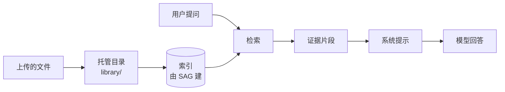

# 知识库原理

## 一句话

**文件先建成索引，每轮提问前检索一次，把命中的片段塞进系统提示，模型据此回答。**

## 一张图



## 三个要点

1. **索引不是我们做的。** 建索引和检索都交给 SAG CLI，我们只调它的 `--json` 输出。
2. **注入在每轮开始前。** 一轮 run 的 pre-step 里检索一次，命中就追加到系统提示；不是回答完再补。
3. **0 配置靠两件事。** 凭据优先复用 jev；没有凭据就退化成关键词（正则）本地匹配，并在证据里标明「非语义」。

## SAG2 是怎么工作的

它**不是**「向量库 + 大模型」，价值恰恰在**不预处理、不 embedding**：

```
目录 ──► 切块（≈512 字符 / 重叠 ≈80，保留标题路径与行列位置）
     ──► SQLite FTS5 索引（content=''，只存词项与位置）
查询 ──► ① 快速检索：FTS5 BM25，纯本地，不需要模型或密钥
         ② 语义检索：查询与候选段落发给 Jev 服务，返回排好序的片段
     ──► 证据片段（文件 + 标题路径 + 行号）
```

几个决定设计的事实：

| 项 | 事实 |
| --- | --- |
| 索引 | SQLite **FTS5 BM25**；无 embedding、无 LLM、无 GPU |
| 增量 | 文件监听、跳过未变文件；读结果时回原文件校验 hash，变了就重索引 |
| 忽略 | 认 `.gitignore` / `.sagignore`；符号链接不扩权 |
| 文件类型 | 文档/表格/PDF 等默认索引；**代码与配置默认不索引**，必须 `sag add --types` 显式指定 |
| 语义档依赖 | Jev 服务（默认 `https://api.302ai.cn/typesafeai/v1`，模型 `jev-latest`）；问题与候选段落会发往该服务 |
| 共享 | CLI 与 SAG Wiki 桌面端共用同一份 `sag.sqlite`、密钥与忽略规则 |

**所以检索天生两条路**：语义（质量好，要网、要 key、内容出本机）与本地匹配（纯离线、零密钥）。这个二分决定了下面的 0 配置策略。

## KenFutWork 怎么接

| 层 | 位置 | 职责 |
| --- | --- | --- |
| 宿主特征 | `apps/server/src/features/knowledge/` | 检索、读取、托管目录、CLI 安装、`pre-step` 注入 |
| 市场 bundle | `plugins/knowledge/` | 安装态、侧边栏面板、图标 |

bundle 是**沙箱 iframe**（纯 HTML + 原生 JS）：没有 React 运行时，**不能 import 宿主组件**，所以面板里的预览是自己渲染原文，不是复用 OpenDesign 或右侧面板。

只走 CLI `--json`（内置 MCP 不对外、service 协议私有）：

- 语义：`sag "<查询>" --json -m N -c`（默认 10 块，`-m` 1–100）
- 本地匹配：`sag -E <正则> -c --json`（`-F` 整串匹配对自然语句必然零命中，真机踩过）

两条路都**遍历所有已注册根**再合并去重——上游按进程 cwd 限定作用域，不遍历会漏。

## 一轮的生命周期

```
问 → 需要查吗（问候/算数/确认就跳过）→ 命中缓存就直接用
   → 检索 → 去重 → 超预算就裁剪 → 注入系统提示 → 模型回答
```

实现是 `pre-step` 监听（`preflight.ts`），**必须调用 `next()`**，否则卡住整条链（DEC-1）。

## 托管目录

- 落盘 `<数据目录>/knowledge/library/`，该目录作为**唯一**根注册（上游以目录为单位，逐文件注册会让根列表爆炸）；
- 上传 `POST /api/knowledge/library`（multipart）：只取基名、剔除控制字符与 `..`、重名加序号不覆盖；
- 注册时显式带 `--types`，否则代码/配置类文件按上游默认不进索引；
- 分类由服务端 `categoryOfFile` 按扩展名判定，随接口下发，前端不重复映射。

CLI 三层探测：系统已装 → 托管目录 → 下载钉死 tarball（sha512 校验）。

## 接口与治理

`apps/server/src/http/knowledge.ts`：`status`、`roots` GET·POST、`roots/remove`、`search`、`read`、`settings` GET·POST、`library` GET·POST。

13 个可调数值都在 `packages/shared/src/governance.ts`，优先级 **库值 ?? env ?? 默认值**，业务代码不写死字面量。

## 边界

- 只认「托管目录 + run 的真实工作目录」，不扫描 Home / Desktop / 磁盘根。
- 语义检索会把查询与候选段落发到 SAG 配置的远端（jev 那条链路）；本地匹配档完全在本机，不联网。
- 卸载插件不改 SAG 配置、不删知识库根。
- 面板资产由服务端启动时缓存，改完必须**重启 API** 才生效。
