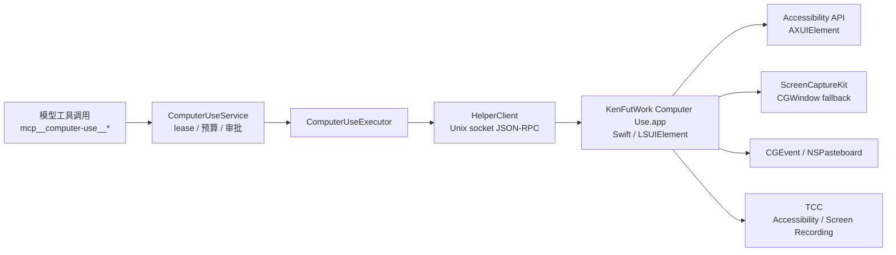
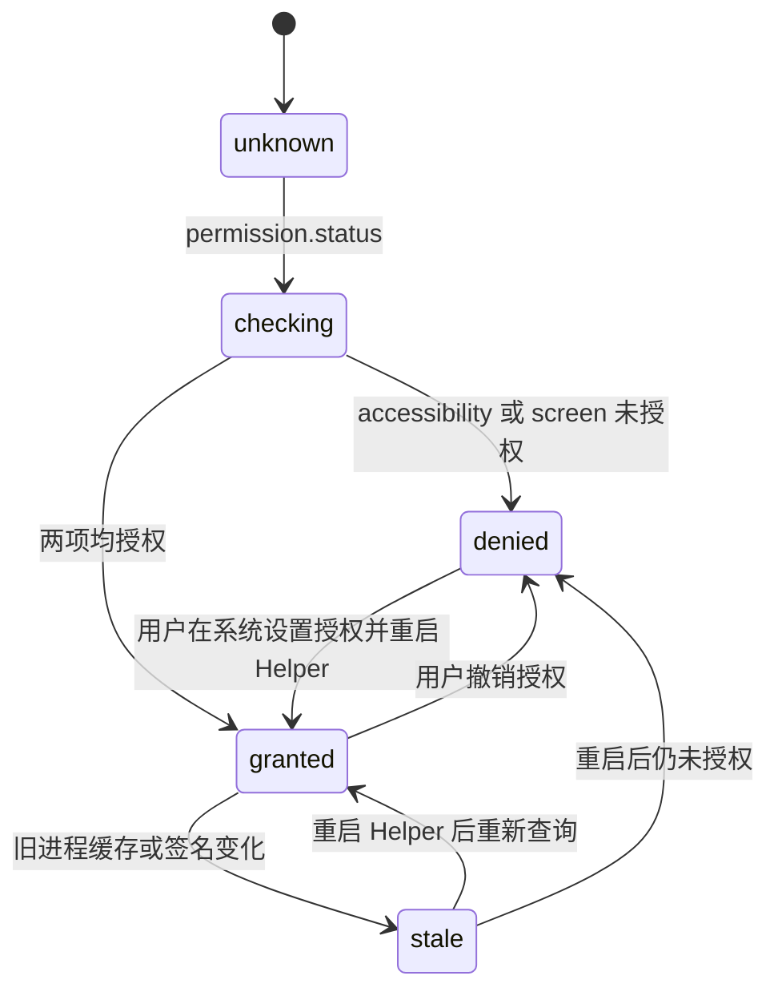

# Computer Use 原生 Swift Helper 设计方案

> 角色：实施规格（方案稿，待实现）。本文只确定原生 Helper 的边界、接口、权限、签名、开发与验收材料，不包含代码改动。
>
> 决策：`CU-B` 于 2026-10-26 修订——macOS 执行层直接采用原生 Swift Helper；当前 nut-js + JXA 的 A 档只保留为源码环境和测试兜底，桌面发布默认使用 Helper。
>
> 关联：《ComputerUse集成设计》（工具面与观察协议）、《CI-CD与发版方案》（签名与出包）、《电脑使用与浏览器使用统一方案》（跨产品行为）、《日志》Computer Use 分批回执。

## 1. 目标与边界

### 1.1 要解决的问题

当前 macOS Computer Use 由服务端 Node 进程直接执行：

- JXA 通过 `osascript` 读取 System Events 的无障碍树；
- `nut-js` 负责截图和输入注入；
- `input-worker.cjs` 是 Node 子进程；
- `@computer-use/node-mac-permissions` 在服务端进程查询 TCC。

因此系统隐私授权的主体是服务端 Node 或它启动的子进程，而不是 KenFutWork 桌面应用。开发环境给 `KenFutWork.app`、`node` 或终端授权都可能对不上，授权后还常要重启整个应用，表现为“已经授权但仍显示未授权”。

### 1.2 目标

1. macOS 的 Accessibility 与 Screen Recording 只授权给一个固定的 Helper 应用。
2. 服务端不再直接调用需要 TCC 的接口，只通过本地 Unix socket 调 Helper。
3. 授权后只重启 Helper，不退出主应用、不重启数据库、不丢当前任务。
4. 开发 Helper 与发布 Helper 都有固定 bundle ID、固定安装路径和可验证签名。
5. 保持现有工具面、审批、lease、截图预算、错误码和 UI 投影不变。
6. 为 Windows 保留同一套 JSON-RPC 协议，只替换平台 Helper。

### 1.3 非目标

- 不绕过 macOS 的用户同意。Accessibility 和 Screen Recording 仍需要用户在系统设置确认。
- 不把 Helper 做成可被任意本机进程调用的通用自动化服务。
- 不在本期实现 Windows Helper；只确定协议和 UAC 边界。
- 不把 ZCode 或 Codex 的闭源 Helper 代码复制进仓库。

## 2. 现状证据

| 事实 | 位置 |
| --- | --- |
| 执行层是 `ComputerUseExecutor` 接口，可替换 Provider | `apps/server/src/features/computer-use/executor.ts:185` |
| macOS 执行器使用 JXA、nut-js 和 `node-mac-permissions` | `apps/server/src/features/computer-use/executor-macos.ts:326` |
| 当前 `build-helper.mjs` 只构建输入 worker 并复制原生依赖 | `apps/server/src/features/computer-use/build-helper.mjs:27` |
| Tauri 只把 `release/computer-use` 映射为 `app/computer-use` | `apps/desktop/src-tauri/tauri.macos.conf.json` |
| 发布链当前只有 ad-hoc 封印，没有 Developer ID 与公证 | `apps/desktop/scripts/macos-signing.mjs:1`、`docs/方案设计/CI-CD与发版方案.md:48` |
| 设计文档已把独立 Helper + Unix socket 定为 B 档目标 | `docs/方案设计/ComputerUse集成设计.md:33`、`:91`、`:134` |
| 实际签名应用与 TCC 授权仍标注为待完成 | `docs/日志.md:4145`、`:4531` |

结论：独立 Helper 不是新方向，而是既定 B 档目标的正式实施。当前 A 档可以继续作为源码环境兜底，但不能作为发布形态的权限主体。

## 3. 目标架构



### 3.1 职责划分

| 层 | 职责 | 不负责 |
| --- | --- | --- |
| Agent 工具面 | 工具名、参数、审批、结果投影 | TCC、AX、截图、输入 |
| `ComputerUseService` | run 级 lease、预算、超时、`actionSent`、停止 | 平台 API |
| `HelperClient` | socket 连接、握手、协议版本、请求超时、重连 | 用户授权与系统设置 |
| Swift Helper | AX 树、应用/窗口枚举、截图、输入、剪贴板、权限状态与引导 | 模型审批、任务编排、业务日志 |
| 桌面壳 | 启动/停止 Helper、显示 Helper 路径、返回设置后重启 Helper | 直接执行 AX 或截图 |

### 3.2 关键原则

- TCC 主体只有 Helper。服务端 Node、Electron 主进程和 WebView 都不申请 Accessibility 或 Screen Recording。
- Helper 通过 LaunchServices 启动为独立应用，不作为服务端子进程 `fork`。
- 特权操作必须在 Helper 进程内完成，或由 Helper 进程内的原生扩展完成；不能再让 `osascript` 或独立输入子进程成为实际 TCC 主体。
- Helper 不决定“是否允许动作”。审批仍由服务端权限层处理，Helper 只执行已批准的请求并记录执行结果。

## 4. Helper 应用设计

### 4.1 产物与身份

| 项目 | 发布 Helper | 开发 Helper |
| --- | --- | --- |
| 应用名 | `KenFutWork Computer Use.app` | `KenFutWork Computer Use Dev.app` |
| Bundle ID | `com.kenfutwork.cua-helper` | `com.kenfutwork.cua-helper.dev` |
| 安装位置 | `KenFutWork.app/Contents/Resources/cua-helper/` | `<数据目录>/cua-helper/dev/` |
| 启动方式 | `open` / `NSWorkspace` | `open` / `NSWorkspace` |
| 签名 | Developer ID + 公证 | 固定自签名开发证书，或 Apple Development |
| UI 形态 | `LSUIElement=true`，无 Dock 图标 | 同上 |
| 最低系统 | macOS 12.0；ScreenCaptureKit 路径 12.3+，低版本回退 CGWindow | 同左 |

开发 Helper 必须使用独立 bundle ID，不能与发布 Helper 共用。这样开发授权不会污染正式安装，正式应用也不会误用开发 Helper。

### 4.2 目录与模块

```text
apps/computer-use-helper/
  Package.swift
  Sources/
    HelperApp/
      main.swift
      AppDelegate.swift
      OnboardingWindow.swift
    Protocol/
      Envelope.swift
      Methods.swift
      Errors.swift
    Socket/
      UnixSocketServer.swift
      PeerVerifier.swift
      FrameCodec.swift
    Permissions/
      PermissionController.swift
      PermissionState.swift
    Accessibility/
      AppCatalog.swift
      WindowCatalog.swift
      AXTree.swift
      AXActions.swift
    Capture/
      ScreenCapture.swift
      WindowCapture.swift
      FrameStore.swift
    Input/
      MouseInput.swift
      KeyboardInput.swift
      Clipboard.swift
    Session/
      LeaseController.swift
      RequestContext.swift
    Support/
      Logging.swift
      Limits.swift
  Resources/
    Info.plist
    AppIcon.icns
  scripts/
    build.sh
    bundle.sh
    sign-dev.sh
```

### 4.3 原生能力

| 能力 | 实现 | 说明 |
| --- | --- | --- |
| 应用枚举 | `NSWorkspace.runningApplications` | 返回 pid、bundle ID、显示名、是否活跃、路径 |
| 窗口枚举 | AXUIElement + CGWindowList | 只返回可绑定窗口；排除合成表面 |
| 无障碍树 | AXUIElement、AXObserver | 元素索引、角色、标题、值、状态、可用 actions |
| 元素动作 | AXUIElementPerformAction | 按元素索引执行 press/raise/show menu 等 |
| 窗口截图 | ScreenCaptureKit；旧系统 CGWindowListCreateImage | 窗口级；返回 frameId、bounds、scale、PNG |
| 输入 | CGEvent | 鼠标移动、点击、拖拽、滚动、组合键、文本 |
| 剪贴板 | NSPasteboard | Unicode 文本先备份再还原 |
| 权限状态 | AXIsProcessTrusted、CGPreflightScreenCaptureAccess | 只在 Helper 进程内查询 |
| 权限引导 | AXIsProcessTrustedWithOptions、CGRequestScreenCaptureAccess、打开系统设置面板 | 用户确认后重启 Helper |

### 4.4 线程与取消

- AX 与 UI 相关操作在主 actor 或专用串行队列执行，避免阻塞主线程。
- 截图、输入、AX 读取各自有超时；取消时释放按下的鼠标按钮和键盘按键。
- 所有请求带 `requestId` 和 `runId`；`stop` 后拒绝新的动作请求。
- 非幂等动作的响应必须带 `actionSent`，服务端据此决定是否允许重试。

## 5. JSON-RPC 协议

### 5.1 传输

- Unix domain socket，路径固定在应用数据目录：
  `~/Library/Application Support/com.kenfutwork.desktop/cua-helper.sock`
- 目录权限 `0700`，socket 权限 `0600`。
- 换行分隔 JSON；单帧上限建议 32 MiB；截图超过预算时返回错误或仅返回元数据。
- 每个请求带 `id`、`method`、`params`；响应带 `id`、`ok`、`result` 或 `error`。
- 连接建立后先 `hello`；协议版本不匹配直接关闭连接并返回可读原因。

### 5.2 握手

```json
{
  "id": "1",
  "method": "hello",
  "params": {
    "protocolVersion": 1,
    "client": "kenfutwork-desktop",
    "clientVersion": "0.1.3",
    "token": "<64-hex-token>"
  }
}
```

```json
{
  "id": "1",
  "ok": true,
  "result": {
    "protocolVersion": 1,
    "helperVersion": "0.1.0",
    "bundleId": "com.kenfutwork.cua-helper",
    "pid": 12345,
    "teamIdentifier": "TEAMID",
    "permissions": {
      "accessibility": "denied",
      "screenRecording": "denied"
    }
  }
}
```

### 5.3 方法表

| 方法 | 参数 | 结果 | 说明 |
| --- | --- | --- | --- |
| `ping` | `{}` | `{pong:true}` | 健康检查 |
| `broker_info` | `{}` | `{bundleId,pid,version,teamIdentifier}` | 身份与版本 |
| `permission.status` | `{probe?:boolean}` | `PermissionStatus` | 权限状态与 Helper 路径 |
| `permission.request` | `{kind:"accessibility"\|"screen_recording"}` | `{opened:boolean}` | 弹系统提示或打开设置面板 |
| `apps.list` | `{}` | `{apps:AppInfo[]}` | 运行中的应用 |
| `windows.list` | `{app:AppRef}` | `{windows:WindowInfo[]}` | 目标窗口 |
| `state.get` | `{app:AppRef, includeScreenshot?:boolean, disableDiff?:boolean}` | `{state:string, frame?:Frame}` | 无障碍树与可选截图 |
| `screen.capture` | `{app:AppRef}` | `Frame` | 窗口截图 |
| `action.perform` | `{action:Action, runId:string}` | `{actionSent:boolean, frame?:Frame}` | 点击、输入、按键、滚动、拖拽 |
| `session.stop` | `{runId:string}` | `{stopped:boolean}` | 释放租约与输入状态 |
| `helper.shutdown` | `{}` | `{ok:boolean}` | 主应用退出或重启 Helper |

### 5.4 权限状态结构

```ts
type PermissionStatus = {
  available: boolean;
  helperBundleId: string;
  helperPath: string;
  teamIdentifier: string | null;
  accessibility: "granted" | "stale" | "denied" | "unknown";
  screenRecording: "granted" | "denied" | "unknown";
  automation?: "granted" | "denied" | "unknown";
  accessibilityProbeOk?: boolean;
  screenCaptureProbeOk?: boolean;
  grantOwner: string | null;
  reason?: string;
};
```

- `grantOwner` 必须是 Helper 的 bundle ID 或 Helper 应用路径，不能是主应用或 Node。
- `stale` 表示系统已有授权记录，但当前 Helper 进程读到的状态不可用；UI 应提示重启 Helper。
- `available=false` 时给出具体原因，禁止返回空对象。

### 5.5 帧与坐标

```ts
type Frame = {
  frameId: string;
  app: { pid: number; bundleId: string; name: string };
  windowId: number;
  bounds: { x: number; y: number; width: number; height: number };
  scale: number;
  mimeType: "image/png";
  dataBase64: string;
  blank: boolean;
  capturedAt: number;
};
```

- 坐标动作必须引用最近一帧的 `frameId`；Helper 校验帧与应用/窗口身份。
- 窗口关闭、位置变化、应用退出时返回 `element_stale` 或 `foreground_required`。
- 黑帧必须标 `blank=true` 并返回 `permission_denied`，不能冒充成功截图。

### 5.6 错误码

沿用现有工具错误码：

`permission_denied`、`element_stale`、`element_unavailable`、`foreground_required`、`app_not_found`、`controller_busy`、`timeout`、`invalid_target`、`internal`。

Helper 返回的错误必须包含 `code`、`message`、`actionSent`，时给出可执行的恢复建议。

### 5.7 共享类型

- 服务端与 Web 的 TypeScript 类型放在 `packages/shared/src/computer-use-helper-protocol.ts`，用 zod 校验。
- Swift 侧用 Codable 镜像同一字段；协议版本号 `1` 在两端硬编码为常量。
- 新增字段必须保持向后兼容；删除或改义字段必须提升协议版本。
- 协议变更同步更新 `docs/api/` 或对应模块说明；该 socket 不进入公开 OpenAPI。

## 6. 权限与 TCC

### 6.1 需要的系统权限

| 权限 | 用途 | 是否必需 |
| --- | --- | --- |
| Accessibility | AX 读取、元素动作、CGEvent 输入 | 必需 |
| Screen Recording | 窗口/屏幕截图 | 必需 |
| Automation | 仅在 Helper 需要操作 System Events 时 | 核心路径不使用；可选 |
| Full Disk Access | 不申请 | 不需要 |
| Input Monitoring | 不单独申请；输入由 Accessibility 覆盖 | 不需要 |

核心路径必须使用原生 AX 和 CGEvent，不使用 JXA、System Events 或 `osascript`。这样可以避免 Helper 之外的进程成为 TCC 主体。

### 6.2 授权状态机



### 6.3 授权引导

1. 用户点击“打开辅助功能设置”或首次调用 `request_access`。
2. Helper 在自身进程内调用 `AXIsProcessTrustedWithOptions` 弹出系统提示；或打开 `x-apple.systempreferences:com.apple.preference.security?Privacy_Accessibility`。
3. 用户把 Helper 加入并开启。Helper 是列表中的 `KenFutWork Computer Use`，不是 KenFutWork 主应用。
4. 屏幕录制调用 `CGPreflightScreenCaptureAccess` / `CGRequestScreenCaptureAccess`；用户确认后，Helper 需要新进程才能生效。
5. 主应用收到授权返回后，通过 `helper.shutdown` 停掉 Helper，再用 `open` 拉起新 Helper。
6. 新 Helper 查询状态并返回 `granted`；主应用刷新设置页。

### 6.4 为什么只重启 Helper

- Accessibility 的 `AXIsProcessTrusted` 是进程级缓存；新进程才能读到新授权。
- Screen Recording 的授权通常要求捕获进程重启。
- Helper 是独立 `.app`，主应用可以只停止和拉起 Helper，不触碰数据库、任务、WebView 或当前会话。
- 如果 Helper 仍以子进程方式运行，TCC 可能把它归到父进程；必须通过 LaunchServices 启动独立应用。

### 6.5 签名与授权稳定性

TCC 授权与 Helper 的代码身份绑定。要让授权在应用更新后继续有效：

- 固定 bundle ID；
- 固定签名身份（Developer ID 或固定开发证书）；
- 固定安装路径与 Helper 名称；
- 不每次构建都更换签名或重命名应用。

当前仓库发布链只有 ad-hoc 签名，没有 Developer ID 与公证。ad-hoc Helper 可以在本机开发时授权，但重新编译后可能被系统视为新身份，导致再次授权。因此：

- 开发态：使用固定自签名开发证书，或 Apple Development 证书；Helper bundle ID 固定为 `.dev`。
- 发布态：使用 Developer ID Application + 公证；这是“升级后不重新授权”的先决条件。
- 如果暂时没有 Developer ID，必须如实告知测试用户：重新构建或更新 Helper 后可能需要重新授权；不能承诺无感升级。

## 7. 开发环境

### 7.1 构建与安装

新增独立构建目标：

```bash
# 构建 Swift Helper
swift build -c release --package-path apps/computer-use-helper

# 生成 .app、写入 Info.plist 并签名
node apps/computer-use-helper/scripts/build-helper.mjs \
  --out release/cua-helper \
  --configuration dev \
  --version 0.1.0

# 需要固定证书时追加 --identity "KenFutWork CUA Dev"
# 启动开发 Helper
open -n -a "release/cua-helper/KenFutWork Computer Use Dev.app"
```

开发脚本需要完成：

- 复制 Info.plist、图标和 Swift 产物；
- 使用固定开发证书签名；
- 写入固定数据目录；
- 校验 bundle ID、签名和可执行文件；
- 输出 Helper 路径与健康检查结果。

### 7.2 开发签名

推荐顺序：

1. 在本机钥匙串创建固定的自签名证书，例如 `KenFutWork CUA Dev`；
2. 用同一证书签 Helper 和开发主应用；
3. 固定 bundle ID 与安装路径；
4. 每次重建后验证 TCC 授权是否仍保留；
5. 如果 ad-hoc 签名下授权每次失效，明确记录为开发限制，不把 ad-hoc 结果当作发布结论。

### 7.3 主应用启动与生命周期

- 主应用或服务端在首次需要 CUA 时启动 Helper；不随应用启动无条件拉起。
- 使用 `open -n` 或 `NSWorkspace.openApplication`，传入 socket 路径和启动参数；不要用 `fork`。
- Helper 单实例：socket 锁 + pid 文件；旧 socket 需清理但不能误杀其他进程。
- Helper 空闲超时退出；主应用退出时先 `helper.shutdown`，再退出。
- 服务端重启后优先重连已有 Helper；连接失败再拉起新 Helper。
- Helper 崩溃时，当前请求失败关闭，服务端按需重启 Helper；不自动重放非幂等动作。

## 8. 安全设计

### 8.1 本地通道

- socket 只位于用户数据目录，目录 `0700`、socket `0600`。
- 32 字节随机 token 以 64 位小写十六进制字符串写入 `0600` 文件；启动参数或握手时传递，不写入日志。
- Helper 验证客户端进程的代码签名（audit token），只接受 KenFutWork 主应用或服务端；拒绝其他本机进程。
- 客户端验证 Helper bundle ID、TeamIdentifier、可执行文件路径和版本；不匹配则拒绝连接。
- 不监听 TCP 端口，不暴露网络接口。

### 8.2 动作边界

- Helper 只执行明确的 action 请求，不执行 shell、脚本或任意 AppleScript。
- `runId` 与 lease 由服务端下发；Helper 拒绝没有有效 run 的动作。
- `stop` 后立即释放按键、鼠标按钮和租约；迟到的动作请求失败。
- 截图预算、AX 树预算、动作超时由服务端治理值控制，Helper 只执行上限。
- 默认窗口级截图；全屏截图需要显式参数。
- 日志不记录用户输入文本、剪贴板内容和截图内容；只记录请求类型、目标应用、耗时和错误码。

## 9. 打包与签名

### 9.1 资源映射

```json
{
  "bundle": {
    "resources": {
      "../../../release/cua-helper": "app/cua-helper"
    }
  }
}
```

### 9.2 签名顺序

1. 编译 Swift 可执行文件；
2. 生成 Helper `.app`；
3. 签名 Helper 内部所有 Mach-O；
4. 使用 `codesign --options runtime --timestamp --sign "Developer ID Application: ..."` 签 Helper；
5. 签主应用；
6. 提交公证并 staple；
7. 运行 `spctl --assess` 与 `codesign --verify --deep --strict`。

当前 `apps/desktop/scripts/macos-signing.mjs` 只支持 ad-hoc 补封。需要扩展为：

- 检测已有 Developer ID 签名时，使用同一身份重签内部 Mach-O；
- 禁止把 Developer ID 降级为 ad-hoc；
- 把 Helper 的签名状态、TeamIdentifier、公证结果写入 `dist-manifest.json`；
- 在未配置 Developer ID 时明确记录 `adhoc`，不冒称公证完成。

### 9.3 开发与发布差异

| 项目 | 开发 | 发布 |
| --- | --- | --- |
| Helper 名称 | `KenFutWork Computer Use Dev.app` | `KenFutWork Computer Use.app` |
| Bundle ID | `com.kenfutwork.cua-helper.dev` | `com.kenfutwork.cua-helper` |
| 安装目录 | 数据目录 `cua-helper/dev/` | 应用资源 `Contents/Resources/cua-helper/` |
| 签名 | 固定开发证书 | Developer ID + 公证 |
| TCC 授权 | 开发 Helper 单独授权 | 发布 Helper 单独授权 |
| 更新 | 重建后验证授权是否保留 | 固定签名下保持授权 |

## 10. Windows 对照

Windows 没有 macOS 的 TCC 两项授权。普通应用的 UI Automation、Windows Graphics Capture、SendInput 和剪贴板访问不需要用户逐项授权；只有目标应用以管理员权限运行并受 UIPI 保护时，非管理员进程不能操作它，需要 Helper 以管理员权限启动，并经过 UAC 确认。

| 项目 | macOS | Windows |
| --- | --- | --- |
| 系统隐私授权 | Accessibility + Screen Recording | 无 |
| 首次引导 | Helper 的 TCC 提示与系统设置 | 无；只有提升权限时出现 UAC |
| 屏幕捕获 | ScreenCaptureKit / CGWindow，需要 TCC | Windows Graphics Capture / GDI，无需同意 |
| 输入 | CGEvent，需要 Accessibility | SendInput / UIA，无需同意 |
| 管理员目标应用 | 不适用 | 非提升 Helper 被 UIPI 阻止；需要提升 Helper 或拒绝 |
| 代码签名 | Developer ID + 公证，影响 TCC 稳定性 | Authenticode 可选，主要影响 SmartScreen |
| Helper 形态 | 必需，TCC 主体 | 可选；仍建议独立进程，便于隔离与提升权限 |

Windows Helper 可以复用同一套 JSON-RPC 协议：

- `apps/computer-use-helper-windows/`，Rust 或 C#；
- 命名管道传输；
- UIA 读取与动作，SendInput 输入，Windows Graphics Capture 截图；
- 普通权限 Helper 先运行；需要控制管理员窗口时，明确提示 UAC，不自动提升；
- 不需要在服务端保存 Windows 权限状态；只返回 `elevated` 与目标进程完整性级别。

## 11. 迁移计划

### 11.1 阶段

| 阶段 | 内容 | 验收 |
| --- | --- | --- |
| P0 原型 | 最小 Swift Helper：权限查询、系统提示、一个 AX 读取、一个截图、一个 CGEvent；通过 `open` 启动 | 只授权 Helper，主应用不授权；授权后只重启 Helper；主应用不退出 |
| P1 协议 | Unix socket、握手、权限状态、应用/窗口枚举、错误码 | 服务端客户端可连接；协议版本不匹配失败关闭 |
| P2 能力 | AX 树、截图、点击、输入、滚动、拖拽、剪贴板 | 与 A 档同一工具面和错误码一致 |
| P3 桌面接入 | 主应用启动/停止 Helper、设置页显示 Helper 路径、授权返回重启 | 开发与打包应用都能只重启 Helper |
| P4 签名发布 | 开发证书、Developer ID、公证、嵌套签名、更新验证 | `spctl` 通过；升级后授权保留；无 Developer ID 时如实标 ad-hoc |

### 11.2 代码落点

| 文件 | 动作 |
| --- | --- |
| `apps/computer-use-helper/` | 新增 Swift Package、Helper 应用与脚本 |
| `packages/shared/src/computer-use-helper-protocol.ts` | 新增协议类型与 zod 校验 |
| `apps/server/src/features/computer-use/executor-helper.ts` | 新增 Helper 客户端执行器 |
| `apps/server/src/features/computer-use/executor.ts` | 工厂优先选择 Helper |
| `apps/server/src/features/computer-use/plugin.ts` | helper 状态、权限 RPC、生命周期 |
| `apps/desktop/src-tauri/src/` | 启动/停止 Helper、转发 socket 路径、退出清理 |
| `apps/desktop/src-tauri/tauri.macos.conf.json` | 增加 Helper 资源映射 |
| `scripts/package-mac.mjs` | 构建、复制、签名 Helper |
| `apps/desktop/scripts/macos-signing.mjs` | 支持 Developer ID 嵌套签名，不降级 |
| `apps/web/src/components/workbench/zcode/settings/ComputerUseSection.tsx` | 显示 Helper 路径与重启入口 |
| `apps/server/src/features/computer-use/*.test.ts` | 协议、权限、生命周期回归 |

### 11.3 兼容与回退

- 新增开关 `KENFUTWORK_CUA_HELPER=1` 或配置项 `cuaHelperEnabled`；发布默认开启。
- Helper 不可用、版本不匹配或签名校验失败时，工具显式返回 `unavailable`，不静默回退到 A 档。
- 源码环境可以显式设置 `KENFUTWORK_CUA_HELPER=0` 使用 A 档；A 档仍保留测试覆盖。
- 回退只切换执行层，不改工具面、审批、lease、UI 投影或存储。

### 11.4 当前进度

#### 协议与权限状态（2026-10-26）

- `packages/shared/src/computer-use-helper-protocol.ts`：hello 参数、成功/错误响应联合、权限状态、逐行请求解析与响应序列化。
- `apps/computer-use-helper` Swift Package：
  - `HelperProtocol`：hello 结果与权限状态的 Codable 解码，版本不匹配、Helper 身份和绝对路径校验；
  - `HelperCore`：权限状态转换 unknown / checking / denied / granted / stale。

#### Socket 握手（2026-10-27）

- `HelperTransport`：POSIX Unix socket 服务，socket 目录/文件权限、64 位十六进制 token、协议版本、hello、permission.status、ping、broker_info、helper.shutdown，以及未握手、错误 token、未知方法、坏 JSON 的错误响应。
- 真实 socket 测试验证：hello 返回 Helper 身份与权限状态；未握手 status 被拒绝；版本不匹配、错误 token、未知方法、坏 JSON 分别返回可读错误；socket 文件权限为 `0600`。
- 验证：
  - `pnpm --filter @kenfutwork/shared exec vitest run src/computer-use-helper-protocol.test.ts`
  - `swift test --package-path apps/computer-use-helper`

#### 可执行入口与 TCC 查询（2026-10-27）

- 新增可执行目标 `kenfutwork-cua-helper`：解析 `--socket`、`--token`、`--bundle-id`、`--helper-path`、`--version`、`--team-id`，启动 Unix socket，收到 `helper.shutdown` 或 SIGTERM/SIGINT 时清理 socket 并退出。
- `HelperLaunchOptions` 对缺失参数、未知参数、短 token、相对 Helper 路径直接报错。
- `MacOSPermissionProbe` 在 Helper 进程内调用 `AXIsProcessTrusted` 与 `CGPreflightScreenCaptureAccess`；`PermissionStatusBuilder` 把结果映射为 granted / denied / unknown，并保留 Helper 身份。
- `permission.request` 的请求与结果已加入 `packages/shared` 协议；socket 通过注入的提示器调用，生产入口接 `MacOSPermissionPrompt`。测试只验证注入提示器的调用与错误分支，不触发真实系统弹窗。
- 进程级测试：真实启动可执行文件，完成 hello/permission.status，发送 `helper.shutdown` 后进程以 0 退出并删除 socket；发送 SIGTERM 后同样清理并退出。
- 验证：
  - `swift test --package-path apps/computer-use-helper`，23 项通过；
  - `pnpm --filter @kenfutwork/shared test`，185 项通过。

#### Helper.app 打包与固定身份（2026-10-27）

- 新增 `bundle-config.mjs` 与 `build-helper.mjs`：
  - dev：`KenFutWork Computer Use Dev.app` / `com.kenfutwork.cua-helper.dev`
  - production：`KenFutWork Computer Use.app` / `com.kenfutwork.cua-helper`
  - 固定 `kenfutwork-cua-helper` 可执行名、`LSUIElement=true`、最低系统 12.0
- 构建脚本支持 ad-hoc 默认签名，也支持 `--identity` 指定固定证书；写入 Info.plist、签名并执行 `codesign --verify --deep --strict`。
- 真实测试：构建 dev `.app`、读取 Info.plist、验签、通过 `open -n -a` 启动、完成 hello/permission.status、发送 shutdown 后 socket 删除；Node 测试 2 项通过。
#### 服务端 Helper 客户端与进程管理（2026-10-27）

- `helper-client.ts`：真实 Unix socket 客户端，64 位 token 校验、协议版本握手、逐行响应、请求超时、断线识别；7 项真实 socket 测试通过。
- `helper-manager.ts`：读取 Helper Info.plist 确认 bundle ID / 版本，创建 `0700` socket 目录，通过 `/usr/bin/open -n -a` 启动 Helper，重试连接，支持 `status`、`requestPermission`、`restart`、`stop`。真实 Helper.app 集成测试覆盖启动、状态、目录权限、重启与 socket 清理。
- `helper-location.ts`：打包壳注入 `KENFUTWORK_CUA_HELPER_PATH` 优先；开发形态落在数据目录 `cua-helper/dev/`。socket 路径超过 macOS `sun_path` 上限时启动期报错。
- `helper-permission-rpc.ts`：`cua-permission.getStatus`、`restartHelper`、`requestPermission` 三个宿主方法改为只调用 Helper；Helper 缺失或启动失败时返回 `available:false` 与可读原因，不再把主应用或 Node 当作授权主体。
- 插件注册与退出清理已接线：服务端关闭时停止 Helper，避免遗留进程。
- 验证：
  - `RUN_CUA_HELPER_INTEGRATION=1 pnpm --filter @kenfutwork/server exec vitest run src/features/computer-use/helper-manager.integration.test.ts`
  - `pnpm --filter @kenfutwork/server exec vitest run src/features/computer-use/helper-permission-rpc.test.ts src/features/computer-use/helper-location.test.ts`

#### TCC 授权引导与返回后重启（2026-10-27）

- 原生引导先经 `cua-permission.requestPermission` 让 Helper 自己触发系统权限框；只有 Helper 进程被 TCC 记录，授权才会落在 Helper 上。弹框未通过时继续打开对应系统设置面板。
- `getStatus` 下推 `includeFunctionalProbes`：Helper 用只读 AX 查询验证辅助功能通道、用 2×2 像素抓屏验证屏幕录制；预检通过但实测失败时辅助功能报 `stale`、屏幕录制报 `denied`，设置页继续引导重启或重新授权。
- 授权引导结果改为 `restartHelperAfterReturn: true`；设置页沿用既有恢复流程，在返回后调用 `cua-permission.restartHelper`，由服务端重启 Helper；重启后的首轮状态查询带功能探针，后续轮询保持只读。
- 设置页「授权应用」卡改为显示状态里的 `grantOwner`（Helper 路径），不再显示主应用路径。
- 开发入口 `apps/desktop/scripts/dev-macos.mjs` 每次启动构建 dev Helper，并通过 `KENFUTWORK_CUA_HELPER_PATH` 注入固定路径。
- 验证：`pnpm --filter @kenfutwork/web exec vitest run test/cua-permission-platform.test.ts`，7 项通过。

#### 原生 AX、窗口枚举与截图（2026-10-27）

- 协议新增 `apps.list`、`windows.list`、`displays.list`、`ax.tree`、`screenshot.capture`：应用清单、窗口几何、显示器清单、带深度/子节点/节点数/文本长度上限的 AX 树、绑定窗口帧的 PNG 截图与黑帧标记。
- `MacOSApplicationCatalog`：`NSWorkspace.runningApplications`，跳过后台代理；`MacOSWindowCatalog`：`CGWindowListCopyWindowInfo`，含屏幕外窗口与 `onScreen` 标记。
- `MacOSAccessibilityTree`：`AXUIElementCreateApplication` 递归读取 role/title/value/position/size/actions；安全输入框不采集 value；超限时标记 `truncated`。
- `MacOSWindowCapture`：`CGWindowListCreateImage` 按窗口捕获，返回捕获时的屏幕边界；PNG 超限自动缩小，仍超限报 `capture_too_large`；全黑画面标记 `blackFrame`。
- 服务端 `helper-manager` 新增 `applications`、`windows`、`axTree`、`screenshot`，全部经共享 zod schema 校验。
- 验证：`swift test --package-path apps/computer-use-helper`，38 项通过；真实 Helper 集成测试覆盖应用清单、窗口清单、显示器清单、AX 拒绝路径、功能探针与截图权限分支。

#### 输入、剪贴板与执行器接线（2026-10-27）

- 协议新增 `input.click`、`input.type`、`input.key`、`input.scroll`、`input.drag`、`clipboard.read`、`clipboard.write`；按钮、按键、修饰键、滚动单位、拖拽时长均有范围校验。
- 工具面的 `keys` 数组按一个组合键解释（`["command","a"]`、`["⌘","f"]`、`["ctrl","shift","s"]`），支持 command/cmd/meta/ctrl/control/alt/option 及 ⌘⌥⌃⇧ 别名；Helper 的 ANSI 虚拟键表覆盖字母、数字与常用标点，不再只支持功能键。
- `MacOSInputController`：CGEvent 注入鼠标与键盘，输入前激活目标应用；无辅助功能授权时在动作发出前失败关闭；剪贴板使用 `NSPasteboard`。
- `executor-helper.ts` 实现 `ComputerUseExecutor`：应用/窗口解析、AX 观察、截图、元素/坐标点击、文本输入、滚动、拖拽、按键、聚焦、剪贴板读写；元素坐标由最近一次观察树解析，坐标动作必须绑定当前 frameId。
- 工具面新增 `clipboard_read`（只读）与 `clipboard_write`（计入动作预算并走审批），其余原生能力沿用既有 click/type/scroll/drag/key/focus 工具。
- macOS 插件的原生执行器改为 `macos-helper`，不再由 Node 进程持有 TCC；Helper 缺失或启动失败时工具显式不可用，不回退 A 档。
- 验证：`RUN_CUA_HELPER_INTEGRATION=1 pnpm --filter @kenfutwork/server exec vitest run src/features/computer-use/helper-manager.integration.test.ts`，真实 Helper 启动/状态/重启/应用/窗口/观察路径通过。

#### Helper 生命周期与 Windows 边界（2026-10-27）

- 服务端拥有 Helper 生命周期：桌面形态（`KENFUTWORK_EMBEDDED_PG=1`）随壳启动预启动 Helper，其他形态按需启动；设置页 `restartHelper`；插件卸载与进程退出时关闭 Helper。
- Helper 启动参数新增 `--parent-pid`；服务端崩溃或被杀时，Helper 每 2 秒检查父进程，父进程消失后清理 socket 并退出，避免残留 TCC 主体。
- 桌面壳不直接管理 Helper 进程：壳负责启动/停止服务端，Helper 由服务端持有 socket、token 与重启；开发壳在启动时构建 dev Helper 并注入 `KENFUTWORK_CUA_HELPER_PATH`。
- Windows 不需要 TCC Helper：保留 `executor-windows.ts` 的 UIAutomation/截图/输入实现，不请求提权、不自动弹 UAC；目标应用以管理员运行时受 UIPI/安全桌面限制，原语失败按 `native_failed` 返回，由模型或用户决定是否手动以管理员启动目标应用。
- 尚未实现：Developer ID 与公证、打包产物内嵌套 Helper 的签名验证、Windows 真机验收。后续切片按 §11.1 接续。

## 12. 测试与验收

### 12.1 协议与单元

- 协议编解码、版本不匹配、超大帧、超时、取消。
- socket token、peer 签名校验、错误权限拒绝。
- 权限状态机：unknown、denied、granted、stale、撤销。
- AX 树归一化、元素索引、窗口绑定、帧绑定、坐标换算。
- 动作 `actionSent` 语义；停止后迟到请求拒绝。

### 12.2 原生集成

- 真实 macOS 应用：列出应用、窗口、AX 树、截图、点击、输入、滚动、拖拽、剪贴板。
- 目标窗口关闭、应用退出、元素替换、窗口被遮挡、黑帧。
- 权限撤销后工具报 `permission_denied`；重新授权并重启 Helper 后恢复。
- Helper 崩溃、服务端重启、主应用退出、孤儿进程清理。

### 12.3 TCC 验收矩阵

| 场景 | 预期 |
| --- | --- |
| 新机器，只授权 Helper | 主应用和 Node 不需要授权；状态变为 granted |
| 只授权 Accessibility | Screen Recording 仍为 denied，截图被拒绝 |
| 只授权 Screen Recording | Accessibility 仍为 denied，AX 动作被拒绝 |
| 授权后重启 Helper | 状态变为 granted，主应用不退出 |
| 撤销 Accessibility | 状态变为 denied；动作失败关闭 |
| Helper 更新，签名身份不变 | 授权保留；状态为 granted |
| Helper 使用 ad-hoc 签名重建 | 可能变为 denied；UI 明确提示重新授权 |
| 其他本机进程连接 socket | 被 peer 签名或 token 拒绝 |

### 12.4 打包验收

- Helper 嵌套签名通过 `codesign --verify --strict`；
- 公证与 staple 通过；
- `spctl --assess` 通过；
- 安装后首次启动只出现 Helper 的 TCC 引导；
- 升级应用后 Helper 授权保留；
- 卸载与重装路径不残留旧 Helper 进程或 socket；
- `dist-manifest.json` 记录 Helper 版本、签名状态、TeamIdentifier。

## 13. 风险与待确认

| 风险 | 影响 | 处理 |
| --- | --- | --- |
| 没有 Developer ID | 用户升级后可能重新授权；Gatekeeper 提示 | 发布前取得 Developer ID 与公证；开发使用固定自签名证书 |
| Swift AX 树移植工作量大 | 与现有 TS 行为不一致 | 先做协议与 fixture 对照；保留 A 档做行为参考 |
| ScreenCaptureKit 最低版本 | macOS 12.0 不支持 | 12.0 使用 CGWindow 回退；12.3+ 使用 ScreenCaptureKit |
| TCC 提示不可自动化 | 用户仍需手动开关 | Helper 提供系统提示、深链和自动重启，不承诺完全免手动 |
| Helper 被其他进程调用 | 本机权限被滥用 | socket 权限、token、peer 代码签名、run lease |
| Helper 更新失败 | 旧进程继续持有权限 | 版本握手、健康检查、退出清理、失败关闭 |
| Windows 提升权限 | UAC 打断流程 | 默认非提升；需要时明确提示，不自动提升 |
| 许可证与来源 | 第三方代码进入仓库 | 只使用 Apple 系统 API 和自写代码；新增第三方依赖按 `THIRD-PARTY-NOTICES.md` 登记 |

需要用户或发布负责人确认的事项：

1. 是否购买 Apple Developer ID 并建立公证流程；不购买则无法承诺升级后不重新授权。
2. 开发签名使用自签名证书还是 Apple Development 证书。
3. 发布 Helper 的最低 macOS 版本是否维持 12.0；ScreenCaptureKit 只在 12.3+ 使用。
4. Windows Helper 是否本期同步实现；建议先完成 macOS，再按同一协议接入。

## 14. 参考资料

### 14.1 Apple 官方资料

- Accessibility：`AXUIElement`、`AXIsProcessTrusted`、`AXIsProcessTrustedWithOptions`
  <https://developer.apple.com/documentation/applicationservices/1460720-axisprocesstrustedwithoptions>
- Screen Recording 预检与请求：`CGPreflightScreenCaptureAccess`、`CGRequestScreenCaptureAccess`
  <https://developer.apple.com/documentation/coregraphics/1454852-cgpreflightscreencaptureaccess>
- ScreenCaptureKit
  <https://developer.apple.com/documentation/screencapturekit>
- CGEvent 输入
  <https://developer.apple.com/documentation/coregraphics/cgevent>
- NSPasteboard
  <https://developer.apple.com/documentation/appkit/nspasteboard>
- LSUIElement
  <https://developer.apple.com/documentation/bundleresources/information-property-list/lsuielement>
- macOS 公证
  <https://developer.apple.com/documentation/security/notarizing-macos-software-before-distribution>

### 14.2 对标产物

- ZCode：`/Applications/ZCode.app/Contents/Resources/cua-helper/ZCode Computer Use.app`
  - Bundle ID `dev.zcode.cua-helper`
  - TeamIdentifier `8A5X4JJ39T`
  - 独立 Helper、`LSUIElement`、公证、broker socket、Helper 重启
- Codex：`/Applications/ChatGPT.app/Contents/Resources/cua_node/lib/node_modules/@oai/sky/Codex Computer Use.app`
  - Bundle ID `com.openai.sky.CUAService`
  - TeamIdentifier `2DC432GLL2`
  - 原生 Swift 权限控制、TCC 对话框、系统设置入口、锁屏守卫

上述产物只用于行为与结构参照，不复制代码。

### 14.3 仓库资料

- `docs/方案设计/ComputerUse集成设计.md`
- `docs/方案设计/CI-CD与发版方案.md`
- `apps/server/src/features/computer-use/executor.ts`
- `apps/server/src/features/computer-use/build-helper.mjs`
- `apps/desktop/scripts/macos-signing.mjs`
- `scripts/package-mac.mjs`
