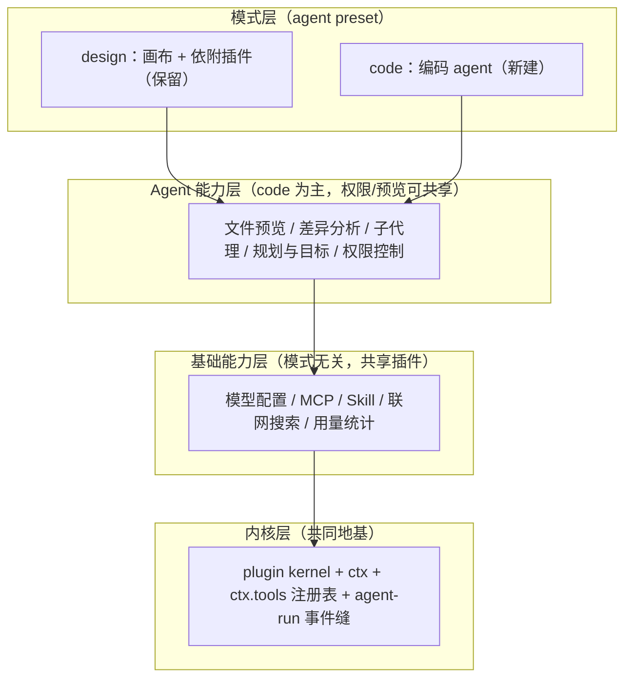

# 改造计划（插件内核 × BYOK × design/code 双模式）

> 状态：**权威蓝图，整体实施中**。2026-09-12 起的插件内核决策继续有效；2026-10-05 本期本地实例用户系统重构（`DEC-20`）已实现、验收并分类提交，`DEC-21` 仅交付基础设施规格。具体规格见《[用户与账户系统重构](./身份与账户.md#用户与账户系统重构)》与《[官方账户与远端连接基础设施](./身份与账户.md#官方账户与远端连接基础设施)》。多端形态见姊妹文档《[多端产品设计](./多端产品设计.md)》。
>
> 上游理念：deepseek-harness（dsh）「一切皆插件」+ nomifun 供应商架构 + Cherry Studio BYOK。

---

## 1. 产品方向与范围

### 1.1 BYOK Work 平台 + design/code 双模式

KenFutWork 是 **BYOK（用户自带 Key）自定义供应商/模型**的 Work 平台，产品分两种模式：

- **design 模式（保留不动）**：现有画布创作能力 + 依附画布的插件（Excalidraw 编辑、`inspect/manipulate/screenshot_canvas`、brand-kit、图/视频生成、canvas-design skill、首页示例/发现库）。本次**不重构**，只在装配层归入 design preset。
- **code 模式**：通用 Agent 能力——文件预览、差异分析、子代理、独立规划、目标与权限控制。
- **基础能力层（两模式共享）**：模型配置、MCP、skill、联网搜索、用量统计——抽象为模式无关的共享插件。

**存储与身份方向（2026-10-05 修订）**：存储统一为**自管 Postgres**；本期主形态为免账户的单一本地实例，桌面与本机 Web 共享本地数据及 BYOK 配置。自部署保留独立实例方向；未来官方账户只授权对应官方服务，远端服务本期只写基础设施规格，不冻结云端计算承载方式。当前实现状态以《02-当前项目实现状态》及《日志》为准；旧测试数据不迁移，历史 SQL 不改写。

### 1.2 工作方式与 Agent 控制分别持有

| 概念 | 含义 | 实现维度 | 取值 |
| --- | --- | --- | --- |
| **产品模式** | 装配哪套业务能力（画布 vs 编码） | agent preset / profile（装配级） | `design` / `code` |
| **Agent 工作流程** | 普通问答与工具任务共用执行过程 | Task／Run | 基础权限、规划状态、Goal 分别持有 |

产品工作方式用 preset 承载业务能力。2026-10-22 已确认统一 Agent 工作流程；规划、权限和目标的实施要求见本文 §14.2.7，运行代码仍待调整。

### 1.3 BYOK 改造输入与目标

| 维度 | 历史改造输入（2026-09） | 现行目标 |
| --- | --- | --- |
| 模型目录 | `http/models.ts` 硬编码静态数组 | 从用户供应商实例动态推导 |
| 供应商凭证 | 服务端 env（openAI/google/replicate/volces/metaso Key） | 本地实例明文凭据文件，按需解析；授权设置可查看复制 |
| agent 模型 | `deep-agent.ts` 按 env 三选一 | 按用户选定供应商实例 + 模型实例化协议适配器 |
| 图/视频生成 | `generation/providers/` 按 env 注册 | 协议适配器固定，实例来自用户配置 |
| agent 能力 | 原实现的 MCP、权限、用量与子代理能力不足 | 共享主 Agent，由插件提供工具、规划、目标、权限与用量 |
| 存储/认证 | Supabase 直连散布各 feature（Auth/Postgres/Storage/PGMQ/RLS） | 自管 Postgres + 显式实例作用域；LocalActor + 统一本机接入验证 |

---

## 2. dsh 理念提炼与裁剪决策

### 2.1 借鉴的八条理念

1. 插件是唯一扩展方式（挂载新插件，而非改核心）；2. Context 是服务仓库（认领稳定 `ctx.<key>`，按 key 发现）；3. `inject` 声明依赖（拓扑表达加载序）；4. 事件即扩展点（waterfall/serial/bail 拦截）；5. 注册即可逆副作用（`ctx.effect()` 返回 disposer）；6. Profile 与 Bundle（有序层组合，`--dump-config` 可观测）；7. 能力缝三元组（Definition + Provider + Consumer）；8. 配置目录化 + fail loud。

### 2.2 裁剪决策

| 考量 | 结论 |
| --- | --- |
| Cordis 处于 developer preview，明示会有破坏性变更 | 不引入 Cordis 本体 |
| dsh 的 profile/patch/热重载服务于「可组合发行版」 | 不引入 YAML 组合层 |
| 简洁优先、禁止大爆炸重写、不为投机灵活性堆抽象 | 自建约 150 行内核（依赖注入 + 拓扑挂载 + 显式覆盖） |
| **v3 修订：agent 能力层要可插拔** | **松绑「不建事件总线」——只加 3 个 agent-run 拦截事件（§4.3），不建通用总线** |

**v3 关键修订说明**：规划、权限与用量需要在 Agent 循环中处理，通过三个事件提供扩展，不建设通用事件总线。

### 2.3 与 dsh / Cordis 的关系：接口对齐 + 协议互操作，不做插件包兼容

Cordis 与 dsh 均处 developer preview（rc 版，官方明示破坏性变更随时发生），且 dsh 插件深度绑定其自有 core 运行时（`ctx.agentLoop` / `ctx.sessions` / `ctx.tools` / `ctx.llm` / `ctx.systemPrompt`）——KenFutWork 运行时是 deepagents + LangChain + LangGraph，两套 agent 内核不通用。故按四个层次区别对待：

| 层次 | 含义 | 决策 |
| --- | --- | --- |
| L1 插件包互通 | dsh 的 `@deepseek-ai/dsh-*` 插件直接装进 KenFutWork 跑 | **不做**：等于实现 dsh 全套 core 服务契约 = 把 KenFutWork 重构成 dsh 发行版，放弃 deepagents 与 design 模式差异化 |
| L2 接口形状对齐 | kernel 的 `name/inject/apply(ctx)` + `ctx.effect()`/`ctx.on()` 签名对齐 Cordis | **做**：心智复用、迁移摩擦小；但仅设计借鉴，不等于插件可互通 |
| L3 语义约定对齐 | ctx key 命名、`mcp__<server>__<tool>`、事件名 `agent/*`、能力缝三元组 | **做**：概念可迁移、文档可参照 |
| L4 生态/分发兼容 | dsh 的 bundle/profile/patch 格式、`dsh plugin add`、`dsh-plugin` topic | **暂缓**：依赖被拒的 YAML 组合层；dsh 生态尚小且绑定其运行时 |

**协议级互操作（真正现实的「兼容」）**：不要求任一方放弃运行时即可共享生态——

- **MCP**（必做）：工具级开放标准，同一 MCP server 两边通用，工具生态天然共享（见 §4.5）。
- **ACP**（Agent Client Protocol，候选）：dsh 有 `acp` profile 与 `subagent-acp`；KenFutWork 支持 ACP 后可与 dsh 等外部 agent 互相委托/编排，作为 §4.6 子代理缝的一种 provider。适配成本待评估。

**重新评估 L1/L4 的触发条件**：① Cordis/dsh 脱离 preview 出稳定版并冻结 API；② dsh 生态出现 KenFutWork 可直接消费的高价值插件；③ KenFutWork 决定做第三方插件热插拔生态（DEC-8）。三者同时成立前维持本节结论。

---

## 3. 当前诊断

### 3.1 已有萌芽缝（改造地基）

生成 provider 注册表（`generation/providers/registry.ts` + `register-all.ts`）、任务 executor 注册表（`registerExecutor()`）、agent 后端工厂（`agent/backends/index.ts`）、HTTP 路由（`registerXxxRoutes(app, deps)`）、认证接口（`RequestAuthenticator`）。

### 3.2 痛点

- **装配层**：`app.ts` 是特权核心（行数 / import / 服务 / 路由 / `BuildAppOptions` 计数以《02-当前项目实现状态》§3.1 为准，本文不维护现状数字）——条件注册内嵌，新增 feature 改四处。
- **供应商主权**：模型目录、agent 模型、图/视频 provider 全按**服务端 env** 硬编码，用户无法自带 Key。
- **存储耦合**：各 feature service 直接持有 Supabase client 并 `.from()`。
- **注册清单漂移**：generation/executor 靠 server、worker 两处副作用 import 人肉同步。
- **agent 能力层薄**：MCP/联网/用量/模式/通用权限/差异分析缺失；子代理、工具注册表未成体系。

---

## 4. 目标架构：四层

### 4.1 分层总览



原则：**能力即缝**（三元组齐备）；**开放贡献、封闭 key**（`ServiceKey` 封闭，用注册表型 key 承接无限贡献）；**基础能力优先抽象**（共享 = ROI 最高）；**不推倒重来**（画布归入 design preset，不重构）。

### 4.2 ctx key 表（稳定契约；**本表是唯一权威副本**，AGENTS.md 与其他文档只引用、不复制清单）

| ctx key | 服务 | 层 | 备注 |
| --- | --- | --- | --- |
| `localInstance` | 本地实例初始化与引导 | 领域 | `DEC-20` 本轮目标：确定并持久化稳定 instanceId，替换 viewer；不创建账户、成员或订阅。 |
| `localAccess` | 本机接入与客户端授权 | 基础 | `DEC-20` 本轮目标：统一 HttpOnly cookie / 明确授权 Bearer 的 HTTP、SSE、WS、RPC 验证，管理接入客户端及脚本凭据；替换 auth 与独立 apiTokens。 |
| `projects`/`brandKit`/`canvas`/`threads`/`chat`/`settings`/`uploads` | 各领域服务 | 领域 | design 侧为主 |
| `designReview` | 画布评论与标注存储 | 领域 | Provider 消费 `persistence`（两张表以 `instance_id` 打头，`:instance` 谓词强制）；HTTP Consumer 经 `localAccess` 验证，作用域 = 实例 + 上游画布 project + 设计文件。刻意不复用上游 daemon 的 comments API（绑 conversation、带 workspace 团队鉴权与云端 relay）。 |
| `projectDirectoryRelink` | 缺失项目目录显式重新关联 | 领域 | Provider 消费 `persistence`/`localInstance`/`goals`/`agentRuns`/`taskWork`/`processSandbox`/`capabilities`/`flowProjectControl`，HTTP Consumer 经 `localAccess` 验证。Code/Design 核验 Task 代际，关闭资源后原子重绑 Project/Canvas/Task；Flow 持久化操作阶段并在启动时恢复维护屏障，同操作只观察未知状态，完成后才解除维护；不重放历史输入。 |
| `codeGit` | CodeGitService（Task工作目录的仓库视图） | 领域 | Provider消费executionScopes与ProcessSandbox，Task路径和真实Git执行受持久Task授权；原Code UI Git与HTTP消费。创建Task之前的项目只读Git由codeUi所属提供方持有项目行锁、可信连接和ProcessSandbox的Project Read Lease，不使用Task身份。 |
| `codeUi` | CodeUiService（原 ZCode GUI 的宿主会话、协议与服务适配） | 领域 | Definition/Provider/Consumer同域；主/子会话消费固定原V4契约，持久Task绑定Project与真实工作目录；原界面经RPC/frame消费。原供应商编辑器复用modelProviders唯一真相，本轮选择编译为有修订号的内部模型快照，运行事实由同域插件贡献到`agent-run-extension`。 |
| `goals` | Task Goal 状态与计量规则 | 领域 | 无模型或数据库依赖的 Provider；Code UI 持久保存状态并通过既有输入接纳机制续跑，工具与提示为 Consumer。普通 Run 结束不等于目标完成，停止暂停目标，服务重启后手动恢复。 |
| `flowProjectControl` | Flow 项目代际与停止证明 | 领域 | Provider 使用显式 `flowGatewayUrl` 与共享密钥；项目文件 Consumer 读取代际快照，目录恢复 Consumer 消费 quiesce/complete-relink，未知回执只观察同一操作，完成必须远端任务清零。 |
| `projectFiles` | 普通项目文件存取与资产索引 | 领域 | Provider 消费 `blob`/`persistence`/`localInstance`/`projects`/`executionScopes`；项目目标使用所属目录，Task 目标使用固定工作域及授权代际。通过 Blob 私有 namespace 提供稳定引用，精确路径读写与恢复，不扫描项目猜测缺失文件。 |
| `generationTargets` | 生成成果的持久来源与执行复验 | 领域 | 接纳时锁定真实项目、会话及Task代际，消费方为JobService和生成执行器；关联外键清空后仍保留原来源，缺失来源不重放。 |
| `mediaDrivers` | 可安装媒体供应商文件 | 领域 | Provider消费`localInstance`、`settings`与`persistence`，HTTP Consumer经`localAccess`提供文件预览、安装版本、停用卸载及媒体连接配置；凭据在应用目录按连接版本保存。预览只解析编译，受限执行及Job消费继续使用此服务。 |
| `jobLoop` | 既有后台生成队列循环 | 执行 | Provider统一装配队列、生成来源、项目文件和uploads素材读取服务；桌面和worker入口只消费同一handle，关闭等待已有工作且不重复释放。服务端HTTP形态由独立worker消费。 |
| `checkpoints` | CheckpointService（Task影子Git、版本预览与完整字节恢复） | 领域 | Provider消费Task作用域、私有metadata和真实Git；恢复先核对版本并取得进程/文件屏障，再经CodeUi更新代际与回执后开放readiness。消费方为Harness轮次边界、原V4文件控制和HTTP；Git不可用或捕获失败给真实拒绝，原画布不参与Code。 |
| `agentRunMetadata`/`agentPersistence`/`agentRuns` | 运行元数据（含持久 pre/post 轮次边界及 owned Task 读取）/运行持久化/Harness；压缩与历史引用由适配器提供，控制消费者不保存原始 checkpoint 或凭据 | agent | `agentRuns`按产品端口委托原生上下文分支，默认Provider由插件装配且可替换；owned Task历史编辑消费opaque引用，不重建消息DTO。`agentPersistence`明确配置Postgres时初始化失败上抛；插件持有SDK资源并按异步释放栈关闭，未用服务不因关闭而初始化。 |
| `contextHistoryArchives` | 当前 Run 的只读原生上下文归档绑定与读取端口 | context-history | 运行时绑定真实 Task 作用域；ReadHistory 的 schema 与执行共用作用域打开时冻结的实例 `codeReadPageCharacters` 预算，不再直接依赖 `settings`。每次读取前后重验权限与分支，Run 收尾释放绑定；不凭 URI 授权、不回退读取最新 checkpoint。 |
| `executionScopes` | Task 身份、主目录/附加目录、代际与受控文件 backend | 领域 | Provider在 `features/execution`，按统一 code_ui_sessions 持久Task Owner加载与更新作用域；Code/Design Run复核项目启用方式与open状态。文件、命令、检查点与宿主消费真实句柄，Canvas定位不替代执行身份。 |
| `canvasAssets` | 画布已知素材导出及索引恢复 | 领域 | Provider消费权威布局文件与projectFiles，HTTP消费者执行精确路径move/relink、版本检查、自包含导出和明确Git恢复；不扫描猜测素材。 |
| `processSandbox` | 真实命令 sandbox、helper 与受管理进程句柄 | 执行 | Unix SRT、Windows native broker，由 scope 生成权限快照，命令消费者及 Task 后台管理器负责生命周期；另提供绑定实例、项目、可信连接和项目修订的Project Read Lease，始终只读无网，取消及宿主关闭等待进程退出，不发布Task快照。Windows以projectOwner和projectReadOnly能力明确区分；旧broker不支持时拒绝Project执行，原Task接口保持。不可用时不裸跑。 |
| `codeTerminal` | 人类交互式PTY及连接生命周期 | 执行 | `features/code-terminal` 提供模块；原Code UI TerminalService与WS消费，显式Task、实例/接入连接归属、初始输出激活和真实退出；复用ProcessSandbox，Task关闭由能力注册表联动。 |
| `taskWork` | Task 后台工作持久记录、跨 Run 生命周期与通知消费 | 执行 | `features/task-work`提供manager/store，Owner只引用统一Task并复核分支代际；Bash/TaskOutput/TaskInput/TaskStop动态Consumer依赖真实scope，Code/Design历史输出由同一宿主消费。 |
| `subagentRuntime` | 子代理派发缝（DEC-14…17：定义注册表 + 后台任务注册表 + task/task_background/task_output 工具 + 通知中间件） | agent | **新增（2026-09-26）**：定义唯一来源 `agent/subagent-definitions.ts`（按 preset 过滤，界面清单同源）；注册表按 run 创建（并发上限来自治理设置，DEC-18），随 run 生命周期销毁；取消/收尾经 `abortAll` 连带清理；plan 档按目标定义只读性放行派发（`DEC-17`）。消费方：`agentRuns`（runtime 创建注册表并传工厂）与 `http/runs` 子代理清单路由 |
| `jobs` | 持久Job接纳与状态服务 | 基础 | `enabled: 有 databaseUrl`；消费queue、generationTargets与uploads保存参考素材引用；桌面/worker复用同一执行链。 |
| `generation` | 图/视频协议适配器注册表 | 基础 | 接受 ProviderInstanceConfig |
| `modelProviders` | 供应商实例管理（CRUD + 凭据解析） | L2 基础 | 服务与 revision/CAS 保留；凭据文件存取是内部统一接口，不增加另一服务 key。 |
| `modelCatalog` | 模型目录（用户供应商实例推导） | L2 基础 | 取代硬编码 `http/models.ts` |
| **`tools`** | 统一工具注册表（schema + 作用域 + guarded 执行；含 **per-run 动态工具缝**——动态 schema/job 闭包/backend 绑定的工具经 `registerDynamic` 在 run 起始期解析，`resolveRunTools` 与静态条目合并过滤） | L1 内核 | **新增**：MCP/skill/联网搜索/diff 等**模型可调用工具**向其贡献。**已实现（2026-10-01）**：内置工具全部走此缝（canvas/brand-kit/generation/code-tools 插件注册，`agent/tools/` 退役） |
| **`systemPrompt`** | 系统提示段注册表（name/order/scope/resolve；组装 = scope 过滤 + order 排序 + 空段剔除） | L1 内核 | **新增（2026-10-01 已实现）**：模式段（design=canvas 插件 / code=code-tools 插件）、品牌段（brand-kit）、base/skills/规则与插件段（agent-runs）向其贡献，挂载即出现；runtime 组装后传入 deep-agent |
| **`capabilities`** | 能力贡献者注册表（**非工具**能力：子代理 provider、能力节点等） | L1 内核 | 开放贡献、封闭 key 的承载点 |
| **`permissions`** | 跨模式 tool-call 策略缝（default/auto-approve/full-access） | L3 | **新增** |
| `approvalReview` | 独立模型审批提供方 | L3 | Provider 消费 `settings`/`modelProviders`/`modelCatalog`，使用真实 Task 宿主的真人约束、Goal 剩余预算与 Run 无工具模型端口；Consumer 为逐调用审批 broker 的 ask 分支。未选模型或证据不全回人工；完全访问直通，Plan/角色/Stop/撤权与最终 claim 保持。配置、要求与许可绑定保留到消费，供应商凭据仅经既有适配器解析。 |
| **`usage`** | token/成本采集（按 instance/provider/model/run） | L2 基础 | `DEC-6`：本地计量保留，不作为余额/套餐门。 |
| **`persistence`** | 自管 Postgres Provider（`pg` 连接池；**唯一 DB 入口**） | 基础 | `FORM-9` 本轮修订：第一方统一实例归属，scoped 查询显式绑定 instanceId，漏写或跨实例访问即拒绝；业务服务不得绕过唯一入口。旧 forWorkspace/forUser 账户作用域本轮退役。 |
| **`plugins`** | 插件注册表缝（目录 / 安装 / 卸载 / 启停 / 导入校验 / 导出） | L3 | 安装前过兼容性门禁（`features/plugins/compat-validator.ts`），未通过不落盘不装载。实例本地安装目录纳入数据根目录，实例主人通过接入授权管理；本轮取消平台管理员依赖。 注册表同时提供只读技能包发现，skills宿主、既有技能工具及agentRuns轮次目录消费同一已安装包；按真实启用态和模式过滤，包引用不签发本机路径或执行权限。 |
| **`voice`** | 语音助手缝（听 / 想 / 说） | 领域 | 内建插件；Definition 为 VoiceService 与语音 Provider 接口，Provider 为离线 sherpa / BYOK 端点，Consumer 为 HTTP 路由与输入框。设置及检测报告归本地实例，依赖 localAccess / localInstance / modelProviders / persistence；模型工具不消费此缝。 |
| **`knowledge`** | SAG2 本地知识库缝（`docs/插件/SAG2知识库插件规划.md`） | 领域 | 内建插件、**默认挂载**；Definition 为 `KnowledgeService`，Provider 当前为 `DisabledProvider`（M2 换 `SagCliProvider`），Consumer 为 M3 的 `pre-step` preflight 与 M4 的侧边栏面板。上游只走 `sag` CLI 的 `--json`，不连 MCP、不逆向私有 service 协议、不做 Jev 桥；凭据以 `modelProviders` 为唯一权威源。安装态由市场 bundle `kenfutwork-knowledge` 决定，**运行期动态门控**、不缓存（装／卸下一轮即生效）；依赖 `plugins`。 |
| **`blob`** | 对象存储缝（BlobBucket） | 基础 | 对象存储唯一入口，Provider 随形态替换；本地文件位于数据根目录，对象路径由服务端确定实例归属。读写通过本机接入边界与资源授权，不依赖账户令牌或假用户。必需能力缺失则启动期失败。 |
| `backend` | agent 后端工厂 | agent | — |
| `ws` | ConnectionManager + EventBuffer | 基础 | — |

**`tools` 与 `capabilities` 的分界**：`tools` 保存提供给模型且有 JSON schema 的可调用工具；`capabilities` 保存运行时按 key 解析的能力贡献者。MCP、skill、联网搜索和 diff 归 `tools`；子代理分发工具 `task` 归 `tools`，其 provider 集合归 `capabilities`。

可信宿主生命周期贡献使用 `capabilities` 的 `plugin-state-lifecycle`，定义为 `features/plugins/state-lifecycle.ts` 的 `PluginStateLifecycle`；市场兼容门面不暴露该能力。注册表在串行安装态变更中先等待 `onStateRevoking` 收尾，失败不继续卸载；成功提交安装态后再通知 `afterStateChanged`。CAD Consumer 精确绑定官方安装 ID，撤销时封锁新调用、取消并等待自己发起的工作，成功激活后重新注册带代际的工具贡献；旧调用、旧审批与原 Run 的能力快照不能自动复活。重装失败应恢复旧目录与真实实现后才通知恢复，不能只回滚库存文字。

依赖拓扑（`inject` 依据，环即 fail loud；**只列真实依赖对，不构成全序**，下方为「先于」关系）：

- `localInstance` 先于 `localAccess` 及实例作用域的领域服务、`modelProviders`；`localAccess` 先于受保护的 HTTP/WS/RPC 消费者，`ws` 仍由连接消费者显式依赖
- 领域服务先于 `chat`；`modelProviders` 先于 `modelCatalog`/`generation`/`usage`
- `goals` 先于 `codeUi`；`canvas` 的文件内容 Provider 不依赖 `ws`，`canvas:tools` 消费 `canvas`/`ws`/`blob`/`localInstance`/`tools`/`systemPrompt`
- `tools` 先于 `capabilities`/`permissions`
- `modelProviders`/`modelCatalog`/`settings` 先于 `approvalReview`，后者先于 `permissions`；Task 宿主在运行扩展中提供真人输入链和预算的私有端口，服务图不依赖会话 UI 装配。
- `goals`/`persistence`/`permissions`/`localInstance`及模型选择服务先于统一 `codeUi` Task 宿主；Code/Design 的 HTTP/WS 消费同一准入，不再装配独立 Design 生命周期。
- `modelProviders`/`capabilities`/`permissions`/`usage` 先于 `backend`/`agentRunMetadata`/`agentPersistence`，后者先于 `agentRuns`（依赖最多，最后挂载）

`tools` **不依赖**本地实例引导/接入服务或领域服务——工具注册表只在执行时经 guard 取上下文，不要制造假依赖。其余 key 不设固定档位，以各插件 `inject` 实际声明为准；compose 检测成环即在启动期抛错。本轮目标移除 viewer/auth、平台 admin、credits/tierGuard/payments 及独立 apiTokens 服务，禁止以空实现或恒放行兼容层保留。

多端形态另引入 `storage`/`toolsGateway`/`blob`/`secret` 等存储与本机能力缝（见《多端产品设计》§5），落地时并入本表（本表是唯一权威副本，AGENTS.md 等其他文档只引用不复制）。`persistence` 已落地，见上表。

### 4.3 内核（`apps/server/src/kernel/`，约 150 行 + 事件缝）

```ts
// types.ts
export interface PluginDefinition {
    name: string;                            // 稳定 id，挂载日志与诊断
    inject: ServiceKey[];                    // 依赖的服务 key，compose 据此拓扑排序
    enabled?: (env: ServerEnv) => boolean;   // 缺省 true；payment/jobs 类开关收编于此
    apply(ctx: PluginContext): void | (() => void);  // 返回 disposer
}
// context.ts
export interface PluginContext {
    register<K extends ServiceKey>(key: K, factory: (deps: DepsOf<K>) => ServiceOf<K>): void;
    get<K extends ServiceKey>(key: K): ServiceOf<K>;   // 未注册即抛错（fail loud）
    effect(fn: () => void | (() => void)): void;
    on<E extends AgentRunEvent>(event: E, listener: ListenerOf<E>): () => void;  // v3 新增：最小事件缝
    app: FastifyInstance;
    env: ServerEnv;
}
// compose.ts
export function composePlugins(plugins: PluginDefinition[], overrides?: Partial<ServiceMap>): () => void;
```

**agent-run 事件扩展（3 个）**：`pre-step`（waterfall，决定模型看到什么、可改写/拒绝）、`tool-pre-execute`（waterfall，权限/审批拦截）、`turn-stopping`（serial，收尾）。waterfall 监听器必须调 `next()` 委托。规划指导、权限和用量通过这些事件连接；服务单例由 kernel ctx 管理，HTTP 封装由 Fastify `app.register()` 管理。

**pre-step指导事实（2026-10-05）**：现有payload由runtime传入已接受Run的实际runId/preset/sessionId/threadId，并从scopeHandle提供workspaceId/taskId；Code模式消费者按该持久归属hydrate指导。此事实不授予工具权限，Code工具执行继续由V4 permissions与worker ceiling裁决。保持上述三事件，不新增模式专用总线。

### 4.4 能力缝三元组

可替换能力 = **Service Definition**（接口）+ **Service Provider**（实现）+ **Consumer**（消费方，常是模型侧工具）。只写实现不声明接口与消费方的「半个缝」不合入。

### 4.5 基础能力层（L2，模式无关共享）—— 本次重点

全部挂到 preset 之外的共享 ctx 服务；两个 preset 按 scope 过滤各自工具子集，做到**能力共享、激活按模式**。

| 基础能力 | 抽象为 | 挂载点（见 §4.2） | design 消费 | code 消费 |
| --- | --- | --- | --- | --- |
| 模型配置 | 协议适配器缝 + catalog | `modelProviders`/`modelCatalog` | 图/视频选模型 | 对话/编码选模型 |
| MCP | mcp-client 插件：连 server → 工具注册进 `ctx.tools`，命名 `mcp__<server>__<tool>` | `tools` | 可用 | 可用 |
| Skill | skill 插件：SKILL.md 发现 → 向 `ctx.tools` 贡献 | `tools` | canvas-design | 编码类 skill |
| 联网搜索 | `web_search` 工具插件（BYOK 搜索供应商） | `tools` | 可选 | 常用 |
| 用量统计 | agent 链路读 LangChain `streamUsage` + 直连生成链路读 job 回调 → `usage` 表 | `usage` | 是 | 是 |

要点：`ctx.tools` 是统一注册表（MCP/skill/搜索同一挂载点，带 schema/scope/guard）；模型配置一张供应商实例表（capability 标注区分聊天/图/视频）；用量统计是横切关注点（不改各能力），**采集点两处，均不新增事件**：

- **agent 链路**：token/成本来自 LangChain `streamUsage`——它是**模型实例化参数**，在 `modelProviders` 实例化模型时开启，属基础能力层内部实现；agent-run 事件缝只负责把用量**归属到 run** 与收尾结算。不要声称「用量挂在 agent-run 事件上采集原始 token」——`pre-step`/`tool-pre-execute`/`turn-stopping` 三个事件都拿不到原始 token。
- **直连生成链路**：画布 `/generate` → PGMQ job → worker，不经 agent 主循环，在 job executor 完成回调处按 job 维度采集。

两处落同一张 `usage` 表（credits 关闭后 usage 是唯一计量，直连生成不能留盲区）。skill 已有实现，收敛为缝即可。

### 4.6 agent 能力层（L3，code 模式主体）

| 能力 | 做成什么 | 依赖缝 | 参照 dsh |
| --- | --- | --- | --- |
| 文件预览 | `ctx.tools` 读取/预览工具 + 前端面板（代码高亮/图片/PDF/产物） | tools | deepagents `read_file`/`ls`/`glob` |
| 差异分析 | diff 工具 + UI（版本 diff、编辑前后对比；design 可复用为画布 diff） | tools | 代码 diff |
| 子代理 | 从 1 个扩为缝：Definition + 多 Provider（in-process fork/spawn/委托；**ACP provider 可委托给 dsh 等外部 agent**，见 §2.3） | capabilities | `subagent/*` |
| Agent 工作流程 | 共用 Agent；规划和 Goal 分别持有，现有模式服务按已确认方案退役 | 当前 Task／Run 与既有扩展点 | 详见本文 §14.2.7 |
| 权限控制 | 跨模式 `permissions` 策略缝，挂 `tool-pre-execute` | permissions + 事件 | `guard/* + sandbox + approval` |

**Agent 控制语义**（2026-10-22 修订并实施）：普通问答和工具任务共用同一执行过程；规划、基础权限、Goal 分别管理，技能／插件／MCP 创建作为普通任务。具体工具使用经过权限、角色、目录与安装检查，目标由独立持久状态控制继续和验收。详细实施仅由本文 §14.2.7 持有，验证范围与遗留项见《日志》同日“统一主 Agent 实施与验证”。

**权限控制**：当前基础权限、独立规划及审批模型的产品行为由本文 §14.2.7 持有。应用审批与操作系统沙箱分别执行，批准操作仍受 Task 目录、角色、授权代际和运行上限约束；模型输出不能自行增加授权。

### 4.7 模式层（L4，design/code preset）

- **design preset** = 现有画布能力集 + §4.5 基础能力层。**纪律**：不为双模式重构画布代码，只声明能力集，行为不变、测试护航。
- **code preset** = §4.6 agent 能力集 + §4.5 基础能力层 + 编码类 skill/工具。
- **permissions 缝的模式归属**：`permissions`（§4.6）是模式无关的跨形态缝，两 preset 都可挂载；但画布操作危险度低，**design preset 默认不激活权限闸门**（保持现有画布行为不变），code preset 默认激活（execute/shell/文件写入等必过 `tool-pre-execute` 拦截）。缝本身始终可用，激活与否是 preset 的配置项。
- 用户切换模式 = 切换 agent preset（会话级，**承载方式 preset vs 独立 profile 待 DEC-2 确认**），基础能力层始终挂载。

### 4.8 BYOK 供应商缝与存储缝

**供应商缝**（三元组）：
- Definition（`packages/shared` zod 契约）：供应商实例归属于 `instanceId`，包含协议、服务地址、凭据引用、模型清单及兼容配置；`protocol` 为封闭集合。具体结构以共享契约为准，不维护文档 DTO 副本。
- Provider：`apps/server/src/providers/<protocol>/` 线协议适配器（聊天复用 LangChain `ChatOpenAI`/`ChatAnthropic`/`ChatGoogleGenerativeAI`；图/视频复用现有 provider 实现——**按供应商族计 6 个**，逐 provider 清单见《02-当前项目实现状态》§3.5——凭证从 env 改为从 ProviderInstanceConfig 读）。
- Consumer：`deep-agent.ts` 按实例实例化聊天模型；generation pipeline 按任务实例实例化图/视频；`modelCatalog` 返回目录。
- **注册路径与职责切分**（防止三个注册表职责混淆）：`generation` = **运行期适配器注册表**（按协议存放已注册的图/视频适配器，任务执行时按实例解析）；`modelProviders` = **用户实例 CRUD + 凭证解析**（不持有适配器实现）；`modelCatalog` = **目录推导**（从实例 + capability 生成可选模型清单）。图/视频 provider 实现迁入 `providers/<protocol>/` 后向 `generation` 注册；**现存 `generation/providers/register-all.ts` 的按 env 副作用批量注册在 P4 退役**，改为实例驱动。
- **凭证边界（唯一规范，`DEC-7` 2026-10-05 修订）**：供应商秘密值经 `modelProviders` 私有凭据接口解析，明文保存于数据根目录内的凭据文件，数据库不保存加密 Key。已授权实例主人可在设置界面查看/复制；普通模型目录、运行快照、工具参数、持久事件与日志不携带 Key。读取须验证本机接入权，日志与错误继续脱敏。该修订取代原“只写不读、永不回显、OS 钥匙串/加密表”的本地规范；目录迁移及停机备份恢复包含凭据文件，应明示其含明文秘密。

**自定义请求头（`headers`，2026-09-16 实现记录）**

> 请求头校验、占位符与适配器职责继续有效；下列文件位置记录当时实现。2026-10-05 本轮第一方存取统一实例归属，旧平台池/管理员入口退役，凭据存取按本节新规范接线。

- **动机（真机实测）**：接入 `opencode`（Base URL `https://opencode.ai/zen/go/v1/`、Chat Completions）报
  `Request is missing x-opencode-session and cannot be routed efficiently.` —— 这类网关要求**额外请求头**才肯路由；
  而现契约只有 `apiKey`（固定映射到 `Authorization`）与 `baseUrl`，**无法表达「这个实例还需要一个自有头」**。
  同类诉求还包括：自建网关的租户标识头、反代鉴权头、灰度/路由标记头。
- **该头的真实语义（2026-09 查证，决定了规格形状）**：`x-opencode-session` 是 OpenCode Zen/Go 自
  **2026-09-05** 起强制的**会话亲和头**——值必须是**单个会话内稳定**的 id，用于把同一会话的请求路由到
  同一上游分片并**保住提示词缓存**；缺失即 HTTP 400。官方还要求「正确的客户端标识」，常见伴随项是
  `x-opencode-client: <client-name>`。**因此**：
  - **静态头**（`Record<string,string>`）只覆盖「租户标识 / 反代鉴权 / 客户端标识」这类**每实例恒定**的值；
  - 但**亲和类头需要逐会话取值**——把 `x-opencode-session` 写成一个固定 UUID 是**错解**（所有会话被钉到同一
    分片，缓存亲和失效）；每次请求现随机生成同样是错解（亲和无意义）。
  - 故规格必须同时支持**占位符**：头值可写 `{{sessionId}}` / `{{threadId}}`，在发请求时按白名单变量替换
    （白名单外一律拒绝，不做任意模板求值）。会话 id 是随 run 下发的既有概念，**不需要新铺线**。
  - **不做供应商内联判断**：不少同类项目按「provider 名或 baseUrl 含 `opencode.ai`」自动塞这个头；本仓库
    AGENTS.md 明文禁止在业务代码里内联供应商判断，故这里坚持走**用户显式配置 + 占位符**，不特判厂商。
- **契约（增量，可选字段）**：`ProviderInstanceConfig` 增 `headers?: Record<string, string>`（与 `compat` 同属「按实例覆盖」，
  值可含白名单占位符）；创建/更新请求携带 `headers`（含值），**响应只回 `headerKeys: string[]`（仅键名）**——
  历史 MCP `env`/`envKeys` 的只写不读约定不能作为本地 BYOK Key 的限制；供应商秘密头与 Key 同走实例凭据接口。MCP 凭据消费仍由其配置接口封装，普通列表、事件和日志不泄漏秘密值。
  普通列表继续只带键名；授权设置读取所需秘密值走统一凭据接口。
- **应用点**：各线协议适配器构造请求时把 `headers` 合并进默认头。聊天（`openai-compatible`/`anthropic`/`gemini`）与
  图/视频适配器**一视同仁**，避免「聊天能用、生图不能」的半通状态。
- **保留头不可覆盖（硬约束）**：`authorization`（由 `apiKey` 解析生成）、`content-type`、`content-length`、`host`
  等由适配器/运行时应持有的头，**自定义头不得覆盖**；自定义头可覆盖适配器的**非保留**默认头。
  保留头由适配器持有，防止用户配置替换协议凭据或请求 framing。
- **校验（fail loud，保存时即拒）**：头名须为合法 HTTP token（RFC 7230）；头值须为可打印字符且**禁 `\r`/`\n`**
  —— 否则可注入额外头（请求走私 / header injection）。非法 JSON、非法头名一律在**写入时**报错，
  不允许「先存下来、运行时才炸」。
- **生效范围**：仅该供应商实例发出的请求，不得渗到其它供应商实例；本期不保留平台池实例。
- **实现前仍需定的四点**（已按下列口径落地，2026-09-16）：① UI 输入形态取「JSON textarea」，
  与既有「模型清单（JSON）」同形；② `headers: {}` = 清空（更新即整体覆盖，与「缺省=不改」区分）；
  ③ 不按协议细分（一个实例一套头）；④ 占位符白名单只有 `{{sessionId}}` / `{{threadId}}`。
- **落地位置**（改契约/校验先改 `packages/shared/src/provider-contracts.ts`，两端跟编译器走）：
  - 契约与校验：`providerInstanceHeadersSchema`（头名 token、保留头、头值可打印 ASCII 禁 CR/LF、
    占位符白名单、≤32 条、禁大小写重复），导出 `reservedProviderHeaderNames` / `providerHeaderPlaceholders`
    供渲染层复用；`providerInstanceConfigSchema` / 创建 / 更新请求增 `headers?`，响应增 `headerKeys`。
  - 存储：迁移 `20260916021900_provider_instance_headers.sql`（`provider_instances.headers jsonb`
    + object 形状 CHECK）；repository 列清单与两种口径（工作区 / 平台池）同步；service 的
    `toResponse` 只映射键名、`toCredentials` 带出原值。
  - 渲染：`apps/server/src/providers/instance-headers.ts`（`renderInstanceHeaders` /
    `instanceHeadersOption`）在**发送时刻**替换占位符；取不到上下文值即抛错，不发出字面量。
  - 注入：`InstanceCredentials.headers`（**已渲染**）→ 聊天三个适配器（openai-compatible
    `configuration.defaultHeaders`、anthropic `clientOptions.defaultHeaders`、gemini `customHeaders`）
    与图/视频六个 provider（openai-image `defaultHeaders`、google-image `httpOptions.headers`、
    volces/replicate 图/视频/metaso 视频 fetch 头合并，**凭证与内容类型排在自定义头之后**）。
  - 会话上下文来源：聊天取 run 的 `sessionId`/`threadId`；图/视频任务取 **job 行**的同名列；
    直连生成路由（`/api/agent/generate-image|generate-video`）取**请求携带**的
    `sessionId`/`threadId`（口径同 run 路径：非空字符串），画布页把当前会话 id 透给生成面板。
  - 历史平台池与 admin 请求头入口随 `FORM-10` 退役，不再作为本地实现前提。
- **验收用例**：用 `opencode` 实例（Chat Completions + `x-opencode-session: {{sessionId}}`）跑通一次对话，
  并断言**同一会话多轮拿到同一个值**（亲和成立）、不同会话值不同；
  另用自建实例断言「自定义头能覆盖非保留默认头、且改不动 `authorization`」。
  实现后以「本地桩服务抓包」同口径验证（真机需用户自己的 key，见 《日志》四十六的遗留项）。

**存储与接入缝**：自管 Postgres 的 scoped repository 统一绑定实例归属；启动引导与接入客户端授权独立建模（`DEC-20`）。文件、凭据、插件与恢复数据统一位于应用数据根目录；外部 Code 目录保持原位置。PGMQ/桌面队列 Provider 选择不因身份重构改变。完整部署清单见《多端产品设计》§5，本轮迁移与恢复规格见《用户与账户系统重构》。

### 4.9 插件目录约定与 profile

```text
apps/server/src/features/<feature>/
    plugin.ts              # PluginDefinition：inject + enabled + apply
    <feature>-service.ts
    *.test.ts
apps/server/src/providers/<protocol>/
    <protocol>-adapter.ts  # 线协议适配器（Service Provider）
apps/server/src/profiles/
    server.ts  worker.ts  test.ts   # 各进程/形态的插件清单
```

`server.ts`/`worker.ts` 退化为「选 profile → composePlugins() → listen」；开发环境 compose 后打印挂载树（`dsh --dump-config` 的轻量等价物）。多端形态的 `profiles/desktop.ts`（server+worker 单进程）与 `profiles/selfhost.ts` 见《多端产品设计》§3。

### 4.10 扩展点速查表（新增行为对应机制，禁止绕过）

| 目标 | 机制 | 不再改 |
| --- | --- | --- |
| 接入新供应商（OpenAI 兼容网关等） | 前端「供应商设置」添加实例——零代码 | 任何服务端文件 |
| 新线协议 | `providers/<protocol>/` + `protocol` 联合类型扩一项 | 适配器之外 |
| 新增图/视频 provider | 实现接口经 `generation` 缝注册 | server/worker 两处 |
| **接入 MCP server** | mcp-client 插件 → 工具注册进 `ctx.tools` | 业务代码 |
| **新增 skill** | SKILL.md 放入 skills 目录，skill 插件自动发现 | 代码 |
| **新增 agent 工具** | 所属 feature 插件 `apply()` 内向 `ctx.tools` 注册 | `tools/index.ts` |
| **新增子代理 provider** | 向 `ctx.capabilities` 贡献 | loop 代码 |
| **新增联网搜索 / diff 工具** | 向 `ctx.tools` 注册（`tools` 与 `capabilities` 分界见 §4.2） | loop 代码 |
| **自定义权限策略** | 挂 `tool-pre-execute` 事件 / 实现 `permissions` provider | loop 代码 |
| 新增 HTTP 路由 | feature 插件 `apply()` 内 `ctx.app.register()` | `app.ts` |
| **新增原Code宿主RPC方法** | feature向`capabilities`的`code-ui-host-rpc`按`service.method`贡献`CodeUiHostRpcHandler`，原RPC入口统一验证接入与活动连接 | `CodeUiService.hostRpc`分支清单；不另造HTTP路由 |
| 新增后台任务 | executor 调 `registerExecutor()` | `worker.ts` |
| 新增业务 feature | 新建 `features/<x>/plugin.ts` + profile 清单加一行 | `app.ts` 四处 |
| **新增存储适配器（DB / blob / 队列 / 凭证）** | 实现《多端》§5 缝接口（`persistence`/`storage`）并换 Provider：桌面 = 捆绑 Postgres / 本地 FS / 进程内队列（`FORM-2`），自托管 = 自管 Postgres / MinIO / PGMQ | 各 feature 的 repository 消费方（隔离规则见 `FORM-9`） |
| **插件需要跨重启保存状态** | 用能力 `storage`，插件显式传入实例归属，状态纳入数据根目录；供应商秘密值仍经 §4.8 的私有凭据接口 | 插件内核之外的存储路径（插件被门禁禁止直连 `fs`/DB） |

### 4.11 插件基座与各层技术栈

**插件基座：自建轻量 DI 内核，不引入任何第三方插件框架。** 依据 §2.2 裁剪决策（Cordis 处于 developer preview、本项目是固定两进程应用、简洁优先）。基座是纯 TypeScript 的「服务仓库 + 拓扑挂载 + 显式覆盖」，站在现有技术栈之上，不新增运行时框架：

- **插件运行时**：自建 `kernel/`（约 150 行）——`PluginDefinition` / `PluginContext` / `composePlugins`，零框架依赖。
- **类型安全**：TypeScript 严格模式 + 泛型/条件类型（`ServiceKey` 封闭联合、`DepsOf<K>` / `ServiceOf<K>` 推导），编译器牵引 `inject` 依赖拓扑，成环 fail loud。
- **HTTP 封装**：Fastify 5——服务单例语义归 kernel ctx，路由封装语义归 `app.register()`（硬边界见 §4.3）。
- **配置校验**：zod 4——每插件 `Config` schema，加载期 fail-loud。
- **事件缝**：自建轻量 waterfall / serial 派发（仅 3 个 agent-run 事件），不引第三方事件总线。
- **agent 运行时**：deepagents 1.13 + LangGraph（checkpointer / store）+ LangChain 1.x（模型适配器）。

**各层技术栈**（复用为主，新增依赖极少）：

| 层 | 核心技术 | 复用现有 | 新增依赖 |
| --- | --- | --- | --- |
| L1 内核 | 自建 kernel（纯 TS DI + 拓扑挂载）+ Fastify 5 + zod 4 + 自建事件缝 | fastify / zod / TypeScript | 无（全自建） |
| L2 基础能力 | 模型 = LangChain 适配器；MCP = 官方 SDK；skill = SKILL.md + js-yaml；搜索 = undici；用量 = LangChain streamUsage + Postgres 表 | @langchain/* / deepagents / js-yaml / undici / pg | `@modelcontextprotocol/sdk` |
| L3 agent 能力 | 预览 = deepagents fs 工具 + 前端渲染；diff = diff 库；子代理 = deepagents SubAgent；规划与 Goal 由 Task 持久状态提供；权限 = `permissions` 缝 + `tool-pre-execute` 拦截 | deepagents / @langchain/langgraph / react-markdown | diff 库、代码高亮库（选型待定） |
| L4 模式 | profile 机制（`profiles/*.ts`）+ deepagents agent preset + 作用域隔离；前端模式切换 UI | deepagents / Next.js 16 / React 19 | 无 |
| 跨层契约 | `packages/shared`（zod 4，前后端单一事实源） | @kenfutwork/shared / zod | provider / capability 契约文件（§5） |

**前端**（design / code 两模式共用一套 UI 产物）：Next.js 16（App Router、Turbopack、`output: export`）+ React 19 + Tailwind 4 + Base UI；design 画布用 Excalidraw；通用 framer-motion / lucide-react / next-themes。code 模式新增代码与 diff 预览组件（react-markdown + 代码高亮 + diff 视图）。

**存储与队列**：**自管 Postgres**（`pg` 驱动）+ PGMQ（Postgres 扩展）为存储适配器——桌面捆绑本机 Postgres 实例，自托管连用户 Postgres。MCP 配置、用量、权限审计、skill 等新表走 `supabase/migrations`（目录名沿用，内容是 Postgres SQL，迁移时剔除 Supabase 专有对象）。文件存储走 blob 缝（桌面本地 FS / 自托管 MinIO）。去 Supabase 云的完整迁移见《多端产品设计》§5。

**构建与质量**：pnpm@10 workspace + Turborepo + Biome（lint/format）+ vitest（测试）+ tsc（typecheck）。

**新增依赖汇总**（改造引入，均需过 GPL license 兼容检查）：

- `@modelcontextprotocol/sdk`——MCP 客户端（参照 `references/mcp-typescript-sdk`），落在 L2。
- diff 库（如 `diff`）+ 代码高亮库（选型待定）——差异分析与文件预览，落在 L3。
- 其余能力全部复用现有技术栈或自建；**明确不引入** Cordis / 任何插件框架 / 通用事件总线 / YAML 组合层。

### 4.12 依赖与供应链安全

- **Next.js**：当前锁定 16.3.3，是 2026-08 最新安全补丁版（已修复当月两个 Critical RCE：`CVE-2026-75604` Windows 路径穿越、AVIF Image Optimizer RCE）。`apps/web` 为 App Router + `output: export` 静态导出，生产无 Next.js 服务端运行时，服务端类 CVE 影响面小。策略：跟随 Next.js 月度安全更新，定期 `pnpm outdated next` + `pnpm audit`；`^16.3.3` 已允许 patch/minor 自动跟随。
- **新增依赖**（`@modelcontextprotocol/sdk`、diff/高亮库等）合入前过 GPL license 兼容检查 + `pnpm audit`（纳入 hygiene 门禁）。
- **Cordis / dsh**：处 developer preview，**不作为生产依赖引入**（§2.3）；仅参照其源码与设计（`references/`）。
- **BYOK 凭据**：遵守 §4.8 的统一规范；设置可查看/复制，目录包含明文 Key；日志、事件、模型目录与 worker 输出不得泄漏。

---

### 4.13 去 Supabase 迁移程序（自管 Postgres 落地）

> 目标态与缝设计见《多端产品设计》§5。方向：去 Supabase 云托管，存储统一为自管 Postgres（桌面捆绑本机实例 / 自托管连用户 Postgres），形态收敛为「桌面本地 + 自托管」。
> **本节只留骨架**（2026-09-20 文档整理）：逐里程碑 / PR 的实现细节、真机纠错过程与 Supabase 专有对象底账，全部移入 [`../日志.md`](../日志.md) 的「四十六、去 Supabase 迁移台账」；引用「§4.13 第十九轮（六）」这类子条目时，请到那边按同名子条查。

**历史去 Supabase 路径**（《多端》§5）：数据库、接入、blob、桌面 Postgres 供给与应用层作用域逐域迁移。2026-10-05 本轮身份重构独立按《用户与账户系统重构》推进，不再以固定本地账户或工作区维持免登录；已完成的迁移回执保留原日期。

**里程碑**（每个里程碑独立可运行、PR 粒度推进；逐项回执见《日志》四十六）：

| 里程碑 | 内容 | 状态 |
| --- | --- | --- |
| **M0** 决策与文档 | `FORM-2`/`FORM-9`/`FORM-10` 拍板；Supabase 专有对象底账；文档同步 | 已完成 2026-09-13 |
| **M1** 存储/认证缝 | M1.1 缝接口落定 → M1.2 自管 Postgres Provider（`:workspace` 谓词强制绑定）→ M1.2b 事务 → M1.3 逐聚合 repository 迁移 → M1.4 自管认证 → M1.5 开发环境换纯 PG 容器 + 删净 Supabase → M1.6 残留棘轮门禁 | 已完成 2026-09-14 |
| **M2** 迁移执行器 + 捆绑 PG | M2.1 schema 前向中性化 → M2.2 运行时迁移执行器（账本 + SHA-256 漂移门禁 + 空库 replay）→ M2.3 桌面捆绑 Postgres + local-trust + 离线冒烟 | 已完成 2026-09-14 |
| **M3** blob 与队列收口 | M3.1 Storage → BlobStore（27 处消费方收口）→ M3.2 PGMQ → 桌面进程内队列缝 | 已完成 |

**约束**：迁移一律**前向修复**（已执行的历史迁移不就地改，见《AGENTS.md》）；每个 PR 行为不变 + 测试护航；空库全量重放与二次 no-op 检查必须通过。

**分支并入的退役历史 SQL（2026-10-07）**：历史 SQL 保持原文。唯一声明在 `supabase/migrations/superseded.json`，只在指定后续退役迁移已实际执行、旧关系不存在且新关系存在时允许明确取代。`public.schema_migrations` 仍是唯一账本：取代记录保存原校验和与 `superseded_by`，`applied_at` 和 `execution_ms` 为 NULL，不能假称执行。声明、已执行版本或关系核对失败即停止；校验和漂移仍拒绝。空库没有退役执行事实，须按原顺序实际执行历史 SQL。

## 5. 共享契约变更（packages/shared）

- 新增 `provider-contracts.ts`：`ProviderInstanceConfig`/`ProviderCompat`/模型能力联合/目录响应 schema。
- `capability-contracts.ts`：工具注册表条目、能力贡献者、权限档位、用量记录 schema。
- `contracts.ts` 的 `ModelInfo` 扩展 `providerInstanceId`（标识用户供应商实例）。
- ws/job 契约：生成任务 payload 携带 `providerInstanceId` + 模型 id；agent-run 事件契约（pre-step/tool-pre-execute/turn-stopping）。
- **契约先行**：schema 定稿合入后，服务端改造才开工（编译器牵引两端）。

---

## 6. 待产品决策（实现前必须定）

> 编号 `DEC-*` 是稳定 ID：跨文档引用决策一律用 ID，不复述、不重编号（规范见 `docs/README.md`）。拍板后在本节标注结论与日期，**理由写入 §6.2**（不再单独维护 ADR 文件与 `decisions/` 目录）。

> **2026-09-12 全部拍板**：`DEC-1`…`DEC-8` 均按本节建议项采纳。**2026-09-13 起理由并入 §6.2**（原 `docs/decisions/` 目录与 ADR 文件已不再维护）；下方条目只标注结论。

1. **[DEC-1] 事件扩展**：使用 3 个 agent-run 事件提供指导、权限与用量扩展。**2026-09-12 确认，理由见 §6.2。**
2. **[DEC-2] 模式承载**：design/code 用 agent preset（会话级切换，推荐）还是独立 profile（部署级）。**已拍板（2026-09-12）：agent preset，会话级切换（理由见 §6.2）。**
3. **[DEC-3] Agent 工作流程与规划／目标边界**：**2026-10-22 实施**：普通聊天与任务共用 Agent，规划、基础权限和 Goal 分别控制；具体方案见本文 §14.2.7，理由见 §6.2。
4. **[DEC-4] 权限默认档**：code 模式默认 `default` 还是 `auto-approve`；`full-access` 二次确认与审计。**已拍板（2026-09-12）：默认 `default` 档；design preset 不激活闸门（理由见 §6.2）。**
5. **[DEC-5] 本地计费口径**：**2026-10-05 修订已批准**：本轮完整退役旧 credits/tierGuard/payments、套餐/额度与平台池计费，所有 BYOK 路径不检查余额；usage 保留。未来官方服务权益单独建模（`DEC-21`），不保留空计费服务。2026-09-12 的迁移期启用结论保留于理由历史。
6. **[DEC-6] 用量统计范围**：是否作为 BYOK v1 必备（建议是）。**已拍板（2026-09-12）：v1 必备（理由见 §6.2）。**
7. **[DEC-7] 本地凭证边界**：**2026-10-05 修订已批准**：数据根目录明文凭据文件 + 私有统一存取接口 + 授权设置查看/复制；数据库加密 Key 退役，普通目录/事件/日志不带 Key。现行规范唯一见 §4.8，原加密落库与永不回显结论被本修订取代。
8. **[DEC-8] 第三方插件生态**：外部插件安装/分发与「不引入 Cordis/YAML」非目标冲突，本次双模式聚焦内部能力，建议暂缓并消除原多端文档的生态承诺矛盾。**已拍板（2026-09-12）：暂缓（理由见 §6.2）。**
9. **[DEC-9] 存量生成与目录路径退役**：2026-09-12 拍板的实例驱动方向保留；2026-10-05 复核明确本项目无 release 与真实用户，不再要求迁移开发 env Key 或保留旧部署兼容。凭据目标按 `DEC-7`，旧运行路径的完整退役仍需同提交接线和验证。

> **2026-09-17 提案 / 2026-09-20 复核补充**：`DEC-10`…`DEC-13` 为 flow 子系统（第三模式）决策，见下方 10–13；实施蓝图在《[flow集成方案](../插件/flow插件集成规划.md)》（宿主适配层 §3.2、`ff-embed/v1` §3.3、开放问题 §9）。

10. **[DEC-10] flow 子系统双形态**：**内嵌模式（可嵌入任意宿主应用）+ 独立模式（保证单独可运行）**；主仓 workbench 是首个宿主（参考实现），内嵌契约对第三方宿主开放。**已拍板（2026-09-17，2026-09-20 复核补充）：双模式成立，两模式差异只准落在宿主适配层六缝，内核不得出现模式分支（理由见 §6.2）。**
11. **[DEC-11] flow 执行引擎**：**本地 Dify 无头栈（唯一方向）**，不引入远程托管引擎；Dify 地址可配，指向用户自管的本地/内网实例。**已拍板（2026-09-17，2026-09-20 复核补充）：引擎保持本地；桌面承载另立 `FORM` 决策（问题定义见《flow插件集成规划》§9.1，候选均为本地形态）。**
12. **[DEC-12] flow 计费/凭证网关缝**：**可插拔三选**——自带网关、宿主网关、第三方网关；部署配置选择，禁止业务内联供应商判断。**已拍板（2026-09-17，2026-09-20 复核）**；2026-10-05 主仓宿主按 `DEC-5`/`DEC-7` 提供 BYOK + usage，不恢复本地 credits。远端计费仅在未来对应服务实现。
13. **[DEC-13] Dify 版本策略**：**保持可升级（MVP 阶段不锁版本）**——兼容硬编码收敛在引擎适配器内 + 每次升级的 DSL 转换回归门禁；固定 digest 仅作可复现基线。**已拍板（2026-09-17，2026-09-20 复核补充）。**
14. **[DEC-14] 子代理分阶段架构**：v1 = in-process 深化（并行 fan-out + 后台任务 + 完成通知 + 轮末闸门），契约字段按 v2 一步到位（`taskId`/`agentName`/`parentRunId` 预留）；v2 独立子 run + continuable + 面包屑另立项。**已拍板（2026-09-26）。**
15. **[DEC-15] 统一后台任务原语**：后台子代理与 Code 长命令共用一张注册表（结算幂等首次获胜、通知按序出队、abortAll 连带取消）；完成通知注入下一轮模型输入（`<task-notification>` user 消息）+ `task.notification` 流事件同源下发；run 持有至全部后台任务结算才放行终态（轮末闸门）。**已拍板（2026-09-26）。**
16. **[DEC-16] 内置子代理清单按 preset**：design = planner / batch_image / video_generate，code = explore / review（只读），shared = video_generate；声明注册表唯一来源（`agent/subagent-definitions.ts`），界面清单 / 派发校验 / plan 白名单判据同源。**已拍板（2026-09-26）。**
17. **[DEC-17] 治理默认档**：派生深度 1（结构性禁孙代理：子代理工具面无派发工具）、后台并发 4、plan 档按目标定义只读性放行派发（`detail.subagentReadOnly` 穿透 ToolGate 全链）、子代理 usage 归父 run、失败结果带 next_step 恢复指引。**已拍板（2026-09-26）。**
18. **[DEC-18] 运行时 tunables 禁止硬编码**：治理数值唯一字面量属主 = shared `governance.ts`；覆盖入口 = `instance_settings` + env 兜底（库值 ?? env ?? DEFAULTS）；含 LLM 请求重试（含首次次数可调 + 无限重试显式开启）。规则同步写入 `AGENTS.md` 硬约束。**已拍板（2026-09-26；2026-10-05 归属及设置名称修订为实例，本期迁移完成）。**
19. **[DEC-19] 子代理事件归因以 metadata 为准**：langchain v2 事件无 `parent_ids`，归因读 `metadata.lc_agent_name`；子代理模型流不进主消息流（usage 照算归父 run）。**已拍板（2026-09-26）。**
20. **[DEC-20] 单一本地实例与接入身份分离**：免账户启动、稳定实例归属、LocalActor 区分实例与接入客户端、统一本机访问、整体数据目录迁移恢复；无旧版本数据兼容。**已拍板（2026-10-05），本期实现、验收及分类提交完成，完整规格见《用户与账户系统重构》。**
21. **[DEC-21] 官方账户与远端服务独立边界**：本期仅基础设施规格；官方身份只授权对应官方服务，自部署独立，本地资源始终保留，远端资源按来源与授权追加，任务固定执行目标。**已拍板（2026-10-05），无商业细则或团队/企业实现，完整规格见《官方账户与远端连接基础设施》。**
22. **[DEC-22] 外部 CAD 由共享 Agent 插件控制**：Code／Design 共用官方插件，先做 FreeCAD 后台独立工程，常用结构化工具与受 Task 权限、审批、停止约束的 FreeCAD Python 并存；交付可编辑工程、交换文件与真实几何预览，当前 GUI 文档控制另作后续阶段。AutoCAD／Blender 先研究官方接口，未安装不宣称验证。**已拍板（2026-10-18）；实施与验收见《CAD控制插件规划》。**
23. **[DEC-23] 外部运行时的归属登记与删除边界**：本应用**不拥有**用户机器上的 WSL 发行版；任何「自带/代装发行版」的能力都必须先登记归属，删除只准按登记清单执行。三条硬约束：① **归属清单是唯一依据**——实例数据根里的承载记录（现状 `dify-stack.runtime.json`，`writeStackRuntime` / `readStackRuntime`）既是「我们用了哪个发行版」也是「哪些资源是我们的」；未来自带发行版时扩展同一份清单（增 `ownedDistro` 一类字段），**禁止按名字前缀猜归属**。② **删除范围只覆盖清单内资源**——容器栈 `down` 默认保留数据卷，显式选择才 `--volumes --rmi all`；WSL 侧只做 `--terminate <distro>`，**禁止 `wsl --shutdown`**（会连带停掉用户全部发行版，含 Docker Desktop）；`wsl --unregister` **不进任何自动路径**，将来自带发行版要删，必须在卸载向导单列一步「检测到的本应用 Linux 环境」，默认不勾、勾选后二次确认「永久删除该发行版内全部文件」。③ **清单缺失即 fail-safe**——回落不删（现状回落 `host`），退化为「只报告 + 给出可复制的 `wsl --unregister <name>`」由用户决定，**绝不代删**。**已拍板（2026-10-19，用户口径「按这个口径来」；理由见 §6.2）。**（原登记为 `DEC-22`，与同日合入的 CAD 决策撞号；`DEC-22` 拍板在前（10-18）故由其保留原号，本决策顺延为 `DEC-23`。）
24. **[DEC-24] 贡献者许可与双版本发布**：社区版继续 GPL-3.0-only；外部贡献须签宽许可 CLA（非独占、永久、不可撤销、可再许可，含商业利用与专利）；商业版在独立私有仓按专有条款发布。历史贡献按 2026-10-04 GPL LICENSE 引入日划分：Loomic MIT 保留声明，`81eecbb4`（PR #4）未获书面许可前不进商业版，future73807 由共同所有者协议覆盖。普通贡献者不自动参与收益分配。**已拍板（2026-10-20）；理由见 §6.2。**
25. **[DEC-25] 商业版治理与收益**：IsKenKenYa 与 future73807 为共同所有者，IsKenKenYa 对外代表；未来公司可受让 CLA/商业许可权利。公开 `GOVERNANCE.md` 只写原则，净收入、比例、周期、vesting、退出与税务在内部协议约定；商业许可默认不含商标；公开仓与私有仓隔离。**已拍板（2026-10-20）；理由见 §6.2。**

26. **[DEC-26] SAG2 本地知识库插件的接入形态与全模式优先调用**：**结论**——① **双层插件**：宿主内核 `features/knowledge/`（Definition／Provider／Consumer 完整）＋ 市场 bundle `plugins/knowledge/`（安装开关与侧边栏）；内核插件恒挂载，安装态**运行期动态门控**、不缓存，装／卸下一轮即生效。② 上游只走 `sag` CLI 的 `--json` 与退出码，**不接 MCP**（上游内置 MCP 仅同一 Rust 进程内）、**不逆向私有 service 协议**（127.0.0.1 随机端口 + token）、**不做 Jev 桥**（`state`／`questions`／`answers.*.noul` 无公开 spec）。③ 凭据以 `modelProviders` 为唯一权威源，未配置时经 `sag config --auth bearer --key-stdin` 的 **stdin** 注入（不进 argv／日志／事件／快照），已配置则复用、卸载不改用户桌面端配置（`DEC-7`）。④ 「无论什么模式」靠提示段 `always`、工具与面板 `shared`、`pre-step` 不按 preset 过滤实现——运行时只有 design／code 两个 preset，Work／Flow 是 Code 壳内主区视图。⑤ 「优先调用」由宿主每轮 `pre-step` **自动检索并注入证据**，不依赖模型主动选工具（工具无 priority 字段、第三方提示段无 order／scope）。⑥ 知识库根按 **run 的真实工作目录**在首次检索时幂等注册（`sag check` → `sag add --types`），拒绝个人目录／磁盘根／系统目录。**理由**：市场 bundle 能力面仅 5 项且禁子进程与文件访问，纯市场插件无法实现上述任一机制；做 Jev 桥要长期维护无公开 spec 的协议，与「不逆向私有协议」自相矛盾；服务端没有「不依赖 run 的全局当前工作区根」服务（`ServiceMap` 无该 key、`ServerEnv` 无相应 env），安装时猜路径会索引错目录。**后果**：新增 ctx key `knowledge`（§4.2）、跨端契约 `knowledge-contracts.ts`、5 条 `/api/knowledge/*` 路由与 OpenAPI tag `knowledge`；`read`／`settings` 路由、侧边栏面板、按需下载器分属 M4／M5；Windows x64 实采发现 0.1.8 发布版 `sag config` 缺省 `auth_mode`，契约已按可选字段处理并加回归锁。**已拍板（2026-11-08，用户授权本代理拍板；规格见《SAG2知识库插件规划》，一手核验见 `apps/server/src/features/knowledge/M0-核验记录.md`）。**

### 6.1 存储迁移与平台管理决策（`FORM-*`，问题定义见《多端》§14）

> `FORM-*` 决策拍板后**并入本节**（曾短暂以独立 ADR 文件记录，现已不单独维护）；结论、理由与后果如下，引用一律用 ID。

1. **[FORM-2] 桌面 Postgres 供给 → 捆绑 `embedded-postgres`（PG 17 线）**。2026-09-13 选型保留：首启动初始化 + 同源迁移，桌面队列不依赖 PGMQ 扩展。2026-10-05 修订数据归属：默认应用目录仍由宿主管理，但不再要求固定不可迁移路径；数据库、凭据、附件、配置、插件与恢复数据统一数据根目录，等待在途工作结束并停机后整体迁移，失败继续原目录（`DEC-20`）。理由：保持 Postgres 单一语义与离线开箱能力，同时满足数据主权和目录备份恢复；代价是需管理完整停机、复制校验与重启生命周期。
2. **[FORM-9] 应用层作用域隔离**。2026-09-13 采用 repository 强制谓词 + 单一信任 DB 角色的机制保留；2026-10-05 修订主体为实例归属，第一方不再持有 workspace/member/user 两套隔离语义。实例 ID、资源归属与 Task 代际显式校验，遗漏谓词及跨实例访问必须拒绝。理由：单本地实例没有账户成员关系，但仍需防止越域与裸查询；代价是 DB 无账户 RLS 兜底，继续用唯一查询入口、静态门禁及行为回归护航。未来自部署多主体授权另立规格，不能由本地规则默许。
3. **[FORM-10] 平台管理后台退役**。2026-09-13 曾立项最小运维台、系统供应商分发及额度管理；2026-10-05 用户确认无 release/真实用户且本期为免账户 BYOK，旧后台、管理员、角色、平台池/额度入口全部退役。实例主人经本机接入授权直接管理本地插件、MCP 和供应商，仍受安装检查、沙箱及审批约束。理由：保留恒 true 管理员和空平台服务会把旧多账户语义嵌回本地产品。未来官方服务管理不沿用该本地后台，由 `DEC-21` 的服务边界另立项。
4. **[FORM-11] 桌面 flow 引擎承载 → flow 插件形态 + 引擎按需下载 + `engineRuntime` 双 Provider**（2026-09-20 拍板，问题定义见《多端》§14）。flow 以**插件**交付（服务端 `features/flow/` + 前端市场条目，未装不加载、不出入口）；本地 Dify 无头栈**不随安装包分发、默认不常驻**，安装/启用时提示体积与代价、用户确认后下载（沿用 `scripts/fetch-runtimes.mjs` 的下载 + 校验和：不匹配即失败、不留半截文件、可取消可重试），生命周期由 flow 插件托管；运行时做成**一条缝的双 Provider**——Windows：**WSL2 承载**（推荐）与**本机 Docker/Podman 承载**（用户已有就复用），macOS：**Colima / Docker Desktop·OrbStack**（macOS 是 Darwin 内核、**没有原生容器**，容器只能跑在 Linux VM 里；Apple Silicon 走 Dify 官方 arm64 多架构镜像，不需要模拟），Linux：原生 Docker / Podman（唯一不需要 VM 的平台），兜底 Provider 为「只装客户端 + 引擎指向用户自管的本地/内网地址」；**不做非容器源码部署**（Dify 官方口径是「只要能运行 Docker 就能部署」、推荐 Docker Compose，非容器生产部署不在官方支持之列，且 `sandbox` 容器是代码执行的隔离边界，裸跑会把它拆掉并违反 `DEC-13`）。理由：桌面预算（安装包 <150MB、内存 ≤900MB）与 Dify 栈（镜像 ~1.7GB、磁盘 4–6GB、空载 1.5–3GB）差一个数量级，随包分发直接违约、常驻直接击穿预算；做成「插件 + 按需」把成本从「所有人的默认成本」变成「用 flow 的人的显式选择」，且插件卸载可收回；WSL2 还顺带免掉 Docker Desktop 的商业授权约束并给出更清晰的隔离边界。**沙箱不是容器运行时**（不提供镜像/编排/容器网络/持久卷），不承担引擎承载，禁止用 `danger-full-access` 兜底。代价与后果：多一条 `engineRuntime` 缝与一套下载/托管/清理实现；桌面需探测 WSL2 与本机容器并明示降级原因；启用态内存需单独实测校准（不计入《多端》§10 的 idle/工作态预算，但要在设置页明示）。重评估条件：出现免容器运行时的本地引擎（如 FlowGram runtime-js 成熟）或 Dify 提供官方轻量分发形态时重开。
5. **[FORM-7] 商业化形态（部分拍板 2026-10-20）**：在社区版 GPL-3.0 之外，允许版权持有人以专有条款发布闭源商业版并出售商业许可；官方托管、增值模型池、企业支持仍待立项。前提是 CLA 覆盖与商业版资产合规（`DEC-24`/`DEC-25`）。

---

### 6.2 决策理由（原 `decisions/` ADR 并入，2026-09-13）

> 原 `decisions/` 目录下 ADR（`DEC-1`…`DEC-9`）的结论、理由与后果压缩至此（该目录与 ADR 文件 2026-09-13 起不再维护）；`DEC-10`…`DEC-13`（2026-09-17 flow 子系统决策，2026-09-20 复核补充）理由同在此处。引用一律用 ID。

- **[DEC-1] 事件缝（3 个 agent-run 拦截事件）**：仅建 pre-step、tool-pre-execute、turn-stopping 三缝（waterfall 须 next()），不建通用总线。理由：零事件则权限/模式/用量硬编码进 loop；总线仅 3 消费者、扩展面失控。代价与后果：新增事件须评审登记契约。重评估条件：出现第 4 个真实事件需求。
- **[DEC-2] design/code 模式承载 = agent preset（会话级）**：两模式为同进程两套能力集（design=画布+基础层，code=agent 能力层+基础层），按会话切换，`profiles/` 只管进程形态。理由：独立 profile 需重启或双部署、且割裂共享基础层。代价与后果：共享插件树，须靠工具 scope 过滤防越界。重评估条件：出现整站单模式部署诉求。
- **[DEC-3] Agent 工作流程与规划／目标边界（2026-10-22 实施）**：普通聊天与任务共用 Agent。规划、基础权限、独立审批模型与 Goal 各自持有状态；原盾牌菜单提供规划与基础权限，目标通过明确操作创建。技能／插件／MCP 制作使用通用工具、技能及提示注册表。输入、排队、历史重试与后台消费者使用同一接纳流程，Goal 关联由可信宿主提供。具体实施与验证由本文 §14.2.7 及《日志》持有。
- **[DEC-4] 权限默认档 = code 模式 default 档**：危险/不可逆操作（shell/写文件/越工作区）触发 ask，记忆粒度本次/本会话/永久；full-access 需明示 + 二次确认 + 全量审计；design preset 不激活闸门，agent 无权自我授权永久。理由：默认 auto-approve 挡不住 prompt injection，full-access 违反「不可逆必过人审」。代价与后果：code 初体验审批偏多。重评估条件：通过率数据积累后按工具类放宽。
- **[DEC-5] 本地计费退役（2026-10-05 修订）**：删除旧计费运行时、路由、契约、配置和测试，保留 usage；不做恒放行或 enabled=false 空壳。理由：无真实用户与发布兼容约束，本地主人自带 Key，无平台余额前提。历史：2026-09-12 以旧云部署兼容为由保持迁移期计费，现前提已撤销。后果：未来官方服务需独立权益/结算接口，不能恢复对本地 BYOK 的余额门。
- **[DEC-6] 用量统计 = BYOK v1 必备**：agent 与直连生成继续采集 usage，归属实例、供应商、模型和 Run。理由：旧计费退役后仍需提供使用事实与成本视图。2026-10-05 仅替换归属主体，不把 usage 重新解释为余额或付费权益。
- **[DEC-7] 本地凭证文件与授权回显（2026-10-05 修订）**：现行规范见 §4.8。理由：用户拥有本机数据与 Key，无真实用户兼容负担；明文目录便于迁移、恢复与手动管理。后果：停机备份含秘密值，应明示，不可放入普通模型目录、事件和日志。历史：2026-09-12 的服务端加密落库 + 永不回显为旧多账户部署边界，本轮取消；未来远端服务凭证需另立规格，不直接照搬本地规则。
- **[DEC-8] 第三方插件生态 = 暂缓**：不做外部插件安装/分发/签名（如 `dsh plugin add`），只做内部插件化；开放贡献、封闭 key，第三方未来经 `ctx.tools`/`ctx.capabilities` 进入。理由：需分发格式/签名/兼容矩阵/YAML 层，全属被否的非目标。代价与后果：第三方无官方接入路径，须在 README/CONTRIBUTING 写明边界。重评估条件：§2.3 三条件任一成立。
- **[DEC-9] 存量路径退役**：实例驱动适配器和模型目录继续取代历史 env 注册路径。2026-10-05 复核：测试数据可重建，不做 env Key → 旧加密表的存量迁移；替代路径与真实消费者必须一起接通，完整删除旧路径引用并验证。历史的云端兼容理由不再约束本轮身份重构。
- **[DEC-10] flow 子系统双形态 = 内嵌模式（可嵌入任意宿主）+ 独立模式（单独可运行）**：形态差异**只准**落在宿主适配层六缝（身份/凭证/计费/事件/视觉/导航），内核（画布 + 网关 + 引擎）两模式同源；主仓是首个宿主与参考实现，`ff-embed/v1` 按多宿主书写、先以主仓单消费者冻结；每一缝必须有独立兜底实现，缺失即降级到独立模式。理由：既要能嵌进别人已有的产品（内嵌价值在宿主流量与身份/计费复用），又要保证单独可交付（自托管/桌面/试用）；若把两模式写成分支，维护面翻倍且画布/执行链路会被模式污染。代价与后果：多一层适配层与协议版本协商；内嵌态需处理不可信宿主（schema 校验 + origin 白名单 + 服务端验签）。重评估条件：出现第三种形态诉求，或 `ff-embed` 对外发布时需重定稳定性承诺。
- **[DEC-11] flow 执行引擎 = 本地 Dify 无头栈**：唯一方向为本地引擎，不引入远程托管引擎；Dify 地址可配以指向用户自管的本地/内网实例（BYON 口径）；自托管 Compose 加 dify profile 且不跑 dify-web/nginx（Dify logo 条款明文不适用）。理由：与「BYOK/去云托管」主线一致，数据不出本机、无外部托管依赖；无头部署同时规避前端版权条款。代价与后果：本地资源占用高（压缩镜像 ~1.7GB、磁盘 4–6GB、空载内存 1.5–3GB），与桌面预算（安装包 <150MB、内存 ≤900MB）差一个数量级 → 桌面承载另立 `FORM` 决策（《flow插件集成规划》§9.1）。重评估条件：桌面 FORM 拍板时复核。
- **[DEC-12] flow 网关三方缝**：自带、宿主与第三方三种 Provider 的方向保留。2026-10-05 主仓宿主按 `DEC-5`/`DEC-7` 提供 BYOK 凭据与 usage；不再假定本地存在 credits/reserve/settle/refund。第三方或未来远端服务的结算归其 Provider，不能把它变成主仓本地余额前提。理由与后果：保持 flow 与宿主解耦，随各服务真实能力接线，不注册无实现计费缝。
- **[DEC-13] Dify 版本策略 = 保持可升级（MVP 阶段不锁版本）**：兼容差异（boolean→number、iteration 展开等）一律收敛在引擎适配器内，不得渗出到业务代码；固定 digest 只作可复现基线而非版本冻结；每次升级跑 DSL 转换回归门禁。理由：flow 仍处 MVP，上游 Dify 迭代快（0.15.3 已 EOL，主线 1.14.x），锁版本等于把 EOL 风险固化进产品；把兼容层做成可回归的适配器才能跟上升级。代价与后果：升级是周期性动作而非一次性工程，须保留回归样例与门禁。重评估条件：flow 进入稳定期或需长期支持某版本时改为「基线 + 长支持窗口」。
- **[DEC-14] 子代理分阶段架构 = in-process 深化先行**：可行性已核 deepagents 1.14 / langchain 1.5 实际源码（并行 fan-out 原生 Send 并发；`beforeModel` 可注入消息；`parent_ids` 不存在）。弃用 deepagents 内置 `task/subagents`（2 字段 schema、同步阻塞、装配固定），自建 Definition + Provider + Consumer 三元组（`agent/subagent-definitions.ts` / deep-agent 装配 / `task`·`task_background`·`task_output` 工具）——与「能力缝三元组完整才算完整」同构。理由：内置 task 满足不了后台化与目录治理；独立子 run 的持久化/恢复成本是它的 2-3 倍，v1 先交付 90% 价值。代价与后果：v2 迁移需动契约与目录。重评估条件：出现跨进程/跨产品委托或子代理需跨 run 存续的用例。
- **[DEC-15] 统一后台任务原语 = 注册表 + 通知注入 + 轮末闸门**：通知「模型可见与用户可见同一份事实」（注入 XML user 消息 + `task.notification` 事件同源）；run 等全部结算才终态，保证通知必达与 usage 归属干净。理由：跨 run mailbox 需要会话级状态与孤儿对账，复杂度翻倍而价值只是「通知晚到一轮」。代价与后果：长后台任务会拉长 run 时长（界面上任务进度可见、取消随时可用）。重评估条件：需要「run 先结束、任务跨轮存活」的用例时改会话级注册表。
- **[DEC-16] 内置清单按 preset + 声明同源**：explore/review/planner 只读（工具面结构性无 execute：文件工具走 createFilesystemMiddleware 白名单），batch_image/video_generate 生成隔离；工具描述动态生成「何时该用」清单，给模型自由度。理由：清单与装配分家必然漂移（R1-3 前车之鉴）。代价与后果：新增内置子代理需改定义注册表一处 + 测试。重评估条件：出现用户自定义 profile 诉求（v2 另立项）。
- **[DEC-17] 治理默认档 = 深度1/并发4/plan放行只读派发/usage 归父/失败带指引**：深度限制是结构性的（子代理无派发工具）而非提示词约定；plan 档不再整拦 task，改为按目标定义只读性动态判定（detail 穿透 ToolGate）。理由：桌面 BYOK 用户对限额敏感；plan 模式只读调研是子代理最安全的第一用例。代价与后果：并发/深度上限需要治理设置面（与 DEC-18 同批交付）。重评估条件：真实用量数据积累后放宽档位。
- **[DEC-18] 运行时 tunables 禁止硬编码**：唯一字面量属主 shared `governance.ts`（DEFAULTS/LIMITS/clamp + env 解析），`instanceSettingsSchema` 引用之；覆盖入口仅 `instance_settings` 与 env（非法值忽略）；LLM 请求重试含首次次数可调 + 无限重试显式开启（治持续 429 的不稳定上游）。理由：桌面 BYOK 的 key 与算力都是用户的，限额必须可调；kimi `KIMI_LOOP_MAX_ATTEMPTS_PER_STEP`/`KIMI_CODE_INFINITE_RETRY` 先例。代价与后果：新增 tunable 必须三处同步（属主/契约/设置消费方），AGENTS.md 列为硬约束。2026-10-05 将设置归属及名称统一为实例，本轮消费者迁移尚在实施；原 ZCode Workspace 是项目目录与原协议概念，不能作为账户身份别名。重评估条件：无（长期纪律）。
- **[DEC-19] 子代理事件归因以 metadata 为准**：`parent_ids` 在 @langchain/core 1.x 不存在；归因读 `metadata.lc_agent_name`（自建派发与 deepagents 同写此键）；子代理模型流不进主消息流（防嵌套文本泄漏），usage 照算归父 run（DEC-6 采集点不变）。理由：工具名启发式（R1-3 做法）对多定义派发不可扩展。代价与后果：前端识别依赖该 metadata 键的存在。重评估条件：langchain 引入 `parent_ids` 或 run 树 API 时迁移。

- **[DEC-20] 本地实例与接入身份分离**：稳定实例是数据主体，客户端只证明接入权；不使用假账户、假 session、固定管理员或工作区成员。理由：本期重点是无需登录的桌面 BYOK，项目尚无 release 和真实用户，旧身份兼容会增加无效复杂度。后果：需贯穿 HTTP/WS/RPC、存储、队列与执行上下文；Code Task 身份和代际不变，访问秘密值只留在接入边界。无数据兼容不等于重写迁移历史，最终 schema 以前向迁移清理。
- **[DEC-21] 官方账户只授权对应服务**：未来账户身份、供应商凭据、本机接入权分开；远端资源标明来源，任务固定原执行目标，退出不取消远端任务。理由：官方服务可以追加产品能力，而不能成为本地运行前提；自部署身份需独立。后果：本期只交付规格，不提前显示入口、编造商业字段或实现团队管理；云端承载、价格和期限仍待服务立项。
- **[DEC-22] CAD 复用现有 Task 与权限内核**：用户希望 Agent 按文字或其它输入制作 2D／3D CAD，并通过官方 Python／CLI 到达广泛能力。固定按钮集会限制进阶操作，故采用常用工具加完整脚本；后台工程隔离用户未保存文档，最终特征、尺寸和保存恢复另行验收。后果：不新增 CAD 工作方式、不嵌入完整 CAD、不要求先安装 Blender；脚本执行保持 OS 沙箱与审批，运行时只读授权精确到所发现应用，不扩大 Task 写域。附件曾写的“禁止 Python”“PNG 必须 Blender”“DEC-22 已于 10-16 落库”均不作为本轮依据，当前用户确认与一手实测覆盖它们。
- **[DEC-23] 外部运行时的归属登记与删除边界**：不拥有用户机器的 WSL 发行版，删除只准按归属清单执行；`--terminate` 而非 `--shutdown`，`--unregister` 不进自动路径，卸载要删必须单列一步默认不勾 + 二次确认；清单坏了回落不删、只报告并给出可复制命令。理由：Windows 的卸载模型没有跨子系统级联——WSL 注册表（`HKCU\...\Lxss`）、shell 应用模型与开始菜单缓存各自记账，本机实测即证：`wsl --unregister` 后 `.lnk` 与 AppX 都没了，磁贴仍留在 `StartMenuExperienceHost` 的 `start2.bin` 里，说明「谁创建的」这条信息系统根本不替我们保管；卸载器若去删不在自己清单上的发行版，爆炸半径是用户的全部 Linux 环境且不可逆。后果与代价：「卸载零残留」的承诺必须收窄——卸载后用户机上可能留有一个我们不再引用的发行版与其 vhdx，卸载向导要**如实报告并给出手动清理命令**，禁止声称「已彻底清除」；自带发行版前必须先落清单字段与卸载向导那一步，否则该能力不得实现。重评估条件：出现自带发行版（Provider A 真落地）或用户明确要求「卸载即删」。（原登记 `DEC-22`，与 CAD 决策撞号，拍板在后故顺延为 `DEC-23`。）
- **[DEC-24] 贡献者许可与双版本发布**：GPL 允许版权持有人双许可，但仓库无 CLA 时多作者 GPL 贡献无法再许可。用户要求社区版继续 GPL、主要人员可闭源商业化；ZCode Apache-2.0、futureFlow MIT、Loomic MIT 均与闭源兼容。历史贡献按 GPL 引入日划分，只覆盖未来贡献；future73807 由共同所有者协议覆盖，hujixiang PR #4 默认排除。后果：需补 CLA 托管、Loomic 来源确认与商业版资产合规；不改变已发布的 GPL 授权。重评估条件：社区版许可证组合（`FORM-4`）拍板后复核 CLA 兼容性。
- **[DEC-25] 商业版治理与收益**：两位共同所有者对商业许可与收益分配共同决策；公开只写原则，避免对普通贡献者形成可诉分成承诺；具体净收入、比例、周期、vesting、退出与税务在内部协议约定。独立私有仓避免 GPL 污染与误合并。后果：future73807 未签共同所有者协议前商业版不得包含其代码；收益分配需律师/税务复核。重评估条件：成立公司或首次出售项目/版权时。

## 7. 分阶段实施（每阶段独立可合并，行为不变）

| 阶段 | 内容 | PR 粒度 | 验证门 |
| --- | --- | --- | --- |
| **P0** | 本计划定稿 + §6 决策拍板（尤其 DEC-1、DEC-2） | 1（纯文档） | 评审 |
| **P1** | `kernel/` 三文件 + **3 个 agent-run 事件缝** + `ctx.tools` 注册表 + 单元测试；`app.ts` 不动 | 1-2 | 全过 |
| **P2** | 试点：`brand-kit` 插件化；`BuildAppOptions.brandKitService` 退役改 `overrides` | 1 | 全过 + 冒烟 |
| **P3** | 批量迁移（每 feature 1 PR，按 §4.2 拓扑序）；本轮接入及 scoped 消费者按 `DEC-20` 替换旧 viewer/auth，计费按 `DEC-5` 退役 | 按可验证行为拆分 | 每 PR 全过 + 冒烟 |
| **P4** | **基础能力层**：供应商契约（§5）+ `providers/` 适配器 + `modelProviders`/`modelCatalog`；**用量统计**（`streamUsage` on + `usage` 表）；**MCP** 接入 `ctx.tools` | 3-4 | 目录/对话/生成/用量冒烟 |
| **P5** | **前端 BYOK**：供应商设置 CRUD；模型选择器读动态目录；`http/models.ts` 退役；skill 收敛为缝 | 2 | 全过 + E2E 冒烟 |
| **P6** | **code 能力层**：`permissions` 策略缝；统一 Agent、独立规划与 Goal；子代理缝；文件预览 + 差异分析 | 3-4 | 权限拒绝、规划、目标及工具执行检查 |
| **P7** | **模式装配**：design/code preset + 切换 UI；工具/executor 缝收编；引入 `profiles/` | 2 | 双模式双进程冒烟 |
| **P8** | 收尾：`app.ts` 退役为 compose 薄封装；`BuildAppOptions` 删除；挂载树打印 | 1 | 全过 + 完整冒烟 |

顺序铁律：内核 + 事件缝（P1）先于一切；feature 迁移（P3）先于基础能力缝（P4）；基础能力（P4）先于 code 能力（P6）——共享层就位后 code 能力才有干净挂载点；**共享契约（§5，随 P4 首个 PR 合入）先于其所有消费方的实现 PR（即 P4 后续与 P5 起）**——P1–P3 不消费新契约，不受此条约束。

---

## 8. 风险与对策 / 非目标

| 风险 | 对策 |
| --- | --- |
| `agentRuns` 依赖多、拓扑深 | compose 检测环即抛错；允许迁移中合并粗粒度 key，须同步 §4.2 |
| Fastify 封装作用域与 kernel 单例冲突 | 硬边界：服务走 ctx（全局单例），Fastify 只承担路由封装 |
| 事件缝被滥用成「什么都能拦」 | 只开放 3 个事件；新增事件须评审并登记契约 |
| code 模式引入 execute/shell 扩大安全面 | 权限缝默认 deny/ask；沙箱后端隔离；prompt injection 清洗；审计 |
| 凭据泄漏面扩大（BYOK） | §4.8：授权设置读取、日志/事件脱敏、模型目录不含 Key；明示目录备份含明文凭据 |
| server/worker 注册清单漂移 | P7 后共享 profile，漂移在编译期消失 |
| 双模式导致画布回归 | design preset 只贴标签不重构；行为不变、测试护航 |
| 存储/身份/文件重构工作量 | 逐聚合接线、垂直切片验证；本轮无旧用户数据兼容，历史 SQL 保留，详见《用户与账户系统重构》 |

**非目标（明确不做）**：不引入 Cordis / 第三方插件框架（YAML 组合、patch、live reload）；不建**通用**事件总线（只 3 个 agent-run 事件，出现第二个真实消费者再按 waterfall 扩展）；**本期不实现平台 SaaS/团队/企业管理，官方账户与远端服务仅写 `DEC-21` 的基础设施规格**；存储后端迁移细节不在本计划展开（由《多端产品设计》§5 承接）；前端不做对称插件化（App Router 本身即插件系统）；本轮共享身份契约允许直接重构（`DEC-20`），不提供旧版本兼容；本次不做第三方插件安装/分发生态（DEC-8）。

---

## 9. 完成度量

- `app.ts` < 100 行且不 import 任何 `features/*`；`BuildAppOptions` 消失，测试统一 `overrides`。
- 用户在前端「供应商设置」添加一个 OpenAI 兼容供应商并完成一次对话 + 一次图生成，**服务端零代码变更**。
- `http/models.ts` 硬编码目录、`deep-agent.ts` env 三选一、`register-all.ts` 副作用注册全部退役（实例驱动等价路径已落地；存量路径退役随 DEC-9 于 D3 切换核销）。
- **接入一个 MCP server、增加一个 skill、配置权限或子代理，均无需修改 loop 代码**（走 `ctx.tools`/`capabilities`/事件缝）。
- design 与 code 两 preset 共享同一套基础能力层（模型/MCP/skill/搜索/用量），server 与 worker 注册来自同一棵插件树，无人工同步点。
- 存储迁移（去 Supabase、自管 Postgres）的完成度不在本计划度量，见《多端产品设计》D1/D3 验证门（缝契约评审 + 桌面离线冒烟 + 迁移重放通过）。

## 10. 子代理与后台任务（按模式）

> 2026-11-16 自《子代理与后台任务设计》并入本章，原文件删除。决策引用一律用 ID（`DEC-14`…`DEC-19`，结论与理由见 §6/§6.2）；本章只写机制、接线与验证。

### 10.1 共用机制

- **能力缝三元组**：`Definition` 在 `agent/subagent-definitions.ts`（preset/readOnly/tools/systemPrompt，按 preset 过滤，界面清单同源）；`Provider` 在 `agent/subagent-tools.ts` 与 deep-agent 装配（childRunner 经 `createAgent` 组子代理）；`Consumer` 是 runtime（注册表生命周期 + 轮末闸门续轮）与前端目录/通知行/轨迹账本。派发工具为 `task` / `task_background` / `task_output`。
- **深度治理是结构性的**（`DEC-17`）：子代理经 `createAgent` 组装，不挂任何派发工具，深度上限 1 不靠提示词约定。
- **只读子代理无执行能力是结构性的**：explore/review/planner 的文件工具走 `createFilesystemMiddleware({tools: 白名单})`，白名单不含 execute。
- **plan 档派发门**（`DEC-17`）：`evaluateToolPolicy` 按目标定义只读性放行 `task`/`task_background`（`detail.subagentReadOnly` 穿透 ToolGate 全链）；`task_output` 恒只读；solo 全拒。
- **并行 fan-out**：一条 AIMessage 多个 task 调用 → langchain Send 原生并发（已核 deepagents 1.14 源码，PregelRunner 并行）。
- **统一后台任务原语**（`DEC-15`）：`agent/background-tasks.ts` 的 TaskRegistry 状态机——`register`（并发闸门，超限返回模型可读理由）/ `settle`（幂等，首次获胜）/ `drainNotifications`（按结算顺序出队并清空）/ `hasPending`（轮末闸门唯一判据）/ `abortAll`（逐个 abort 回调 + canceled 结算，迟到结算不复活）；每 run 一个实例，随 run 生灭。
- **通知双通道同源**：结算 → 通知队列 → ① mailbox 中间件在 `beforeModel` 把已结算未消费的通知以 `<task-notification>` XML user 消息注入下一轮；② `task.notification` 流事件推前端（`task_notification` 消息块落库转录）。模型可见与用户可见是同一份事实。
- **轮末闸门**：模型收尾（`run.completed`）时若 `hasPending()`，吞掉该事件（状态与持久化保持 running 口径），以通知文本为新 HumanMessage 重入同一 thread 继续跑；全部结算后的 completed 才放行。取消随时可用（abort → abortAll 连带清理）。
- **事件与归因**（`DEC-19`）：归因读 `metadata.lc_agent_name`（自建派发与 deepagents 同写）；stream-adapter 给 `tool.started/completed` 带可选 `agentName`，前端目录/轨迹据此归属；子代理模型流不漏进主 assistant 消息流；usage 照算归父 run（`DEC-6`）。
- **治理与设置**（`DEC-17`/`DEC-18`）：默认值/护栏唯一属主 `packages/shared/src/governance.ts`；五项 `subagentMaxDepth=1`、`subagentMaxConcurrency=4`、`llmRequestMaxRetries=10`、`llmInfiniteRetry=false`、`executeTimeoutMs=120000`；覆盖入口为设置页「Agent 治理」页签与 `KENFUTWORK_*` env 兜底，优先级 **库值 ?? env ?? DEFAULTS**，读侧钳回护栏。LLM 请求重试在 `llm-retry-middleware.ts`（只重试 429/5xx/超时/网络，指数退避 30s 封顶，信号中止即停）。

### 10.2 Code

- 内置子代理：`explore`（代码调研，只读，文件白名单 ls/read_file/glob/grep，工具 project_search）、`review`（代码审查，只读，工具 project_search/diff_files/preview_file）、`video_generate`（视频生成，shared，无画布落点时由定义注释说明边界）。
- 派发工具描述按 preset 动态生成可用清单与「何时该用」指引；失败 ToolMessage 附 `next_step` 恢复指引（`DEC-17`）。
- 后台任务消费方：`task_background` 与 Code 长命令 `execute_background`；同一 Task 同时只持有一个前台 Run。

### 10.3 Design

- 内置子代理：`planner`（规划拆解，只读，工具 inspect_canvas/project_search）、`batch_image`（批量出图，工具 generate_image）、`video_generate`（shared）。
- Design 主区始终为画布；子代理产物落真实画布/媒体元素，权限仍由 Task 与工具边界持有。

### 10.4 Work

- Work 模式尚未实现（见 §1 与《多端产品设计》）；当前没有 Work 子代理定义、派发入口或后台消费者。实现时沿用同一 Definition/Provider/Consumer 三元组与按 preset 过滤，不新增第二套注册表。

### 10.5 Flow

- Flow 是独立插件工作流系统（`FORM-11`、`DEC-10`…`DEC-13`），由插件自身承载工作流引擎；Agent 工具与 Agent 节点仍后置（见 §7.4 与《多端产品设计》）。当前不注册 Flow 子代理，也不在宿主侧另建派发通道。

### 10.6 文件接线

| 层 | 文件 |
| --- | --- |
| shared 契约 | `packages/shared/src/governance.ts`（唯一数值属主）、`events.ts`、`contracts.ts` |
| server 原语 | `apps/server/src/agent/background-tasks.ts`、`task-notifications.ts`、`llm-retry-middleware.ts` |
| server 子代理 | `apps/server/src/agent/subagent-definitions.ts`、`subagent-tools.ts`、`execute-background.ts`、`deep-agent.ts`（装配）、`runtime.ts`（注册表生命周期/闸门/取消）、`stream-adapter.ts`（归因） |
| server 设置 | `features/settings/*`（五列读写）、`config/env.ts`（治理 env 兜底）、`features/agent-modes/execution-mode-service.ts`（plan 派发门） |
| 迁移 | `supabase/migrations/20260926152600_agent_governance_settings.sql` |
| web | `lib/workbench-tools.ts`（通知块/归因）、`lib/subagent-directory.ts`（task_background 语义）、`lib/workbench-trajectory.ts`（通知行）、`components/agent-governance-section.tsx`、`components/workbench/{workbench,settings-modal,trajectory-view}.tsx` |
| 硬约束 | `AGENTS.md`「运行时可调数值」小节 |

### 10.7 验证门（v1 已过）

- server 全量 vitest（含注册表状态机 7、派发工具 7、execute_background 4、LLM 重试 5、治理设置/env、plan 派发门、归因/泄漏回归）；
- web 全量 vitest（通知块/目录 task_background/轨迹通知行）；shared 契约测试（`task.notification`/`task_notification` 块/`agentName`/治理默认值）；
- `tsc --noEmit` server/web/shared 全绿；workspace 门禁（env 登记）与 docs 门禁。

### 10.8 v2 边界

子代理独立持久化与 continuable、面包屑/独立会话跳转、用户自定义 markdown profile、ACP/跨产品委托 provider、SRT 沙箱档位（《多端产品设计》§7 另一条赛道）、命令输出流式转发。

---

## 11. 工作台融合兼容计划（历史清单）

> 历史方案 + 参考。S3 已于 2026-10-12 确认；控制方式按 Code 工作域规格执行，其余条目先核对当前实现。


> **角色与当前使用范围（2026-10-22）**：历史方案与功能核对参考。下文记录 2026-10-11／12 的讨论和当时状态；当前控制方式按本文 §14.2.7 执行，实施证据见[日志](../日志.md)同日“统一主 Agent 实施与验证”。其余功能逐项核查当前源码后再认领，不能将历史清单整体作为当前施工要求。S3 已于 2026-10-12 确认。
> **总原则（Q1 拍板）**：**交互布局按原版来，视觉风格采用 ZCode 的**。设置页面同样适用——分区功能对齐旧版、呈现用 ZCode 形态（差异见 §2.5）。
> **前提（此前已拍板）**：ZCode UI 恒为工作台基座（§一百五十六）；旧壳不回退（§七十五）；验收基准 =「旧功能清单逐项找回」（Q2）。
> **基准**：旧版功能以 commit `a110b8de^`（2026-10-03 退役前最完整形态）为准；现状以 2026-10-11 工作区实测为准。

### 11.1 拍板记录（2026-10-11）

| # | 问题 | 结论 |
| --- | --- | --- |
| Q1 | 痛点校准 | **交互布局按原来的来，只采用 ZCode 风格**；设置页面同样处理，差异清单见 §2 |
| Q2 | 验收基准 | 以「旧功能清单逐项找回」为准 |
| Q3 | 浏览器面板范围 | 完整旧能力（实时画面+元素拾取+自由尺寸+调试口+历史栈），对齐「浏览器/终端完美兼容」 |
| Q4 | 浏览器面板落点 | ZCode 右栏页签（融进现 Code 模式右侧面板） |
| Q5 | 元素拾取 | 保留（坐标引用填进输入框） |
| Q6 | 执行模式 | 六档与 ZCode 四档**并排** |
| Q7 | 六档作用面 | **Code 模式也要有**（Design 现状保持） |
| Q8 | 自动 git 提交 | 恢复、默认开、设置可关；**提交信息不写死「第 N 轮」，按实际更改内容生成** |
| Q9 | init 入口 | GitPane 空态补「初始化仓库」；**worktree 必须能正常用** |
| Q10 | worktree | 完整三能力（新建/删除/绑为工作目录） |
| Q11 | 设置缺口 | **索引库、外部应用授权、引导直接去掉**；浏览器偏好并入 ZCode 已有 browser 分区（旧版本就有浏览器设置分区，见 §2.5 T6） |
| Q12 | 全局权限档 | **按旧的来**：权限档保持旧四档语义（默认 / 自动审批 / 完全访问 / 自定义），恢复旧权限分区充当新会话默认档；**不采用** ZCode 的 build/edit/plan/yolo 作为权限档（第三轮拍板） |
| Q13 | 上下文用量 | 恢复旧版 16px 圆环（弧长=已用%）；**现状进度条不正常显示，一并修复** |
| Q14 | 消息耗时 | 接受轮粒度「已工作 X」 |
| Q15 | 检查点 | **保留旧版**多轮时间线回滚弹窗（可回更早轮次） |
| Q16 | Design 首页 | 保持现状，用户后续自行处理 |
| Q17 | 终端 shell 菜单 | 要（cmd/PowerShell/Git Bash 切换，第二轮确认要做）；**终端现状疑似坏了，需先修**（已知根因见 §8） |
| Q18 | 快捷 chips | 不要了 |
| Q19 | Flow 引擎页表格 | **保持现状**（不回 Paths/Addresses 表格）；Flow 起不来见 §8 |

> 第二轮补充拍板（2026-10-11 同日）：T16 恢复旧版独立关于页 + 「检查更新」按钮；T7 权限分区恢复复用（= 新会话默认档）；Q17 确认要做；Q19 保持现状。
> 第三轮（2026-10-11/12）：**Q12 权限档按旧四档来**（不映射 ZCode 四模式）；按代码复核结论修订 G1 表述、G7/G8/G9 风险与依赖、T4 定性、清理面矛盾、阶段〇状态（见 §4.1、§6）。
> 第四轮（2026-10-12）：**S3 拍板——Code 侧栏按 ZCode 新模型**（手动分组 + 项目视图按绑定目录 + 未绑目录会话归「任务」区），不回退旧分组观感；计划唯一开口关闭。
| Q20 | 开工协调 | 不管在途文件；**现在只出方案，不实现** |

### 11.2 问题定性（git 考古，三次退役叠加）

| 时间 | 提交 | 动作 |
| --- | --- | --- |
| 2026-09-30~10-01 | §六十二（zui P1~P9） | 对话流逐层换 ZCode 原件，手写消息/工具/composer 全删 |
| 2026-10-03~04 | `a110b8de`、`581f0a5c`、`b234f8f8` | 默认挂 ZCode 原宿主，旧 Code 展示链 53 文件删除，与 Task 内核合并 |
| 2026-10-11 | `59ac3a77`、`2413a0af`、`0d987481` | Design/Flow 融合进 Code 壳，旧画布壳删除 |

退役清单里一部分有 ZCode 原生对应物（多数更强，见 §3），一部分没有（§4 缺口）。Q1 拍板后，兼容工作 = **功能缺口找回（§4）+ 布局差异回退（§2）** 两条线。

### 11.3 布局差异清单（Q1 要求：布局按原版，风格用 ZCode）

判定词：**回退**=恢复原版布局/行为（ZCode 视觉重绘）；**保持**=现状已对齐或已另行拍板；**补充**=ZCode 缺分区需新增功能；**去掉**=按 Q11 废弃。

#### 11.3.1 侧栏

| # | 旧版 | 现状 | 判定 |
| --- | --- | --- | --- |
| S1 | 宽度 200–420px 可拖拽 + 持久化 | 固定宽，收起 48px rail（定稿） | **回退**：补拖拽调宽 |
| S2 | 品牌行/模式 pills/共用导航/收起按钮 | tab 轨道式定稿 + rail（你在改） | **保持** |
| S3 | Code 列表：项目（工作目录）为组、对话挂组下（旧观感） | ZCode 任务列表：**分组=用户手动自建组；默认零散会话；「项目」视图按绑定目录聚合，未绑目录的会话归底部「任务」区** | **保持 ZCode 现状**（第三轮拍板：按 ZCode 新的来，不回退旧分组观感） |
| S4 | Design 项目列表+新建+行内改名/删除 | ModeSidebarContent 已同构 | **保持** |
| S5 | Flow 导航：工作流/插件/任务中心 | 同 + 引擎入口 | **保持** |
| S6 | 头像下拉（信息卡/设置/管理后台） | 底部 Footer（用户/设置/用量）+「本地用户」 | **保持**（「本地用户」已拍板） |

> S3 已拍板（2026-10-12）：**按 ZCode 新模型来**——分组是用户手动建组，默认呈现零散会话；「项目」视图按绑定目录聚合，未绑定目录的会话显示在底部「任务」区。旧版「项目为组、对话挂组下」的呈现**不回退**；数据仍是服务端 Task（不涉及 localStorage）。原「待确认」关闭。

#### 11.3.2 会话头与主区

| # | 旧版 | 现状 | 判定 |
| --- | --- | --- | --- |
| H1 | 会话头：标题+「已自动提交本轮」回执+插件面板按钮+**锁定只读目录 chip**+分支 chip+右栏开关 | ZCode 会话头（工作区名等组织不同） | **回退** chip 组：锁定目录 chip（Task 身份已不可变，呈只读）+分支 chip+右栏开关；自动提交回执随 G3 恢复 |
| H2 | 空态编排器：图标+标题+composer+快捷 chips | 「Code with KenFutWork」+composer | **保持**（chips 按你拍板不回） |
| H3 | 对话转录（ZCode ConversationTimeline） | 同 | **保持** |
| H4 | 每条消息耗时 | 轮粒度「已工作 X」 | **保持**（Q14） |

#### 11.3.3 Composer 工具条

| # | 旧版 | 现状 | 判定 |
| --- | --- | --- | --- |
| C1 | 权限档 chip（旧四档：默认/自动审批/完全访问/自定义） | ZCode 四档（build/edit/plan/yolo） | **回退为旧四档**（Q12 按旧的来）：composer 权限控件改用旧四档语义；ZCode build/edit/plan/yolo 控件在「六档执行模式 + 旧四档」覆盖后退役（实施时确认是否有 vendored 硬依赖，见 G7） |
| C2 | 执行模式 chip（六档） | 无 | **回退**（G2） |
| C3 | 模型 chip | ModelConfigSelect | **保持** |
| C4 | 思考强度 chip（六档竖条） | ThoughtLevelCycleControl | **保持** |
| C5 | 上下文用量 16px 圆环（弧长=已用%）+HoverCard 读数 | 进度条，且现状不显示 | **回退**（G10：圆环+修复显示） |
| C6 | 工作目录 chip（弹层选择/打开文件夹/填路径/会话内锁定只读） | DirectoryBrowser + Task 工作域身份 | **部分回退**：会话头锁定 chip 按 H1；新建任务选择流程保持 ZCode |
| C7 | 分支 chip 弹层：提交输入框（Enter 提交）/推送到上游/更改统计/智能体活动/**工作树入口**/**图谱入口**/分支列表/脏工作区确认/非仓库「初始化仓库」 | GitBranchSwitcher（分支+图谱）+ GitPane | **部分回退**：提交快捷入口、推送、init、worktree 入口（G3/G4/G9-init）；其余保持 |
| C8 | 语音/附件/@mention/slash | 已接 | **保持** |

#### 11.3.4 右栏面板

| # | 旧版 | 现状 | 判定 |
| --- | --- | --- | --- |
| P1 | 编辑器式标签条（＋菜单/可关/右邻接替/收起仍挂载/搜索） | ZCode side pane tabs（重排/关闭/重开/搜索） | **保持** ZCode 骨架（能力等价；坚持旧标签条视觉再点名） |
| P2 | 宽度拖拽 280–900px+拖到上限自动收左栏腾地方 | ZCode pane 宽度行为 | **回退**：补上限联动 |
| P3 | 页签内容：变更/检查点/文件/终端/浏览器/子代理/审查 diff | git/codeViewer/terminal/browser(禁用)/subagent/plan/workflow… | 内容基本对齐；浏览器=**G1**、检查点时间线=**G11** |
| P4 | 终端在右栏 | 底部面板+右栏双形态 | **保持**（更强） |

#### 11.3.5 设置页（Q1 点名；形态保持 ZCode，分区功能按下表对齐）

| # | 旧版分区（18 页三组） | ZCode SettingsPage 现状 | 判定 |
| --- | --- | --- | --- |
| T1 | 居中大模态三组形态 | 管理文档 keep-alive 页面（§一百五十八 刚拍板） | **保持** ZCode 形态 |
| T2 | 通用（Profile+终端设置） | general | **保持**；终端 shell 偏好核对（随 G9） |
| T3 | 外观 | appearance（主题桥已接） | **保持** |
| T4 | 模型（默认模型/重试/自动压缩开关） | modelProvider（BYOK）+父页 Agent 治理弹窗 | **保持 + 补建**：自动压缩开关现唯一 UI 在待删的 `workbench/settings-modal.tsx`（服务端设置缝已活），须在 ZCode 设置新建入口；默认模型入口核对 |
| T5 | 供应商 BYOK | ModelProviderSection | **保持** |
| T6 | 浏览器（默认搜索引擎等本机偏好） | browser 分区已存在 | **补充**：旧 BrowserSettingsSection 配置项逐项并入 ZCode browser 分区 |
| T7 | 权限（PermissionSection，现为孤儿） | 无 | **恢复旧分区**（旧四档语义：默认/自动审批/完全访问/自定义）充当「新会话默认档」（Q12 按旧的来） |
| T8 | 规则与记忆 | memory | **保持**（user_rules 语义对齐核对） |
| T9 | 命令/钩子/子智能体 | commands/hooks/subagents | **保持** |
| T10 | 使用统计 | usage | **保持** |
| T11 | 插件面板 | plugin | **保持** |
| T12 | 索引库 | 无 | **去掉**（Q11） |
| T13 | 外部应用授权（ApiTokens） | 无 | **去掉**（Q11） |
| T14 | 引导 | 无 | **去掉**（Q11） |
| T15 | 账号（套餐/余额/管理后台） | 已隐藏云账户 | **去掉** |
| T16 | 关于 | ZCode 桌面更新缝现成（`UpdateStatusButton/DialogController/WindowRoot`） | **恢复旧版独立关于页**（`workbench/about-section.tsx` 仍在工作区、现孤儿，直接接线）+ 新增「检查更新」按钮（接 ZCode UpdateStatus 缝，非桌面形态按平台能力如实隐藏） |
| T17 | —（ZCode 新增） | migration/shortcuts/computerUse/WorkspaceFileSearch/skill/mcp 独立页 | **保持**（ZCode 能力） |
| T18 | 语言入口 | 宿主设置弹窗（§一百四十七） | **保持** |

### 11.4 已等价功能（ZCode 原生提供，无兼容动作）

终端真 PTY（底部+右栏双形态，强于旧版）、侧栏文件树（git 着色/搜索/watcher）、GitPane 变更与 diff 虚拟化、检查点逐文件回退（服务端 shadow-git 缝健在）、PreviewPane（覆盖旧「阅读」页签）、子代理右栏、分支选择+分支图、DirectoryBrowser、计划批准门、模型选择、思考档、语音（按住说话+转写+朗读）、附件/@mention/slash、会话分享、Cmd+K/Cmd+F。

### 11.5 缺口与兼容动作

| # | 缺口 | 方案要点 | 阶段 |
| --- | --- | --- | --- |
| G1 | 浏览器面板整链 | **从 git 历史（`a110b8de^`）恢复**旧 CDP MJPEG 实现（`panel-browser-view/live`，已于 `581f0a5c` 删除）再改造为 ZCode side pane 宿主页签（Q4）；完整能力含实时画面交互回填、元素拾取生成坐标引用填输入框（Q5）、自由尺寸视口、调试入口分流（桌面 WebView2 / Web 注入）、面板内历史栈；服务端 `/api/browser*` 缝已核健在；vendored 改动登记源码清单偏差。本项是对当前平台门控（§一百五十九：浏览器环境按设计不渲染）的**有意放开**，依据用户「浏览器/终端完美兼容」拍板 | 一 |
| G2 | 六档执行模式回 Code 壳（Q7：Code/Design 都有） | 契约三连：shared run 请求加 `executionMode` → 服务端 code-ui 透传 → `agent/runtime.ts` 既有消费点生效（服务端缝已活）；composer 工具条加六档 chip（C2），与 ZCode 四档并排（Q6）；合并规则：选六档「计划」自动置 ZCode plan 模式，其余六档不干预四档；落库复用 `chat_sessions.execution_mode` | 一 |
| G3 | 每轮自动 git 提交 | run 终态（Code+已绑目录）→ commit 全部变更，**提交信息按实际更改内容生成**（候选：本轮变更统计启发式 / 复用本轮模型产物一句话；不写死「第 N 轮」）；默认开、实例设置可关（Q8）；失败静默不阻塞；会话头「已自动提交本轮」回执随 H1 恢复 | 二 |
| G4 | worktree 管理 | GitBranchSwitcher 弹层补「工作树」入口，移植旧对话框三能力（新建/删除/绑为工作目录，Q10 完整）；「绑为工作目录」映射为项目 Task 工作域目录身份变更（走 taskWorkspaceRegistry 既有校验）；服务端 worktree 缝开工前复核 | 二 |
| G5 | GitPane「初始化仓库」 | 非仓库空态补 init 动作（Q9） | 二 |
| G6 | 上下文用量圆环（Q13） | 恢复 16px 圆环（弧长=已用%，越预留线转琥珀）+HoverCard（精确读数/三段条/缓存命中率）；**先修现状不显示**：定位宿主桥 usage 数据供给链（疑似模型元数据/contextUsage 数据未接进 zcode toolbar store） | 一 |
| G7 | 权限档按旧四档（Q12） | 恢复旧 PermissionSection（旧四档：默认/自动审批/完全访问/自定义，含自定义规则表）为设置页「权限」分区＝新会话默认档；**服务端旧档缝（`features/permissions/tier-store.ts`、`http/permissions.ts`）现无消费方**（新 run 链路 code-ui/runtime 不读，已 grep 核）——须重新接入做门控；composer 权限控件回退旧四档；ZCode build/edit/plan/yolo 控件去留实施时确认 | 二 |
| G8 | 检查点多轮时间线回滚（Q15 保留旧版） | 恢复旧 checkpoint-restore-dialog：时间线下拉（轮次快照倒序）+恢复预览+确认回滚；服务端 checkpoints 时间线/恢复缝健在。**入口需定义**：旧入口是消息卡 checkpoint chip（已随旧 UI 删），ZCode 现只有逐轮 `ConversationFileSummaryPanel`（挂 `ConversationTurnGroup`）、无多轮时间线——建议入口落会话头或 `ConversationStatusPanel` | 二 |
| G9 | 终端 shell 切换菜单 + 终端修复（Q17） | 终端修复：错误串在 Rust（`process-sandbox/native/src/windows.rs:44`「Task 执行身份或授权版本无效」），**依赖「沙箱 broker 缺陷族」立项（原《未做需求》#1；2026-10-13 已修引号/代际两条真实缺陷并在新 Code 壳实测终端可用，剩余 `stop_unconfirmed` 为 PSEC 环境族）**；开工前先在新 Code 壳真机复现定性（§一百五十五之七 记的是 Design 侧终端，同一 broker 路径大概率同因但未在新壳实测）。菜单：`/api/code/shells` + 换 shell=换会话（cmd/PowerShell/Git Bash） | 一（复现/立项）/二（菜单） |
| G10 | 设置分区功能补充 | T6 浏览器偏好并入、T7 恢复权限分区（旧四档）、T16 关于页+「检查更新」按钮、T4 自动压缩新建入口 + 默认模型入口核对 | 二 |
| G11 | 布局回退组 | S1 侧栏拖宽、H1 会话头 chip 组、C6/C7 部分回退、P2 面板宽度联动（S3 已拍板保持 ZCode 现状，不在此组） | 二 |

#### 11.5.1 风险、依赖与改动面

| G | 改动面 | 风险 / 依赖 |
| --- | --- | --- |
| G1 | vendored 新增 pane 类型 + 从历史恢复旧面板组件 | **中高**：ZCode 侧栏**无宿主侧 pane 扩展点**（已 grep 核），改 vendored 是唯一路 → 漂移累积、上游同步变难；约束=改动集中一处、逐笔登记 `packages/third-party/zcode/来源清单.json` |
| G2 | `packages/shared` 契约 + code-ui 透传 + composer 控件 | 低：服务端缝已活（`runtime.ts:563` 透传、`execution-mode-service` 有指令+工具策略双层）；契约改动须走 Apifox 三连 |
| G3 | 壳内事件监听 + 实例设置开关 | 低：**提交信息口径未定**（变更统计启发式 vs 复用本轮模型产物一句话） |
| G4 | GitBranchSwitcher 弹层 + 对话框移植 | 中：服务端 worktree 缝需复核；「绑为工作目录」须过 `taskWorkspaceRegistry` 不可变身份校验 |
| G6 | 恢复圆环组件 + 诊断 usage 数据链 | 中：**先定位「不显示」根因**（疑似宿主桥 usage/模型元数据未接进 zcode toolbar store，**未经证实**，勿当结论） |
| G7 | 恢复权限分区 + 服务端档缝重新接线 | **高**：旧档缝无消费方，须重新接入新 run 链路；旧四档与 ZCode build/edit/plan/yolo 的关系是设计点 |
| G8 | 恢复时间线弹窗 + 新入口 | 中：入口位置需定（见 G8 行） |
| G9 | Rust broker 修复（外部工作流）+ 菜单 | **高**：依赖「沙箱 broker 缺陷族」立项（原《未做需求》#1），非前端可控；终端已在 2026-10-13 本轮真机复现定性（可用性通过，剩余 `stop_unconfirmed` 属 PSEC 环境族） |
| G11 | 侧栏/会话头/composer/面板的布局回退 | 中：多为 UI 层，但会话头 chip 涉及数据绑定（锁定目录只读态、分支 chip 位置） |

### 11.6 分阶段实施

| 阶段 | 内容 | 验证门 |
| --- | --- | --- |
| 〇 | **已完成**：在途文件已提交（`fd2d6b3b`/`29cfd8e5`）；服务端缝复核已做完——`/api/browser*` 缝健在、六档 `executionMode` 缝活着（`runtime.ts:563`）、ZCode 无自动提交（grep 核）、旧权限档缝活着但**无消费方**（见 G7）、ZCode 侧栏无宿主 pane 扩展点（见 G1） | — |
| 一（P0） | G9 终端修复 → G1 浏览器面板 → G2 六档 → G6 上下文圆环 | 逐项真机 GUI 验收 + `apps/web/test` 全绿 + vendored 偏差登记 |
| 二（P1) | G3 自动提交 + G4 worktree + G5 init + G7 默认档 + G8 检查点时间线 + G9 shell 菜单 + G10 设置补充 + G11 布局回退组 | 同上；设置页改动真机看图 + 文案守卫必跑 |
| 三（P2） | 孤儿清理与收尾（Q19 保持现状，Flow 引擎页不动） | grep 零残留 + 全量 `pnpm test` + `pnpm typecheck` |

每 PR 一步一提交一步一测试；恢复的行为附回归测试锁死。**PR 拆分**：按 G 项切（每项一个 PR），G11 布局回退组可按 S/H/C/P 子项再拆；每 PR 只动一个缺口，便于真机验收与单独回滚。

### 11.7 清理面（阶段三）

- 旧设置簇（零外部消费者，已 grep 核）：`workbench/settings-modal.tsx`、`workbench/index-library-section.tsx`、`workbench/user-menu.tsx`、`workbench/sidebar-row.tsx`；T12/T13/T14 去掉后对应旧 section 组件（含 `ApiTokensSection`、`OnboardingSection`、`IndexLibrarySection`）同批删。
- **依赖修正（复核发现的自相矛盾）**：`workbench/composer-compact-select.tsx` 是 `TIER_OPTIONS`（旧四档唯一定义源）的属主，而 `permission-section.tsx:12` import 它——原计划把它列清理面会删断恢复面。处置：**从清理面移出**，把 `TIER_OPTIONS` 迁入恢复后的权限分区（单一来源随 T7 走），`composer-compact-select` 的旧 composer chips 部分届时随迁删。
- **迁移前置**：删 `settings-modal.tsx` 前，其内的自动压缩开关（T4）必须先在新 ZCode 设置入口建好。
- **恢复面（不在清理面）**：`components/permission-section.tsx`（T7 复用）、`workbench/about-section.tsx`（T16 复用）、`terminal-settings-section.tsx`（被 Design 消费，§七十五保留项）。
- `workbench/context-usage-button.tsx` 在 G6 落地时按新实现取舍（改造或删除）。

### 11.8 护栏

- vendored（`zcode/`）改动最小化并逐笔登记 `packages/third-party/zcode/来源清单.json` 偏差；版权与 `THIRD-PARTY-NOTICES.md` 不动。
- 服务端只复用活缝，不为兼容新开特权路径；契约改动走 `packages/shared` 单源 + Apifox 三连。
- 不变量不碰：Design/Flow 主区恒为画布、Code Run 绑定 Task 工作域、模式 pills 壳内切换。
- 界面文案按「只写标签」口径；S3 按 ZCode 新模型（手动分组 / 项目视图按绑定目录），数据保持服务端 Task 真相，不回 localStorage。

### 11.9 现状故障排查（用户实测报障，已有登记的已知根因）

| 症状 | 已知根因（日志登记） | 处置 |
| --- | --- | --- |
| 终端坏了（shell 启动报「Task 执行身份或授权版本无效」） | §一百五十五之七：broker（Rust）要求 `generation > 0` 而 createRoot 铸造 `generation: 0`，属**沙箱 broker Windows 派生缺陷族（原《未做需求》#1，已收口：引号与代际两处已修、终端实测可用）**；错误串确在 `process-sandbox/native/src/windows.rs:44`。**注意**：该记录来自 Design 侧终端，新 Code 壳终端未实测 | 纳入 G9：**先在新壳真机复现定性**，修复依赖该缺陷族立项（Rust 侧，同时也是打包冒烟第 7 步挡路石） |
| Flow 起不来 | §一百五十六登记环境阻塞；**已解除**：§一百五十九 配 Docker 代理后引擎栈 9 容器 ready、flow 前端在壳内画布完整加载 | 已拉通；再出现启动失败按 bug 修 |
| 上下文用量不显示（Q13 附带报障） | 疑似宿主桥 usage/模型元数据未接进 zcode toolbar store（对照旧 `contextUsageModelMeta` 链路） | 纳入 G6 先诊断后恢复圆环 |


---

## 12. Code / Design 模式能力分离（DEC-2 落地记录）

> 已落地记录：两模式能力边界的唯一参考；方向属主仍是本文 §6 DEC-2。


> 状态：**已落地**（2026-10-01；第一步三提交 `3d938c82`/`68d31f81`/`2970b504`，插件化收敛五提交 `896ae1a2`/`b6fd34cf`/`3bae11c8`/`c5134d8b` + 文档收口）。
> 决策依据：《改造计划》§6 `DEC-2`（design/code = agent preset，会话级切换；「共享插件树，须靠工具 scope 过滤防越界」）。本文记录诊断结论、用户拍板、落地架构与遗留项，是「两模式能力边界」的唯一参考。
>
> **插件化收敛（用户追加要求：「系统提示词、工具这些也要分开来，一定要遵循一切皆插件的理念」）**：第一步把注册权放进了 agent-runs 插件、提示组装留成了纯函数——两者都是集中化残留。收敛后全部能力（工具 + 提示段）由属主 feature 插件经内核缝贡献，挂载即出现、卸载即消失。

### 12.1 问题诊断（2026-10-01 分析结论）

两模式共享同一 agent 内核（deepagents）本身没问题（DEC-2 已拍板），但实现层四处混装：

1. **工具面全量共享**：`createMainAgentTools` 无条件注册画布三件套与生图生频，Code 会话全部带上。
2. **系统提示单份且纯 design 风味**：通篇画布操作表 / 颜色字号规范，Code 会话的 agent 拿着「设计师手册」干编码活，编码指导为零。
3. **`<canvas_state>` 无差别注入**：Code run 也带真实 canvasId（沙箱目录名载体），每轮都注入隐藏画布数据。
4. **两套 canvasId 口径分叉**：checkpoint 用 `sandboxScopeId ?? canvasId`（真实载体画布），画布工具用 `run.canvasId`（Code 无项目时是会话 UUID → `canvas_not_found`；有项目时真实写入**用户看不见的主画布**——静默成功型坏体验）。`screenshot_canvas` 在 Code 前端无 handler 必失败。

根因：Code 会话载体「方案 A」复用画布记录（隐藏「Code 工作台」项目 + 主画布，canvasId 兼作沙箱目录名），画布能力没有随 preset 收敛。

### 12.2 用户拍板（2026-10-01）

| # | 决策 | 备注 |
| --- | --- | --- |
| 1 | **彻底分离**：Code 会话不携带任何画布能力（工具 / 提示 / canvas_state 三处全净） | future 的「Code 操作画布」设想以「显式目标画布」将来另行立项，本期不做半吊子保留 |
| 2 | **生图生频归 design**：Code 模式先剔除 | 产物当前只能落画布，Code 会话无处可去；「生图落沙箱」独立立项 |
| 3 | **直接对准注册表目标态**：不做参数化过渡层 | 无用户探索期，测试数据可弃，失败可回退 |
| 4 | **Design 侧 execute/文件工具本期不动** | 伤害小（提示不引导、无静默写画布），记遗留 |

产品口径重申（用户原话，历史日志）：「Code 模式是对话、Design 模式是画布」。

### 12.3 落地架构（插件化收敛后）

一切能力经内核缝、属主是 feature 插件——deep-agent 只消费，不再装配任何具体工具或提示：

#### 12.3.1 工具面：`ctx.tools` 双缝（静态注册 + 动态解析）

| 缝 | 工具（scope） | 属主插件 | 为何走这条缝 |
| --- | --- | --- | --- |
| 静态 `register` | `inspect_canvas` / `manipulate_canvas` / `screenshot_canvas`（design）、`get_brand_kit`（design）、`preview_file` / `diff_files`（code） | canvas / brand-kit / code-tools | 服务型依赖（canvasRepository / brandKit / ws / blob）+ 静态 schema；per-run 上下文从 `execCtx` 取（`brandKitId` 由画布→项目 JOIN 在 execute 期重推导） |
| 动态 `registerDynamic` | `generate_image` / `generate_video`（design）、`project_search` / `persist_sandbox_file`（shared） | generation / code-tools | 运行态依赖：动态 schema（工作区模型目录）、job 闭包（捕获 run 上下文）、backend 绑定（grep 虚拟工作区）、沙箱目录守卫——`resolveRunTools` 在 run 起始期解析（`RunToolResolutionContext` 携带 backend 工厂/沙箱/store/闭包/目录），null = 本 run 不装 |

- 过滤只有一条路：`registry.resolveRunTools({preset})`（静态 scope + 动态 scope 同规则，shared 恒在）→ 桥接为模型工具列表 → deep-agent 全量消费。
- 动态产物同走 guarded 执行（`executeDefinition`：tool-pre-execute 拦截对静态/动态一视同仁）。
- 桥接层优先原生 `zodSchema`（避免 JSON Schema 往返丢 default/union/enum）；invoke 期 `user_attachment_map` 从 RunnableConfig 透传进 `execCtx`（装配期不可得的 run 级输入）。
- `agent/tools/` 目录与 `createRunScopedTools` 退役。

#### 12.3.2 系统提示：`ctx.systemPrompt` 段注册表（dsh PromptSection 式）

`PromptSectionDefinition = {name, order, scope: always|design|code, resolve(ctx)}`；组装 = scope 过滤 + order 升序 + 空段剔除，重名 fail loud：

| 段（order） | scope | 属主插件 | resolve 输入 |
| --- | --- | --- | --- |
| base（-100） | always | agent-runs | 常量文本（身份/工具总则/错误总则/语言） |
| design 画布段（0） | design | canvas | 常量文本（原「设计师手册」全量） |
| code 编码段（0） | code | code-tools | 常量文本（工作目录/文件命令工具/检查点/子代理，零画布字眼） |
| 品牌段（50） | design | brand-kit | provider：`ctx.brandKitId` 有则出、无则隐 |
| skills 段（200） | always | agent-runs | 渲染 `ctx.workspaceSkills` |
| 规则与插件段（300） | always | agent-runs | `ctx.userRulesFragment`（runtime 读 settings 同一趟顺带取出）+ 闭包自取插件提示段（装/卸载下一轮生效） |

`PromptCompositionContext` 只装 run 起始期事实（preset / workspaceId / brandKitId / workspaceSkills / userRulesFragment）——需要服务的数据由 provider 闭包自取，ctx 不装「已取好的数据」。runtime 组装完成后整串传入 deep-agent（必填 `systemPrompt` 入参）；`agent/prompts/` 目录退役。

#### 12.3.3 canvas_state 门控

`resolveCanvasStateForRun`：**仅 design 注入**。Code run 即使带真实 canvasId（项目主画布 / Code 工作台载体）也不再注入隐藏画布数据；仓储缺席 / 画布解析失败维持非关键降级（design 下可手动 `inspect_canvas`）。

#### 12.3.4 fail-loud 加固

- `resolveChildToolbelt` 缺名抛错：preset 过滤或装配漂移掏空子代理工具带时在派发期暴露。
- 注册表重名（工具/动态 id/提示段）一律启动期或注册期抛错。

#### 12.3.5 模式能力 = 插件装配（一次换装，两处生效）

canvas 插件同时贡献画布工具与 design 提示段；code-tools 同时贡献 code 工具与 code 提示段——**工具与指导同属主、同装卸**。新增一种模式能力 = 一个 feature 插件向两条缝注册，不碰 deep-agent / runtime / 任何集中装配点。

### 12.4 远期：两模式打通（方向性共识，未立项）

用户判断：Codex 竞品已支持在编码会话直接生图（ChatGPT 与 Codex 合体、ChatGPT Work 基于 Codex），**打通本身不是问题**；但前提是**两个模式的能力先各自做强、好用**。当前不打通的核心障碍是数据流异构：

- Design 的资产在数据库（图片应存 S3 / 本地文件系统，当前链路未收口）；
- Code 操作用户机器的真实文件系统（编辑文件、跑 bash）。

打通前置条件（立项时逐项核对）：
1. Design 资产存储收口（S3 / 本地 FS 统一落盘协议）；
2. 「显式目标画布」工具设计（canvasId 参数 + Code UI 画布预览入口 + 跨项目授权语义）；
3. 生图产物落沙箱文件（Code 场景）与落画布（Design 场景）的双落点协议。

### 12.5 遗留项

| 项 | 说明 | 时机 |
| --- | --- | --- |
| Design 侧 execute / 文件工具收敛 | 改造计划 §4.7 目标态里 execute 属 code 能力层；现状 design 也带（FilesystemMiddleware 默认注入） | 随内核 PR 或注册表深化 |
| `persist_sandbox_file` 的 workspaceId 口径 | workspace 缺席时回落 `uploads/` 前缀（无 RLS 前缀；预存行为保留） | 随 Code 会话载体口径统一时处理 |
| 双 canvasId 口径（checkpoint vs 画布工具） | 画布工具已 design-only 且走 execCtx；checkpoint 用 `sandboxScopeId ?? canvasId` 的分叉仍在 | Code 会话载体重构时统一 |
| design 段的生成指导拆分 | design 画布段整体由 canvas 插件持有（含 generate_image 路由指导）；生成指导长大后可从 generation 插件另注册 design 段（order 靠后） | 按需 |

### 12.6 验证

- 契约测试：`run-scoped-tools.test.ts`（code 工具面无画布/生图）、`compose.test.ts`（提示模式段互斥）、`kernel-tools-bridge.test.ts`（zod 直通 + canvas_state 门控三态 + preset 语义）、`subagent-definitions.test.ts`（清单矩阵 + 缺名 throw）。
- vitest 全量 1451 通过（105 skipped 为既有豁免基线）；`pnpm typecheck` 本改动零新增错误。


---

## 13. Code／Design 统一模型体系

> 实施规格：2026-10-08 用户确认；旧模型 UI 退役，Design 画布和其他设置保持原风格。


> 角色：实施规格。2026-10-08 用户逐项确认并授权实施；不以页面挂载代替完整验收。

### 13.1 目标与边界

Code／Design 共用模型管理页、配置服务、目录和选择规则。使用固定 ZCode 3.14.3 原外壳与聊天编辑器，新增图像／视频生成专用编辑区；允许统一模型页的背景、导航和面板采用适度毛玻璃，其他界面保持原风格。原组件装配、版权及来源清单保留，源码偏差逐项登记。

设置在独立文档中显示。关闭返回原模式的 Task／画布，底层工作区保持挂载。Design 画布、助手、IGM／VGM 参数、Job 和产物链路保留。本期不改名 Work，不自动向 Code 开放图像／视频工具，不统一其他设置。

旧模型界面、重复入口、旧本地偏好和失效引用删除，只留 Git 历史。旧开发数据不兼容、不转换、不恢复；历史 SQL 不修改，仅用前向迁移收敛新契约。

### 13.2 配置与接口

- `modelProviders` 是供应商／模型 CRUD、启停、排序、模板、凭据、校验与修订的统一领域服务，不增加服务 key 或配置库。
- UI 沿原 `providerSettingsService`／`modelSelectionService` RPC 消费；`/api/provider-instances` 保留为同一服务的薄 REST 入口。目录端点只做能力投影。
- `provider_instances` 保存唯一供应商／模型定义；原聊天高级配置完整往返。平铺目录、原 UI view 与 `ModelInvocationSnapshot` 统一编译派生，重复字段不能独立编辑。
- 授权设置可查看、复制、替换与清除凭据；普通目录、工具参数、快照、事件、日志不携带秘密值。实例配置及连接测试无需 Project／Task，不创建隐式工作区。
- 原聊天模态与生成用途分离，保留现有所有协议。Dify 属 Flow 连接，不进入本机模型候选；现有 audio 声明不被保存时丢弃，不扩展语音功能。

公共模型引用统一为 `{ providerId, modelId }`，字符串标识仅在原 RPC／既有公开接口边界转换。图像／视频策略为自动或非空、有序的手动引用集合；重复引用、非法身份与无兼容候选明确拒绝。

实例默认按 chat／image／video 三个角色持有。聊天默认为模型引用或空值；图像／视频默认自动。Task／画布元素显式区分继承与覆盖，未覆盖项在下一次执行读取最新实例默认；正在执行的模型修订、实际选择与候选策略保持冻结。

### 13.3 运行消费

- 手动候选在工具目录、Job 提交及执行准备共同限制，不能仅作为提示词偏好；无兼容模型或候选失效时报可读错误，不换未选模型。
- 自动模式允许 Agent 从有效、任务适配的候选中选择。画布直接生成按配置顺序选择首个兼容模型，展示实际选择。
- image-edit 沿 image 角色策略按任务过滤。目录／参数控件消费真实 `imageGeneration`／`videoGeneration`，字段未声明为未知，不能伪造支持或固定 limits。
- 直接生成接通真实供应商身份、图片参考图、视频首尾帧等字段；保留 Agent、直接生成、Job 恢复及产物回画布路径。
- Design 旧模型／供应商管理入口合并；治理参数回归已有治理页。删除旧表单和 localStorage 偏好，不提供旧 UI 回退开关。

### 13.4 实施切片与验收

按公共契约与服务收口、原编辑器扩展、默认／执行策略、Design 接入和旧入口清理顺序提交。每切片同步日志，显式暂存所属路径，保护并行工作。

TDD 边界仅为用户确认的公共契约、Code 宿主、原组件操作、Design 不变量。替身限外部 HTTP／模型／DB／文件系统，不能 mock 原组件、store 或内部服务。禁止与其他 Agent 并行跑测试或共享构建。

验收覆盖：RPC／REST 一致与并发 CAS、迟到删除、凭据边界和高级字段往返；聊天／IGM／VGM／Dify 分流；继承／覆盖与冻结、严格候选和自动选择；生成能力参数、参考图／首尾帧、两条生成路径与恢复；设置进入／返回、画布和助手保持、旧 UI 零残留。桌面从 `pnpm desktop` 验实际新产物，截图覆盖明暗主题及加载／成功／失败，不因供应商页显示就计完成。

门禁依次为 `pnpm test`、`pnpm typecheck`、`pnpm lint`、`pnpm build`、`pnpm api:spec`。HTTP 变化同步 registry 中文注释、文档和 Apifox AI 分支；合并须用户确认。迁移验历史 SHA、最终 schema、空库重放及二次 no-op，不自动迁移用户运行库。

当前状态与每切片验证记录见《日志》，来源及逐项偏差见 `packages/third-party/zcode/来源清单.json`。

---

## 14. Code 工作域与工具内核实施规格

> 2026-11-16 自本文 §14并入本章，原文件删除。产品方向仍以《改造计划》和《多端产品设计》为权威；本章承接 Code 工作域、工具、沙箱、后台任务、提示与 UI 接口的实施与验收。


> 角色：本 Goal 的实施规格与验收账本（2026-10-03，实施中）。产品方向仍以《改造计划》和《多端产品设计》为权威。第一轮模式分离记录见《改造计划》§12；本规格承接其目录、工具与后台任务遗留。当前产品为无用户的 MVP，允许破坏性调整 Code 契约，不保留旧调试数据的运行兼容层。
> 2026-11-16 合并《Harness稳定性与Goal实施规格》（并入 §7）与《现有能力接线与入口统一》（并入 §8），两份原文件删除。
> 当前阅读入口（2026-10-22）：统一 Agent 见 §14.2.7，共享 Code/Design 见同名实施章；§14.5 及带日期检查点保留当时结果。当前提交和未完成事项以[日志](../日志.md)的最新对应记录为准；不要根据旧检查点的分支或 Goal 状态恢复旧操作。

### 14.1 已确认的产品语义

- 本期 Code 是以编码为重点的通用工作模式，也承接调研、文档、数据处理。未来可以单独设计 Work 模式，本期不新增模式枚举或入口。

- 一套 Harness：模型、循环、压缩、持久化与协议适配共用；产品模式由持久 Task 身份决定，客户端不能靠某轮 preset 改变模式。Code/Design 的会话、模式指导与专属能力分开。
- Code 名称保留，编码优先，支持调研、文档与数据处理。Work 独立模式以后再议。
- Code 完全解除画布依赖：目录、会话、检查点、skills、终端/git、插件安装与文件交付都不再用 Canvas ID 定位。Code 项目不创建主画布或隐藏画布。
- 每个项目有一个主目录；可显式绑定真实目录，否则生成稳定的项目默认目录。Task 固定其主目录，项目默认变更不偷偷迁移既有 Task。
- 附加目录支持只读/读写；项目保存默认组合，Task 可显式调整。相对路径按主目录或显式 cwd 解析，绝对路径表示执行机器的真实路径，不伪装成虚拟根。
- 目录、权限收紧立即阻止新操作及旧 stdin，终止受影响的命令/worker；直到确认退出才报告撤销完成。扩权不自动扩大已派发 worker 的权限。
- 多 Task/worker 共用目录，本期不增加 worktree 产品功能。应用内同文件提交串行并检查观察版本；不同文件可并行。普通 shell/外部编辑器的写入不宣称具有同一提交协议。
- 内置核心能力默认随 profile 装配，用户无需安装每个 Read/Edit/Bash 工具；属主按 feature 贡献能力与指导。MCP/可选插件按需发现，并同时检查模式、角色、授权及实际后端能力。
- explore/review 只读，worker 可写。子代理继承父权限上限，声明责任范围、完成标准和返回证据；所有角色复用共同 Harness。
- 后台命令/子代理属于 Task，可跨 Run 存活，支持查询、增量输出、输入和真实停止。终态通知忙时在下一模型边界消费，空闲时自动发起同一 Task 的新 Run；不为等待任务反复请求模型。
- 主停止只停当前前台轮次；显式后台工作继续并仍可通知。后台卡片可以单独停止。删除/关闭执行资源会停止所属工作，删除墓碑与分支代际拒收迟到通知。
- 执行进程重启后后台任务标为已中断，保留记录和输出，不自动重放有副作用的执行或旧通知。
- 文本/代码、图片/PDF 是本期文件范围；原始结果、模型摘要和用户展示分别投影。用户产物在授权目录，日志/交付引用归 Task；展示不依赖 Canvas，不默认上传。
- 项目 AGENTS 按目录作用域加载，Skills 先元数据后正文；只读参考规则不成为主项目全局指令。规则和模型文本不能授权目录、工具或永久提权。
- 未来联动通过用户选择的 @Canvas/其他资源 mention，明确资源身份、权限与反馈；本期不开放 Code 画布读写，也不从当前 Design 页面借目标。

### 14.2 模块与公共契约

#### 14.2.1 项目与 Task 工作域

沿用 Project/Task/Workspace 领域模型，不另造客户端项目或账号工作区。公共 Code workspace 删除 canvasId，增加稳定的工作域身份；Project summary 按 kind 区分 Code 目录与 Design/Flow 画布。

执行作用域返回受控句柄，而非让调用方随意消费路径字符串：

```ts
interface ExecutionScopes {
  openTask(actor: LocalActor, taskId: string): Promise<ExecutionScopeHandle>;
}
interface ExecutionScopeHandle {
  describe(): CodeExecutionScope;
  derive(role: "main" | "explore" | "review" | "worker", agentId?: string): ExecutionScopeHandle;
  resolvePath(path: string, operation: "read" | "write"): Promise<string>;
  readonly backend: BackendProtocolV2;
}
```

`CodeExecutionScope` 包含 instanceId/projectId/taskId、generation、rootDirectory、additionalDirectories 与 sandboxMode；LocalActor包含instanceId/accessClientId，不包含账户别名、bearer、provider key或可由模型伪造的审批凭据。后台执行器由同一scope生成OS policy。所有消费者必须接线，禁止路径校验只存在于模型schema/提示。

Task 的持久目录授权保存到 Code session，项目默认在创建时继承。数据库/目录不可用必须返回可读原因，禁止吞错换到另一目录。路径穿越、符号链接逃逸、同路径别名、只读子目录和跨工作区身份均由统一规则处理。

创建 Task 之前的项目文件面板使用独立 Project Read Lease 读取 Git。所属宿主提供方在同一数据库会话事务中核验当前项目、真实主目录和附加目录，并持有项目行锁到进程关闭；目录保存、重新关联及归档沿同一项目行更新等待，锁冲突立即返回可读原因。租约绑定实例、项目、可信连接和项目修订，始终只读无网，不改变 Task 授权、不创建 Task／Run 或发布 Task Work 快照。原连接关闭、数据库会话丢失或读取结束时取消工作并等待实际退出。普通目录没有仓库时忽略列表为空，已授权但位于当前仓库外的文件不应用该仓库规则；所有输入路径仍先按当前项目授权检查。

chat_sessions 增加项目及产品模式归属，Canvas 外键仅为 Design 可用；Code UI session 删除 Canvas 外键。历史迁移不改 checksum，只新增前向 SQL；旧 Code 调试会话可清理，Design 数据与用户真实文件不删。

#### 14.2.2 文件与编辑

以 ZCode 核心工具及 display 契约为主要对齐对象，复用原 V4 界面；工具名称/输入/结果适配集中在生产端，不手写第二套卡片。

- Read：真实路径、行/列范围、文件版本、分页继续指针和截断原因；超长行与 Unicode 边界可继续读取；二进制不能当 UTF-8。
- Glob/Grep：限定授权根，支持范围/过滤/行号，错误不等于零命中；截断明确并可继续获取。
- Write/Edit/补丁：新建不覆盖现存文件；既有修改须观察版本。精确替换和补丁共用版本检查、同文件锁、提交与真实 diff。多文件部分提交/失败必须明确，不伪装成跨文件原子事务。
- 图片/PDF：用户预览与模型读取分开；模型能力不足显式说明。复用现有 sharp、pdfjs/react-pdf 路线，不依赖用户手装 Poppler 才能完成基础交付。
- 预览、diff、终端/git、回滚、安装与 artifact 均消费同一真实目录规则。影子 Git 不改用户 .git；回滚核对并发变化，不能恢复掉其他会话的新修改。

#### 14.2.3 命令与真实沙箱

命令由统一执行器持有进程句柄，foreground/background 是生命周期选择，不是两个重复 shell 后端。句柄有 Task/Run/调用归因、stdin、输出游标、退出状态与真实 stop；wait/yield 与进程 deadline 分开。

- macOS/Linux：固定 SRT 0.0.78 的官方 API；每 Task 独立 Node helper 隔离其单例/代理状态，逐调用传完整目录 policy。helper 与后台工作同寿命，命令退出逐个 cleanup，所有进程退出后 reset。
- 原生 Windows：复用/改编 Codex 独立 sandbox/broker/Job 的必要低层实现，不引其 AgentCore；Task 私有权限主体/读取域，不能沿用 stock 全局读取组或 SRT Alpha 的全局账号授权。
- 启动前功能探测与 enforcement 报告，缺少必需能力直接失败，不裸跑。派生角色只收窄；一次性审批绑定原调用与授权版本，不是 agent 的永久授权入口。
- 撤销状态 `ready → revoking → ready/failed`。禁新 spawn/stdin、杀受影响进程并等待管理范围退出；停止失败保持可见，不把逻辑 canceled 当真实退出证据。
- helper 不继承服务端数据库/provider 凭据。用户执行环境与业务服务环境分开；宿主接口与输出脱敏保留现有 BYOK 红线。

#### 14.2.4 Task 后台工作、工具目录与提示

后台工作统一状态/持久化/输出/通知，命令与子代理是具体 executor；其他确有消费者的异步工作可贡献 executor，不预建空壳。独立 child session/run 与父调用稳定关联，不把子正文塞进主转录。

终态、通知 admission/消费与自动新 Run 都具有稳定身份和幂等记录；单 Task 不并发两个前台 Run。压缩后重新注入运行中工作及输出引用，避免重复启动。主停止与单后台停止分离，关闭页面不停止服务端工作。

`tools` 注册表扩展曝光元数据：core 常驻、可选工具 deferred，普通发现工具做宿主确定性检索，不额外调用 LLM 选工具，也不要求供应商原生 tool-search。下一模型请求只发送许可 core＋已激活工具；执行再次复核当前 scope/role/permission。卸载及授权变更撤销旧激活与指导。

prompt registry 保留：中性共享基础＋Code/Design 模式段＋实际工具指导＋角色＋项目规则＋Skills/插件段。Kimi MIT 核心提示可作底稿，改为本产品事实；Claude 镜像仅作历史机制参考。取消“方案讨论一律不能读工具”、全模式可爱人格与子代理硬编码中文。工具描述、曝光与指导同源，不宣称尚未实现能力。

#### 14.2.5 规划状态与基础权限

Task的基础权限mode与独立planEnabled分别持有。输入接纳即冻结二者；普通纯文本guide按FIFO在同一Run下一模型边界生效，未消费的输入不能提前改变当前策略。开启规划保留基础mode，由既有逐调用解析器派生有效plan权限，工具目录、真实执行门与规划提示消费同一事实；关闭后回基础权限，仍受Task物理目录/沙箱及派生角色上限约束。

规划开关不等于退出批准。Enter/Exit必须是有限的可信控制效果，不能伪装成Read或让MCP描述签发权限；Exit复用原人审，明确approve才可批准，拒绝/取消/撤权保持可读结果。批准计划属于独立Task事实与管理文件相对引用，不能把snapshot.plan的Todo进度作为批准源，也不能为了计划扩张Task目录。批准文件、冷恢复、子任务限制和压缩后的消费者均须真实接线与验证。批准正文消费者沿code-ui owner与原PromptSection注册缝，每模型请求从真实执行Actor/Scope/branch定位Task，并核原plan.approved事务指纹、管理ref/FD/路径/SHA；不得从旧ToolMessage或摘要恢复批准权威，正文不扩张当前执行权限。

#### 14.2.6 基础权限、独立规划与模型审批（2026-10-22）

基础权限、独立规划和审批模型各自持有事实，Code／Design 是单独冻结的 Run 工作方式。普通问答与工具任务共用 §14.2.7 的 Agent 工作流程。

| 基础权限 | 语义与强制消费 |
| --- | --- |
| 变更前确认（`build`） | 文件变更和命令执行逐次审批。 |
| 自动编辑（`edit`） | 受控 Write／Edit／ApplyPatch 自动允许，命令执行继续审批。 |
| 完全访问（`yolo`） | 自动执行，使用执行机器当前 OS 账户可访问的文件与网络，不等于 root 或系统提权。独立规划、派生角色、Task 身份与撤权代际继续限制实际操作。 |

独立 `planEnabled` 开启时只读调查并形成计划，保留基础权限。Bash 获人工允许后仍只能在已验证的物理只读、无网路径执行；可信退出规划批准后回到本次 Run 冻结的基础权限上限。explore／review 子任务只读，派生任务继承父权限上限，角色限制不能被人工或模型批准扩大。

输入接纳冻结模型、思考、基础权限、规划、工作内容与授权版本；排队、重启、历史重试、子代理及后台续跑消费各自的已接纳事实。后续菜单操作只影响新输入，不能读取当前选择扩大历史权限。权限收紧、Task 关闭或撤权仍即时生效。

基础权限改档作为本次真人输入的单次授权效果处理：忙时进入新Run队列，不能指导旧Run换工作域；新Run持有真实Task前台身份后、执行前消费选择。授权CAS同时核对原代际、分支、Run、canonical命令和待消费值；Stop、撤权及抢占优先。内部授权更新只承接同代active/queued输入，逐条仍用各自冻结档位；同档消费不增加代际，历史重试与后台续跑不重新签发旧全权。更新中断沿既有恢复丢弃未完成输入并提示确认重发，不自动重放。

原 ZCode 盾牌菜单只显示独立 Plan 勾选与三种基础权限，沿用原图标、间距和橙色完全访问状态。Plan 标记关闭直接修改当前 Composer 草稿，保留基础权限；发送时复制该草稿中的即时选择。权限设置独立选择审批模型，空值表示人工审批。

“帮我批准”是 Approval Gate 的可替换决策提供方，接收宿主绑定的 Task／Run／调用、参数指纹、权限与规划代际、真实操作及上下文，返回允许／拒绝／交还人工及理由。最终执行仍经同一权限 claim 和撤权复核，模型建议不能签发目录权限、越过规划或角色限制，已消费批准不能重放。模型不可用、预算不足或结果不完整时回到原人工审批。凭据只在供应商接口解析，不能进入审批参数、事件或持久日志；提供方沿现有插件能力贡献，定义、实现与消费者共同连接。

完全访问采用确定性的直接执行，不逐操作请求审批模型。审批模型只供需要审批的操作消费，独立绑定用户 BYOK 目录，不固定供应商、模型 ID 或统一默认值。当前对话模型与审批模型分别保存，切换不能借此前决定扩大已冻结权限。

审批只使用完整、受信的操作投影；未知工具、带环境值、敏感内容、过长或不完整上下文交人工。宿主从持久 canonical 输入和当前主会话真人消息恢复约束，后台通知与模型文本不能签发授权；有限 Goal 的剩余预算在请求前校验，同 Run 审查串行接纳，实际用量归原 Run。人工先答、Stop、供应商或审批选择变化取消在途审查；允许结果绑定到最终 claim，并在执行前复验配置与真人要求版本，迟到或已消费许可不能重放。提供方返回拒绝／不明／失败均保留人工门，退出规划仍由人工明确批准。

Code先对标实际ZCode应用：双方明确使用GLM5.3Flash、同一任务与相同初始文件，分别核对工具/审批和最终产物，以一次用户输入自动完成为目标；仅新建一个隔离测试文件夹，不改用户已有ZCode项目、任务或供应商配置。Kimi/DSH/Codex用于权限与模型审批机制源码核验，不照搬专有实现或削弱本项目Task、规划、撤权及Stop边界。Design对标Toonflow源码，本轮不操作或配置Toonflow应用。

真实媒体优先复用已生成原片做保存/回填；必要时图片、视频各最多一次新生成提交，失败或结果未知立即停止，不自动降清晰度、换模型或补发。源码与自动化回归先完成并冻结，再运行真实KFW任务，避免开发热重载干扰运行结果。以上为新Goal验收范围，不改变2026-10-16已完成范围的历史回执。

#### 14.2.7 统一 Agent 工作流程（2026-10-22）

普通聊天、读取文件、编码、媒体、CAD、技能和插件任务使用同一 Harness。模型按用户请求选择已启用能力，真实执行检查 Task、角色、规划、审批、工具启用、目录与授权版本。规划、基础权限和 Goal 分别持有事实。

参考项目的执行控制比较见[《Code权限与模型审批源码对照》](../调研/19-Code权限与模型审批源码对照.md)首章。KFW 使用统一循环与独立控制，Plan 的实际执行限制以 §2.6 为准。

##### 14.2.7.1 交互与执行规则

- 输入框直接接收普通消息。原盾牌菜单显示独立 Plan 勾选项和三种基础权限，模型与思考选择继续使用原控件和 BYOK 目录。
- Plan 决定先调查并形成计划；人工明确批准退出后继续遵守原基础权限上限。只读子任务、物理目录和撤销结果不能被按钮、自然语言或模型批准扩大。
- Goal 使用 `/goal`、状态面板和目标控制命令。只有明确创建目标才启用持续推进；普通消息不创建或替换目标。已有 Goal 的消息按真实目标状态及原队列／指导规则处理，暂停后普通消息不自动恢复目标。
- 技能、插件或 MCP 制作属于普通任务。通过 ToolSearch 发现实际工具，制作指导由 plugins feature 注册为系统提示内容；生成文件、发布技能、安装插件、启用能力及启动进程分别检查当前 Plan、角色、目录、兼容性和审批。
- Code／Design／Flow 保持现行工作台与工具范围语义，项目共享、Task 身份、Canvas 视口、选区和内容标签不随发送、审批或 Goal 控制改变。

##### 14.2.7.2 当前消费者

| 范围 | 实际消费路径 |
| --- | --- |
| 界面与发送 | [原盾牌菜单](../../apps/web/src/components/workbench/zcode/v4/composer/V4ComposerModeControls.tsx)直接更新 Composer 草稿；[原提交配置](../../apps/web/src/components/workbench/zcode/v4/composer/composerSubmissionConfig.ts)冻结模型、思考、基础权限、规划和工作内容，再通过原 V4 envelope 发送。 |
| 输入与运行接纳 | [Task 宿主](../../apps/server/src/features/code-ui/service.ts)使用同一命令接纳普通输入、队列、指导、历史编辑和重试；每条输入保留自己的模型快照、目录及权限上限。 |
| Goal | [目标命令](../../apps/web/src/components/workbench/zcode/v4/slashCommands.ts)、[目标服务](../../apps/server/src/features/code-ui/goals.ts)和[后续 Run 接纳](../../apps/server/src/features/code-ui/goal-admission.ts)使用真实 Goal ID、修订、Run 关联和运行来源，保留预算、验收、暂停／恢复及自动化审批场景。 |
| 工具与审批 | [权限策略](../../apps/server/src/features/permissions/code-policy.ts)与真实执行作用域共同限制操作；审批模型使用独立供应商选择和原人工审批门。 |
| 插件制作 | [制作指导](../../apps/server/src/features/plugins/authoring-prompt.ts)经原系统提示注册接口提供，实际操作继续使用既有工具和插件注册表。 |

##### 14.2.7.3 升级与已接纳数据

服务停机后执行前向迁移 [20261022130155_retire_execution_modes.sql](../../supabase/migrations/20261022130155_retire_execution_modes.sql)。迁移将相关未完成输入标为 `discarded`，取消相关活动 Run，清理其队列、待处理命令与交互，并把运行中的消息投影更新为已中断。受影响的活跃 Goal 转为暂停，服务启动后需要用户明确恢复；未完成输入需要明确重新提交，不自动重放。

模型调用快照、Task 目录、基础权限上限、授权代际和命令指纹保持原值；已完成的运行结果继续保留。历史重试、恢复和后台继续不能读取当前界面选择扩大原授权，也不能把升级后的首次启动当成新的用户批准。

##### 14.2.7.4 验证记录与范围

实施、迁移检查及各项验证回执统一记录在[日志](../日志.md)。完整验收仍需覆盖普通问答、授权读取、三个权限预设下的编辑与命令、Plan 开关折返、审批模型与人工先答、只读子任务、插件制作与安装、Goal 创建／验收／暂停／恢复／重启、排队后切权限、历史重试和恢复。验证需经过真实组件、HTTP／RPC、临时 PG、Task 与工具消费者；当前记录不表示这些场景已经全部完成。

### 14.3 TDD、治理与来源

用户已授权代理代为决定实现细节；测试 seam 固定为：执行作用域/真实文件工具、进程与 Task 后台公共接口、Agent 公共运行事件、原 Code 宿主 RPC/frame/组件操作、Design 画布与助手不变量。使用临时真实 FS/子进程；真实 PG 测试标 integration，外部模型边界可替身。一次一条 red→green，所有测试由主代理串行调度，worker 不另跑测试实例。

治理仍只有 shared governance 默认/护栏、设置表与 env 两入口。沿用深度/并发/重试配置；新增读取、搜索、输出、yield、终止宽限和后台 deadline 的值集中登记，不在业务代码写死。默认模型预览 8000 字符、单命令采集 64 MiB、yield 1000 ms、终止宽限 2000 ms；后台 deadline 默认不设，用户可配置。输出达到采集上限明确记录丢弃量；不自动删除用户产出。

来源固定并记录提交、原/现 SHA、许可证、修改与消费方：ZCode 29628c9、DSH 639ed01、Codex e53e932、Kimi 21406fb、SRT c7adb1e（官方 anthropics/sandbox-runtime，Apache-2.0）。保留 LICENSE/NOTICE；可借原工具契约、纯编辑/parser/分页与低层执行器，不引另一条 Agent loop，不把镜像版权声明当原作者授权。

### 14.4 实施顺序与完整验收

1. 按用户后续指令，统一在主checkout的 `codex/完整移植ZCode-Code界面` 并行开发，不再在独立worktree施工。共享Schema先协调，保留其他线程的路径/hunk，测试只启动单实例；提交按功能模块分批，不整体暂存。
2. Code Project/Task/schema/作用域改造，移除隐藏画布与画布目录载体；全链追问、刷新、重连仍绑定同一真实目录。
3. 文件工具＋受控 backend：Readonly/Worker、精确编辑/补丁、分页/搜索、真实 diff。
4. 真实命令与三平台 sandbox/helper，前后台句柄、stdin/输出/stop/撤销。
5. Task 后台工作＋独立子运行＋自动通知/续跑＋重启中断，接原 V4 activeWorks/卡片。
6. 工具目录/按需发现＋prompt/rules/skills＋图片/PDF/输出引用。
7. 清理被替代 Code runtime、工具、路径/Canvas 契约与测试；共享 Design/Flow 不变量保留。
8. 依次完成窄回归、`pnpm test`、`pnpm typecheck`、`pnpm lint`、`pnpm build`、`pnpm api:spec`；历史 SHA、实际 schema、空库全量重放、二次 no-op。HTTP 变化导入 Apifox AI 分支，合并遵既有确认规则。

验收必须覆盖：跨工作区/路径与角色拒绝、并发同文件/迟到请求/幂等、空/超长/Unicode、真实 stop 与撤销、Task 删除/重启/分支通知、忙闲自动续跑、压缩恢复与跨轮产物、三协议工具发现、图片/PDF、真实模型链路、原 UI 交互与 Design 回归。没有证据的项仍是未完成，不以窄测试替代全目标。

### 14.5 当前回执

> 本节为 2026-10-03 起的历史施工记录；现行实现从文头指定的新章节和日志读取。

2026-10-07原生准备租约更新：默认adapter在首次目标写入前以已有Agent persistence store持久认领，复制完成保存opaque引用；重建Provider可按匹配租约清理未发表目标，已释放目标不可清理。发布方await持久释放，原文件/命令不重放；真实PG全部池关闭后冷装配与原生/历史边界映射已取得对应实际证据，最终九文件24条交叉及全量门禁通过。命令准备清单、部分复制崩溃和全部附件/输出资源的启动reconcile尚未完成，不将此租约阶段当完整恢复链完成。

2026-10-07运行输出截点更新：以已持久TaskOutput的保留/总计/丢弃字节事实冻结只读前缀，源日志随后增长不进入副本，源执行不被分叉停止；frozenAt保留观察时源状态，statisticsComplete=false明确不是源最终统计。真实Bash追加、截短拒绝/恢复/同键失败重放、两个祖先删除、再次分叉与新模型读取已通过，并与原完整输出、事务发表、子历史、原生资源及控制权限七文件25条交叉通过。尚未覆盖所有子/生成产物与native准备重启恢复，不将该范围当作完整Goal完成。

2026-10-06终端重连更新：真实SSE断线确认旧PTY已结束，服务恢复后原终端曾复用失效缓存；现按本客户端真实create回执记录归属，服务换代与解绑仅释放本客户端的原终端缓存，原组件重挂取得新PTY，不重放旧命令。换代/关闭后的迟到create回执拒绝发表，实例/Task/目录与后台权限不扩张。实际断线场景与默认归属/迟到回归已通过；全键盘/resize/权限恢复、视觉、历史截点/产物/媒体、Design/Flow及三平台完整验收继续。

2026-10-06原终端更新：原TerminalSession/xterm实际绑定持久Task，原粘贴输入经HTTP/SSE/真实PTY产生文件及DOM输出，卸载/重挂保留同一PTY与期间输出，原退出回调实际通过。第一方终端服务代理观察原void销毁的外层Promise拒绝，外部await仍收到真实取消；不修改原源码、不把取消改成成功。终端断线重连、完整键盘/尺寸/权限恢复、用户旧页面与视觉以及其它全目标仍继续。

2026-10-06原文件撤销更新：安全拒绝现在持久化rejected并显示原弹窗原因，失败同键重放保持rejected；成功恢复仍沿原accepted/duplicate语义。原SessionPane真实Edit拒绝、Edit成功后重开、空目录Write撤销与外部文件保留三场景通过，并与审批/队列/全文/子停止四场景交叉；原RPC成功重放和冷服务聊天/reverted另有真实回归。只证明这些公共链，不替代全场景视觉、大文件/媒体、运行中截点/产物、终端、Design/Flow及三平台验收。

2026-10-06空目录快照更新：Task首轮空目录现在取得真实影子Git空树基线，无变化时复用已有HEAD；真实Git十二条通过，原SessionPane首轮Write撤销删除目标新文件并保留后来外部新建文件与聊天，已与Edit拒绝/成功及其它四原组件场景交叉通过。只改管理目录内的影子仓库，不修改用户.git；完整GUI/视觉、历史截点与产物、终端、Design/Flow及三平台仍继续。

2026-10-06原队列更新：原SessionPane实际指针排序、删除、撤回到原composer、立即发送真实抢占、Esc停止与原恢复已通过服务端/DOM双侧验收，并与原审批/全文/子停止交叉。完整视觉/其它操作、用户旧页面、媒体/历史截点/全部产物、Design/Flow及三平台继续，证据与命令见《日志》本条。

2026-10-06审批计时更新：模型start/end/error事实决定无输出计时，人审/工具等待不再误报模型停滞，取消与真实模型超时仍保护；agentStreamIdleTimeoutMs接实例治理、0关闭与原env兜底。真实服务等待/批准/停止/迟到回执及当前原审批卡通过，Code/Design治理十六条实际通过。用户旧页面构建/呈现状态、全GUI视觉/媒体/历史截点/产物、三平台继续；回执见《日志》。

2026-10-06原PreviewPane文本更新：原全文按钮的真实来源已由原PreviewPane/CodeViewer在公开Shadow DOM实际显示中文emoji完整日志，原后台面板及子停止两GUI交叉通过。其它文件类型/大文件、原Root全操作和视觉等继续，具体证据见《日志》。

2026-10-06原后台详情更新：backgroundBashOutputV4与code-output全文读取已接原宿主，真实日志/错误/Unicode/历史副本14条交叉与原组件两GUI通过。完整门禁与范围见《日志》；原PreviewPane完整渲染、全部GUI/视觉、运行中历史截点、全部生成产物、Design/Flow及三平台仍未完成。

2026-10-06更新：共享checkout的Code原宿主已接Task删除、历史编辑/重试/分叉、结构化提问与同Run指导、模型/权限/规划控制；Task工作域、角色与后台生命周期沿同一Harness。独立Plan、压缩预算与保留目标、实例治理设置以及附件/完整文件/子转录的历史归属已按功能提交。098d5bd7原前台/嵌套子独立Stop含原组件实际点击与完整门禁通过。当前完整子/Bash输出批次已获真实父删除、再次分叉、冷服务、新摘要及SQL发表失败清理证据，具体提交与命令以《日志》为准。原GUI全操作/视觉、旧Code清零与完整Design/Flow、运行中日志截点/持久准备、全生成产物及三平台验收仍未完成，完整Goal保持active；不将已通过的范围替代整体产品验收。

2026-10-05更新：已回到主checkout，Code/用户系统/Computer Use共享同一分支。c0aa9f59已独立提交同Run mode指导与拒绝事件；独立规划boolean取得9446真实RED→32492三条GREEN、82942八文件12条交叉、14938全包16/16及42407全类型13/13；随后94110冷起点与原场景4条再次通过。对应独立提交以Git历史及《日志》为准。Code完整Goal继续active。Enter已独立提交e707c7ea；Exit明确批准与管理文件初链已取得真实GREEN及server2009/类型13/13最终门禁；2026-10-06批准owner/PromptSection取得真实compact排除旧Exit→新Run正文消费GREEN、篡改零模型请求与macOS FD路径竞态RED→GREEN，类型13/13与workspace/API25通过，两个全server回归各有旧时序/搜索断言失败待独立处理，原plan输入归一化、审批取消/撤权/冷恢复/压缩、guided历史/工时、媒体/子任务/摘要组合、原GUI/Design与三平台完整验收继续待完成。命令与剩余项见《日志》（原独立回执已清理），不将默认skip计为能力通过。

以下为2026-10-03初始快照，保留当时施工位置与证据，不作为当前checkout或完成状态：

- 独立 worktree：`/Users/shigaoyu/.codex/worktrees/code-harness/KenFutWork`；分支 `codex/重构Code工作域与工具内核`；起点 `65d1097e`。
- 已完成一手调研与接口比较；总 Goal active。代码/数据库/真实 UI 全目标尚未验收。
- 实现与测试回执逐步追加；本规格不把计划勾成已实现。
- 共享 Code 项目目录契约完成首条 red→green：Code 不要求主画布，Design/Flow 仍要求；`pnpm --filter @kenfutwork/shared exec vitest run src/execution-contracts.test.ts` 1/1 通过。依拓扑构建 model-option-map、zcode-shared、shared 均通过。
- 受控文件后端首批六条窄行为回归通过（文件 worker 持唯一测试 token）：读取后整文件写入、partial 精准编辑、UTF-16 长行续读及相关边界；不代表所有文件/媒体/检索目标已完成。
- 新目录 Scope Provider、Project/Chat/Code UI 存储改造、Unix helper/真实进程管理器已在施工；Windows native backend仍未完整验收。运行时已接可信 scopeHandle 的 backend，后续仍需子代理、后台工作、工具目录及 UI 全链。
- 官方 CLI 生成前向迁移 `20261002192638_code_task_execution_scope.sql`；根会话直接人类授权审核后安全源码写入成功。仅保留/归档旧 Code 内容并解除列依赖，未连接或执行现存数据库；空库重放/实际 schema/no-op 尚待验证。
- 测试资源：文件 worker 暂持唯一 token，主代理及其他 worker 不同时启动 tests；Scope/Process green 待该 token 归还后串行运行。当前尚无 commit/push/PR，完整 Goal 保持 active。

### 14.6 Code/Design 统一实施（2026-10-14 用户确认，2026-10-16 本轮验收完成）

本节取代前文的 Code/Design 会话隔离、单画布绑定与互斥项目归属规则；Task 文件授权、代际、租约及原 ZCode 协议要求继续有效。

#### 14.6.1 已确认行为

- 项目是资源与会话容器；默认工作方式与启用列表由服务端持有。新建默认隔离，跨模式显式复用项目；同目录提示，不自动合并。共享项目默认显示全部会话，可按使用过的工作方式筛选。
- 复用 ZCode 会话聚合为唯一 Task 权威，同一 Task、历史与 Goal 可跨 Code/Design 继续。Run 接纳时冻结工作方式、能力、资源、模型及授权代际；切换界面不改当前执行。
- 未选外部目录继续使用真实托管目录。Task 固定目录与文档授权分别持有，选择画布不改变 cwd 或文件权限。画布文件继续是权威，不搬回 DB jsonb。
- 可收起项目导航、左侧原 SessionPane、右侧内容标签。Design 默认画布；用户显式打开文件/浏览器才切标签。消息、审批及恢复不抢占内容，画布状态保留。
- 项目/会话/目录/画布分别创建，画布按需创建。Design 发送自动附当前画布可移除引用；画布工具在项目内按权限搜索、读写及创建文档，跨项目需显式资源授权。
- Design 插件贡献选区、品牌素材、生成偏好、图片/视频投影、落画布与同步；图层/资源/编辑工具留在内容面。通用提问、审批、Goal、队列与恢复只使用共享会话链路。
- 同一本地实例的画布编辑即时写入IndexedDB草稿，按项目/文档/客户端隔离，保留确认基线与结果未知的在途保存。重开按持久画布做三方合并，冲突保留原稿并可逐份导出；不按时间自动删除草稿。初始化读取完成前画布只读，保存ACK仅清除匹配token，迟到ACK不得退回更新的远端基线。此范围包含多标签页、Agent与媒体回填，不引入多人实时协作。
- 已受理媒体仅在保存了供应商句柄时，可跨可信宿主关闭或同宿主排他冷恢复继续查询同一Job；不重启Agent/Goal、不重新提交生成。有效Stop或已接纳抢占的精确原Run停止意图同根事务持久化，跨自然完成、reservation晋升/丢弃与重启仍有效；发布继续核验Task、授权与分支代际、文档存活和Job取消。普通失败、未知历史及无句柄Job不借重启恢复副作用。
- 旧 Design 开发会话不兼容，本轮不做历史导入/运行兼容。备份停机后清理旧执行状态，保留画布、素材、外部目录、Code 会话及审计。

#### 14.6.2 交付顺序与公共测试面

1. 项目与 Task 权威：项目公共接口、输入接纳/冻结、真实 FS 与文档授权；覆盖默认隔离、共享、同目录、并发、取消与迟到请求。
2. 共用 UI 与内容槽：原宿主协议、SessionPane、项目导航、标签切换及画布状态；保留 ACK/租约与来源清单。
3. Design 插件：媒体、选区、文档工具、审批、生成同步及补放；接通后删除旧运行/UI/接口生产引用。
4. 门禁与桌面验收：`pnpm test:workspace`、`pnpm exec turbo run test --concurrency=1`、`pnpm typecheck`、`pnpm lint`；`pnpm desktop` 下现有 GLM 验证真实文件、画布、审批、跨模式、重启恢复。GUI 与自动化证据分别记录。

每步独立验证与提交，日志记录实际完成项。Work 规划同步改为共享会话/内容插件接缝，不实现 Office；future OpenDesign 与 Flow 编辑逻辑不扩入本轮。

#### 14.6.3 持续 Goal 执行账本（2026-10-15）

Goal 为本节完整目标，阶段回执不能代替完成。起点 `ec13c97f`；下表于2026-10-16按已提交实现、公共测试和真实桌面证据分别更新，早期检查点保留当时结果。

| 条目 | 状态 | 验收依据 |
| --- | --- | --- |
| 默认工作方式与显式启用列表、按需求创建基础 | 已完成 | 日志一百九十六；全量门禁与真实临时 PG |
| 同目录提示与复用/独立创建 | 已完成 | 公共选择交互、真实PG并发与重新关联；原生复用/独立创建完整结束，最近目录去重且不猜执行身份 |
| 统一 Task、Run 上下文冻结、队列/Goal/恢复 | 实现及公共验收完成 | 原V4/真实Scope、跨客户端点击策略、忙时改档与撤权PG回归；真实Flash Goal正例与公开保留约束反例已验，旧失败记录保留 |
| 共用 SessionPane 与右侧文档标签 | 已完成 | 原生同Task跨Code/Design、审批不抢占画布/设置、浏览器与文件源码/差异往返保留画布；真实冷窗口恢复与画布深链无误共享，24项导航范围与Web全包通过 |
| 文档 CRUD/权限与媒体、选区、品牌插件 | 已完成 | 文档发布取消/撤权PG、FileStore CAS、IndexedDB草稿、离线整应用冷恢复及双标签双向同步已验；真实IGM回填和读取已验；真实VGM整应用冷启动后同Job/句柄续查、单次素材/落图与原生播放已验，原10元素及运行期编辑保留 |
| 旧 Design UI/运行链路退役 | 实现及公共验收完成 | 旧生产接线与契约已删除，真实PG退役迁移通过；仅Flow使用的ChatService及审计保留不属于Design兼容 |
| Work 规划与 API/来源/日志同步 | 已完成 | Work共享宿主边界、来源与文档门禁通过；OpenAPI与Apifox AI分支8737737已同步，未合并主支 |
| 完整真实桌面 GLM 验收 | 本轮场景验收完成 | 文件/画布/跨模式/Goal/离线草稿冷恢复与双标签已有实证；真实IGM单次生成、VGM同任务冷恢复后保存/播放通过；可信中断与media waiter回归修复、最终四门禁及8b9c988e源码冷启动复验通过 |

主代理持有唯一测试/构建/提交入口；Task/Run、文档插件、内容标签按文件所有权并行实现，共享契约逐 hunk 协调。用户要求发现目标漂移时停止：新增 Work/Flow/OpenDesign 编辑范围、另写 Agent UI/第三套 Task 状态、隐式合并项目、伪造或降低验收均属漂移；停下对应改动、记录偏差并重新对齐。常规失败和接线缺口应修复，不用「已完成」掩盖。


##### 14.6.3.1 -10-15 集成检查点（未完成）

- Goal仍active；只在`啃啃在开发`施工，`main`/`future`和他人reference改动未纳入。
- 原Task/V4输入增加工作上下文与贡献快照；HTTP/WS正迁向同一准入，旧Design执行插件与UI被替换。源码删除不等于已完成验收。
- 文档第一轮34项通过（`/tmp/kfw-unified-document-first.log`）；后台核心第一轮106项通过（`/tmp/kfw-unified-first-core-suite.log`）。第二轮扩大UI检查73通过/8失败，包含新桥接回执和原Markdown组件测试材料差异，正在修复；不得引用为全绿。
- 全量门禁、当前HEAD完整类型检查、来源清单、真实PG发布/取消并发、桌面GLM与重启恢复尚未完成。全部实现和删除仍是WIP，不据此标Goal complete。
- 媒体统一由worker对冻结Job/Task/文档发布，以真实assetId投影到原会话；原Run取消窗口、撤销授权与最后文件发布的屏障仍需真实并发验证。文档锁经persistence专用连接，避免持池连接等待同一池的资源饥饿。

##### 14.6.3.2 -10-15 接线复核（仍未完成）

- 原UI独立类型检查通过（`/tmp/kfw-unified-ui-sixth-typecheck.log`）。媒体偏好从Next依赖迁入宿主共享入口，Next画布通过编译入口复用同一实现，没有复制媒体UI。
- 扩大前端回归72项：71通过、1个旧显式项目打开夹具失败；该夹具已补真实项目ID，待复跑。媒体、文档桥接/标签、原Markdown、预热与独立文档通知在该轮通过，不能代替完整桌面验收。
- 服务端定向123项：122通过、1个迟到截图错误措辞夹具失败；已核RPC返回后重新验权且未上传/登记文件，修正夹具后待复跑。
- 同目录409恢复和重新关联显式共用正在实现；Goal能力改为逐Run捕获，旧Run保持冻结。原Goal模型/目标不因此变化，后台续轮不借用已完成Goal的旧上下文。
- 临时PG真实并发和退役迁移本轮在运行，结果未定；完整门禁、Apifox和pnpm desktop/GLM仍未完成。品牌冻结套件ID，工具读取时核真实资产版本；未声称Run启动即冻结套件全部资产内容。

##### 14.6.3.3 -10-15 扩大验收与审阅（仍未完成）

- 完整 `pnpm typecheck` 26/26、`pnpm test:workspace` 38/38通过；原UI构建成功。它们是对应检查时的WIP证据，后续审阅修复必须复验。
- 全包串行第一轮未通过：服务端2790通过、29失败、345默认跳过，12个失败文件。旧运行夹具与退役聊天入口测试正在修正，EmptyProviderResultError闸门不放宽。不能把此轮描述为全包green。
- 根线程后续窄回归：服务端退役/公共Run/文件工具49项通过；UI恢复/媒体/共享宿主43项通过（含断线删除后GET事实清理旧编辑器和引用）。新增Code/Design不能走旧聊天写入的两项负向测试还待下一轮执行。
- 临时PG第五轮12项10通过2夹具失败（Task创建顺序、Canvas实例权限join），均已修材料待复跑。目录PG12项11通过1失败；失败为手工影子Git路径与生产short-layout不同，已改用同一helper并加强真实Git/excludes及缺仓拒绝证据，待复跑。
- 双轴源码审阅发现原ACK去重前重新验资源会阻断已接纳输入重放，Task实现代理正在修正并补PG回归。导航审阅发现深链重试、迟到目标与初始跨方式准入缺口；容量错误前已有部分源码写入，根线程接管并补RPC迟到选择guard及真实Zustand存储修正，行为测试正在补齐。审阅不是GUI或执行通过证明。
- SessionPane改为通用ComposerContext贡献接口，品牌/媒体/画布header和移除引用留在宿主插件侧；贡献指纹规范化由Kernel/MCP共用内部实现。原UI独立类型检查第七轮通过。
- OpenAPI已生成189端点/169组件，尚未同步本轮Apifox AI分支；首次lint有格式阻断，已只修所属第一方文件，未格式化来源原件，最终lint待跑。尚未提交后续里程碑，Goal仍active，桌面GLM/媒体/重启恢复尚未执行。

##### 14.6.3.4 -10-15 重放与导航回归阶段结果（未完成）

- 公共Runtime/审批/原输入定向8文件78项通过（`/tmp/kfw-unified-runtime-retirement-second.log`）；正常Provider夹具产生实际消息，空结果闸门保持拒绝，autoCommit未延长超时。
- 导航4文件27项通过（`/tmp/kfw-unified-navigation-first.log`），含真实TabStore与HTTP client；权威404清理引用后的Web类型检查也通过。贡献指纹/Canvas工具/Flow旧聊天限制/MCP定向53项通过。
- 临时PG8文件14项通过、TaskWork独立开关4项跳过；随后单独打开该开关4/4通过。目录先前11项通过，手工Git夹具纠正后的Code检查点场景单独1/1通过，保留额外缺仓拒绝证据；这不是本轮完整桌面证明。
- Task发送ACK重放已通过真实PG；Goal控制与Session创建同类准备顺序仍在补修，不把发送路径green等同所有命令幂等已完成。全包、最终typecheck/lint、Apifox、真实桌面与分步提交仍待闭合。

##### 14.6.3.5 -10-15 收口检查点（仍未完成）

- Goal实时核对为active，HEAD仍`ec13c97f`，暂存区为空；只有`啃啃在开发`主工作区。后续实现和退役文件尚未提交，不改动main/future或其他作者分支。
- Goal控制、会话创建与输入原ACK重放的临时真实PG回归4/4通过（`/tmp/kfw-unified-control-replay-pg-first.log`）；真正macOS沙箱内的Task MCP场景1/1通过（`/tmp/kfw-unified-mcp-native-second.log`）。首次MCP材料误传shell启动器的失败保留，不据此声称产品故障。
- Canvas编辑器准备注册改为同步的当前文档ref，保存前后复核画布身份；恢复准备、挂起保存、缺失revision与切换文档14/14通过（`/tmp/kfw-unified-canvas-prepare-sixth.log`）。
- 最新workspace门禁38/38通过（`/tmp/kfw-unified-workspace-final.log`）；完整串行包测试第四轮正在运行。此前第三轮Web失败未被当作完成证据，最终typecheck/lint待跑。
- Apifox仅更新AI分支`ai/20261014-from-main-code-design-unification`（8729198）：189个spec端点完整存在、无重复，10个旧Design端点已移除；36个原有spec外接口保留。未合并Apifox主支。
- 停机备份已取得7498文件/2600583312字节核验回执；当前尚未启动本轮pnpm desktop，没有GUI/GLM/媒体/重启恢复完成证据。真实桌面数据迁移与验收仍待执行。

##### 14.6.3.6 -10-15 首轮真实桌面结果（未完成）

- 原仓`pnpm desktop`已启动`KenFutWork.app`（API3301/Web3400），实际日志完成两条新前向迁移。新项目无画布，显式共享后出现Design文档入口，手动创建才产生画布和可移除引用；这一GUI链已观察。
- “启用Design”误报已实际复现：PATCH成功204，但宿主继续JSON解析。真实204进入原导航测试后RED，修复后导航/宿主19/19 GREEN，重建并重启后的新项目显式共享成功。首个已共享项目保留，未以重复mutation抹掉失败。
- 合成项目`9f7c96dd-54ad-44c1-9e81-bf384cdfbdb7`的首发Task`6b9fb047-14b6-4acb-8db0-a9f6cef70327`、Run`d75f28fd-ac69-4176-9e5e-ee87aeb68e0f`失败：创建回执把界面自动切回Code；真实Run报“系统提示工作模式与可信Task不匹配”。没有文件/画布工具执行成功证据。
- 只读PG回执证明该Run仍冻结Design、画布`87fe795b-78d6-4230-bc3c-421f8217e988`与原选区，Task初始预热上下文是Code。Task身份不等于Run工作方式；提示校验与原Task导航接线分别修复，不能删除强校验、覆盖失败Run或自动重放原输入。
- Runtime+真实Scope+PromptRegistry回归已取得对应RED（`/tmp/kfw-unified-desktop-prompt-red.log`）；GREEN和原桌面复验待执行。当前图片/视频模型列表仍为空，媒体真实验收等待可用配置。此前全绿门禁只对应首轮桌面前的实现，最终门禁需覆盖桌面发现的修复。

##### 14.6.3.7 -10-15 桌面缺陷回归（待真机复验）

- Runtime+Scope+PromptRegistry修复23/23通过（`/tmp/kfw-unified-desktop-prompt-green.log`）：使用绑定同一真实Task句柄、Run与实例的冻结工作方式，未放宽跨Task/Project/只读角色/缺失身份拒绝。原失败文件实际不存在，原Run仍failed且activeRun为空，没有重放。
- UI最初缺真实共享Provider的材料2/2未登记为GREEN；补齐后取得Design/Flow自动切Code的两项RED。原Root导航修复后，新建会话又取得画布面板被收起的真实RED。最终四文件23/23通过（`/tmp/kfw-unified-desktop-task-nav-green-second.log`），保留显式Code切换与文档同一iframe实例，Task文件/终端不扩入保留规则。
- 项目导航读取服务端项目名，不再把托管目录UUID当项目名；名称更新不改Task/目录身份。独立RED后与共享导航11/11通过。只登记App实际适配复制哈希及说明，原始来源SHA/基线未改。
- 第三次原仓`pnpm desktop`正在重建/启动；真实工具、审批、Goal重启恢复和最终四门禁仍待执行，媒体配置仍待用户提供。

##### 14.6.3.8 -10-15 真实GLM文件与冻结目标验收（全目标仍未完成）

- 第三次原桌面构建/启动通过；同一Task`6b9fb047-14b6-4acb-8db0-a9f6cef70327`保留旧失败后接纳新Design Run`f12fec32-8a3e-4244-8ff8-45ed306541b8`。manipulate_canvas与Write真实到达原共享“本次允许”审批，批准一次后两工具成功、Run持久状态completed。
- 等待画布工具审批时，手动创建并切到画布B`2189b678-e295-4d86-a840-b1b1d382abe4`。实际文件/API核对：19字节`统一验收B.txt`等于`unified-recovery-B\n`（SHA256`1e14099de8f134024d9ad207cb428819ae7dc47a1b95fecf48715adfe7e2f149`）；蓝色矩形与“统一会话 B”实际落在冻结画布A，B仍为空，界面仍显示B。不是以模型文字当操作证据。
- 同一Task显式切Code，Run`8b76f494-6de8-4a73-8645-86d017dd62a9`实际Read成功；Bash审批等待期间切界面到Design，批准后真实`cat 统一验收B.txt`exitCode0、19字节、未截断，Runcompleted。持久Run上下文仍为Code，未借当前界面切换改变执行。
- GUI三栏/导航收起、共享项目名称、手动文档创建、审批期间内容不抢占与跨模式同会话已有对应观察；原错误仍在历史且原失败文件不存在。证据位于ignored`统一工作台验收`目录，GUI与持久Run/文件/API回执分开记录。
- 正在同一Task创建有限文件Goal以核对暂停、冷重启和显式恢复；尚未完成这一项或最终门禁/提交，媒体模型仍为空。

##### 14.6.3.9 -10-15 Goal冷恢复与独立评估真实回执（仍未完成）

- 合成Goal`01a13c99-3448-7421-b738-6992e27f242f`在Write审批前暂停：Run`9f5c3cab-8d9e-4f5f-9dcd-e75f921c72aa`canceled，C文件不存在，保留21841tokens/103秒。冷关闭再原仓启动后，同Goal保持paused、用量不变、新Run数0、C不存在；旧操作没有重放。
- 在Design视图显式恢复后，新Run`4ccc61d6-33b3-4507-837c-f5b226ffb4f4`仍冻结Code，实际重新Read并创建C文件。C实际16字节等于`goal-recovery-C\n`，SHA256`f0ce81030fb442c3ba6119bd446d22e5f5bcfd35c56f75bea9da5d4019b7d806`，既有B文件未变。但独立评估报缺用量并暂停，不能算Goal已验收。
- SDK源码与真实SDK后台queue gate取得RED：默认后台handleLLMEnd可能晚于invoke返回，旧port已关闭用量接收。回调与返回AIMessage共享一次真实记账、等待成功后才返回的修复44/44 GREEN（`/tmp/kfw-unified-model-request-usage-green.log`）；缺用量/非法字段/异步失败/取消仍拒验，无估算、假零、睡眠或重试。
- 再恢复的新Run`c74f4fb3-73dc-4f14-a1fc-10f3ffbb4e73`取得真正独立评估，明确notSatisfied：本轮证据只有Read，缺上轮真实Write创建回执，assistant叙述不能替代它。已暂停测试Goal（rev15），无活跃Run，原拒绝及实物保留。正在修同一Goal跨Run可信证据归属，不重复写既有文件、不放宽验收标准。
- 原Goal轮次投影及真实验收轮次持久化40/40 GREEN；未知旧轮次保留审计不猜。最终门禁和分步提交尚未执行；图片/视频配置仍待用户提供。本聊天整体实施Goal仍active，未因测试Goal暂停而停止目标。


##### 14.6.3.10 -10-16 真实视频冷恢复在途（最终终态未完成）

- 一秒请求20261016B在旧工具schema阶段被拒，未创建Job/提交供应商；原失败回执保留。实际目录能力投影修复与旧默认回归已提交561ccdf5，最终全包19任务、全类型26任务、workspace38项和lint通过。
- 新独立20261016C仅提交一次：Job`8a80ea70-5ac3-4af9-85ae-19f80f704374`，原Run`64c6e1de-77d3-421d-8680-6d083fa81c8e`，H3一秒/480p/16:9、无参考图/音频flag、同原画布。正常退出整应用并重启后，Run持久`canceled/host_shutdown`，无新Agent Run/Goal续轮，同Job和供应商句柄继续处理。没有重提旧dead_letter Job。
- 真实PG只读两次核对`next_action_at`在冷启动后持续前移；既有句柄分支只有供应商pending回执才会排程，恢复扫描和心跳均不能制造该字段前移。因此已证明实际续查，未将旧phase当恢复证据。供应商终态仍未到，不据此宣称视频保存或播放通过。
- 原10画布元素的ID/内容/完整几何经API对照零变化，Run期间新增H也保留，当前11元素。接下来仅观察同Job终态、核一次素材/落图和实际播放器；失败或未知不得重提。

##### 14.6.3.11 -10-16 真实视频最终结果

- 同Job`8a80ea70-5ac3-4af9-85ae-19f80f704374`在10:14:34UTC成功，attempt0、原供应商句柄不变；输出、素材与视频元素各一份。本机素材认证读取200，原生Play→Pause实际播放白底蓝色圆环，画布保留原10元素、运行期H及100%视口，最终12元素。
- 请求参数是一秒/480p/16:9且不传音频开关；供应商原片实测H264、864×480、1.625秒并含AAC音轨，未裁切或重编码。请求成功不等于供应商精确满足一秒或静音，原片事实保留。
- 最终只读PG/API对账确认latest Run仍为原`64c6e1de-77d3-421d-8680-6d083fa81c8e`、`canceled/host_shutdown`，零active work，未重启Agent/Goal；本Task两条视频Job分别为本次成功和旧dead_letter。B的schema失败无Job，未重复付费提交或改写任何旧失败记录。
- 回执、原片、媒体探测及原生播放截图保存于ignored验收目录。正常退出的前台工具误报与媒体等待取消窗口属于独立回归，后续记录其修复与最终门禁，不以视频本次成功掩盖该时序缺口。

##### 14.6.3.12 -10-16 本轮最终验收

- 可信工具中断与已受理媒体等待修复提交`8b9c988e`。真实SDK/Registry/公开快照回归保留同名业务失败和先到成功/失败；私有native迟到取消只在严格身份及空结果负载下去重，Provider证明门不放宽。图片/视频的正常退出与真人Stop跨轮询间隔、原句柄冷恢复及撤权/分支等12项真实PG回归通过；不回写旧工具失败历史。
- 最终`pnpm exec turbo run test --concurrency=1`19任务通过（server3096/shared160/Web1049），`pnpm typecheck`26任务、`pnpm test:workspace`38项及`pnpm lint`通过；核心五文件48项通过。默认skipped不计作真实PG或平台实测，既有lint warning/info保留。
- 固定源码提交后，原仓`pnpm desktop`冷启动完成11任务构建，API3301/Web3400就绪；显式重新打开原Task、切Design并选回原画布，100%视口与12图层保留，已有视频实际播放。随后只读PG/API确认原Run未重启、零active work、同Job仍成功、旧失败未动，原10元素/完整几何和H不变。原生截图与结构化回执在ignored`统一Harness最终冷启动复验-20261016.*`。
- 本节已确认增量完成；前文历史检查点保持当时事实，不代表所有旧Harness或三平台事项均已验。多人实时协作、Office/Flow/OpenDesign编辑与未来审批模型实现不扩入本轮；型号和入口布局等待grilling项继续保存在《Code与Design共享Harness对标核验》。OpenAPI/Apifox AI分支已同步且未合并main，main/future保护引用不变。

### 14.7 Code 宿主 Git 服务接线方案（未实施）

> 来源：2026-11-04 方案稿，未实施；2026-11-16 自《Code宿主Git服务接线方案》并入本节，原文件删除。事实取自当时分支「啃啃在开发」的源码、测试与提交记录，用户确认后再决定实施顺序。

#### 14.7.1 现状结论

- 前端实际调用 `gitService` 的 13 个方法，共 21 处调用。
- 服务端 Code 宿主已接通 10 个只读方法，并明确拒绝 8 个写方法。
- 8 个写方法里，7 个在 Task 作用域具备实现条件，项目作用域因只读租约全部不能写；`generateCommitMessage` 当前没有服务端实现。
- 前端另有 5 个接口方法没有真实调用；`useGitActions` 里的暂存、取消暂存、撤销、提交、刷新只是占位提示，不发请求。
- 本方案不修改 `IGitService` 接口。宿主通道按方法名动态转发，新增方法不需要改前端类型；只有返回字段需要增补时才改 `packages/zcode-shared` 的 Git 类型。

#### 14.7.2 前端调用清单

调用入口在 `apps/web/src/components/workbench/zcode/host/httpChannelClient.ts` 与 `remoteServiceAccess.ts`，通过 `IGitService.channelName` 取通道。通道层自动把 `viewerScope`（项目或 Task）与 `workspaceIdentity` 注入第一个参数，前端调用点只传业务字段。

| 方法 | 调用位置 | 传入参数 | 期望返回字段 | 当前宿主状态 |
| --- | --- | --- | --- | --- |
| `refresh` | `hooks/useGitRepository.ts:467` | `workspacePath`、`includeIdentity`、`includeBranchComparison` | `summary`、`identity`、`unstagedChanges`、`stagedChanges`、`branchComparison` | 已接通 |
| `refresh` | `GitActionMenu.tsx:930` | `workspacePath`、`includeIdentity` | `summary`、`identity`、`unstagedChanges`、`stagedChanges` | 已接通 |
| `refresh` | `workspace-file-tree/gitStatus.ts:17` | `workspacePath` | `summary`、`unstagedChanges`、`stagedChanges` | 已接通 |
| `getLocalBranches` | `hooks/useGitBranchSwitcher.ts:71` | `workspacePath` | `headRefType`、`currentBranchName`、`branches` | 已接通 |
| `getCommitGraph` | `git-graph/GitGraphDialog.tsx:59`、`:98`、`:128` | `workspacePath`、`maxCount`、`skip` | `commits`、`hasMore` | 已接通 |
| `getChanges` | `git-branch-switcher/switchAssist.ts:55`、`:59` | `workspacePath`、`sourceId`（`unstaged` / `staged`） | `GitFileChange[]` | 已接通 |
| `getIdentity` | `git-branch-switcher/switchAssist.ts:63` | `workspacePath` | `userName`、`userEmail`、`nameSource`、`emailSource`、`scopeLabel` | 已接通 |
| `getDiff` | `GitPane.tsx:213` | `workspacePath`、`path`、`sourceId` | `availability`、`patch`、`beforeContent`、`afterContent`、`summary` | 已接通；`last-turn` 拒绝 |
| `getIgnoredPaths` | `workspace-file-tree/useWorkspaceFileTreeData.ts:238` | `workspacePath`、`paths` | `string[]` | 已接通 |
| `switchBranch` | `hooks/useGitBranchSwitcher.ts:252`、`:352` | `workspacePath`、`targetBranchName` | `ok`、`action`、`branchName`、`didChange`、`created`、`summary`、`issues` | 宿主拒绝 |
| `createBranchAndSwitch` | `hooks/useGitBranchSwitcher.ts:284` | `workspacePath`、`branchName` | 同上 | 宿主拒绝 |
| `stagePaths` | `GitActionMenu.tsx:1173`、`hooks/useGitBranchSwitcher.ts:341` | `workspacePath`、`paths` | 无 | 宿主拒绝 |
| `commit` | `GitActionMenu.tsx:1178`、`hooks/useGitBranchSwitcher.ts:346` | `workspacePath`、`message`、`paths`、`stagedOnly` | `commitHash`、`summary` | 宿主拒绝 |
| `push` | `GitActionMenu.tsx:1081` | `workspacePath` | `branchName`、`trackingBranchName`、`remoteName`、`setUpstream`、`summary` | 宿主拒绝 |
| `generateCommitMessage` | `GitActionMenu.tsx:1002` | `workspacePath`、`workspaceIdentity`、`locale`、`includeUnstaged`、`currentSessionFilePaths`、`conversationContext` | `message`、`providerId`、`model` | 宿主拒绝 |

接口里存在、当前前端没有真实调用的方法：

- `getRepositorySummary`
- `getWorkspaceRepositoryInfo`
- `getBranchComparison`
- `unstagePaths`
- `discardPaths`

`useGitActions.ts` 中的 `stagePaths`、`unstagePaths`、`discardPaths`、`commit`、`refresh` 只记录日志并弹出 `diff.placeholder.toast`，不调用 `gitService`。`WorktreeMenu` 走 `/api/code/git` 的 HTTP 接口，不经过 `gitService`。

#### 14.7.3 服务端现状

##### 14.7.3.1 已接通的只读方法

`apps/server/src/features/code-ui/host-git-rpc.ts` 的只读集合包含：

`getRepositorySummary`、`getWorkspaceRepositoryInfo`、`getLocalBranches`、`getCommitGraph`、`getChanges`、`getIgnoredPaths`、`getDiff`、`getBranchComparison`、`getIdentity`、`refresh`。

实现要点：

- `refresh` 一次返回 `summary`、可选的 `identity`、`unstagedChanges`、`stagedChanges`、可选的 `branchComparison`，与前端三处调用一致。
- `getDiff` 支持 `staged`、`unstaged`、`branch`；`last-turn` 直接拒绝，提示「上一轮差异必须经真实会话文件变更入口读取」。
- 所有方法先校验连接身份与目标实例一致，再校验目标目录与可信来源一致。
- 项目作用域走 `project-git-session.ts`：读取项目行时要求 `archived_at is null`、`archive_state = 'open'`、已启用 `code` 或 `design`，缺失返回 404「项目读取来源已失效，请重新打开文件面板」。
- Task 作用域走 `executionScopes.openTask(...).derive("review", ...)`：Task 删除或不属于当前实例返回 404；执行授权处于撤销中或撤销失败返回 409。
- 项目会话只打开只读租约 `openProjectReadLease`，`resolvePath` 收到写操作时直接返回 403「项目文件面板仅支持读取，请在任务中修改文件」。
- 路径先经 `session.resolvePath` 解析真实路径，再经 `host-git-repository.ts` 的 `paths()` 校验是否位于仓库根内；NUL 路径拒绝；路径数量超过 `codeSearchMaxResults` 拒绝。
- 附加授权目录按只读处理，并且不套用主仓库的忽略规则。
- Git 命令由 `git-client.js` 执行，参数以数组传递，不经 shell。

##### 14.7.3.2 明确拒绝的写方法

`host-git-rpc.ts` 的不可用集合：

`switchBranch`、`createBranchAndSwitch`、`stagePaths`、`unstagePaths`、`discardPaths`、`generateCommitMessage`、`commit`、`push`。

调用任一方法返回错误「当前Git宿主尚不支持 <method>，该能力仍未接通」。

##### 14.7.3.3 Task 级 HTTP Git 能力

`apps/server/src/features/code-git/code-git-service.ts` 已有 Task 作用域能力，入口在 `/api/code/git`：

- 只读：`status`、`diffStat`、`graph`、`changes`、`fileDiff`、`readFile`、`listFiles`、`listWorktrees`
- 写：`checkout`、`setFileStaged`（暂存 / 取消暂存单个文件）、`applyFileHunk`、`discardFile`、`discardAllChanges`、`init`、`commit`、`push`、`createBranch`、`createWorktree`、`deleteWorktree`
- 终端：`runTerminal`

这些能力全部要求真实 `taskId`，并由执行作用域校验归属。它们与 `gitService` 的请求形状、返回字段和路径口径不同，不能直接按方法名转发。

#### 14.7.4 能力分类

##### 14.7.4.1 能接（已完成）

10 个只读方法已经接通，不需要再改。现有测试覆盖：

- `host-git-rpc.test.ts` 使用真实临时仓库验证 staged / unstaged 内容、未跟踪文件行数、rename 路径、graph 引用、ignore 与分支、越界路径、连接身份、写操作拒绝。
- `project-git.integration.test.ts` 验证没有 Task 的项目读取、非仓库空忽略列表、目录外请求拒绝、附加目录撤销后拒绝。
- `task-git-isolation.integration.test.ts` 验证 Task 提交只进入自己的临时仓库，主仓 HEAD 不变。

边界：

- 只读，不写数据库，不写 Git 索引和引用。
- 项目读取在数据库只读事务内完成，只打开只读租约。
- 路径限制在仓库根内；附加授权目录只读，不继承主仓库忽略规则。
- 项目归档、项目删除、Task 删除、执行授权撤销、连接身份不匹配都会拒绝，并给出可读原因。

##### 14.7.4.2 只能部分接

这一类的共同边界：只在 Task 作用域可行，路径必须同时通过 `scope.resolvePath(path, "write")` 与仓库根校验；只读 Task、已删除 Task、撤销中的 Task、项目作用域都拒绝；不写数据库，只改 Git 索引、工作区或引用；全部属于不安全操作，禁止自动重试。

| 方法 | 可接部分 | 缺口 | 工作量 |
| --- | --- | --- | --- |
| `getDiff` 的 `last-turn` | `staged`、`unstaged`、`branch` 已接通 | `last-turn` 必须读真实会话的文件变更记录，不能由 `git diff` 伪造 | 小到中；复用 `file-changes.ts` / `owned-history.ts` 的既有入口 |
| `switchBranch` | Task 作用域可执行 `git switch`，返回新的 `summary` | `GitBranchMutationResult.issues` 需要把 Git 错误映射为分支问题码，否则前端“提交后切换”辅助流程不出现 | 中；错误映射是主要工作 |
| `createBranchAndSwitch` | Task 作用域可执行 `git switch -c` | 同上，另需保留 `created` 与 `didChange` 语义 | 中 |
| `stagePaths` | Task 作用域可逐路径 `git add` 或 `git restore --staged` | 需要批量路径授权、数量上限与部分失败时的可读结果 | 小 |
| `unstagePaths` | 与 `stagePaths` 同一实现路径 | 前端当前没有真实调用，只有占位按钮 | 小；补消费方后才能验收 |
| `commit` | Task 作用域可执行提交 | 现有 `CodeGitService.commit` 是 `add -A` 后提交全部改动，不遵守前端的 `paths` 与 `stagedOnly`；`CodeGitStatus` 不含 `commitHash` | 中；需要按选中路径提交并回读 HEAD |
| `discardPaths` | Task 作用域可撤销已跟踪文件改动，未跟踪文件需要删除 | 前端当前没有真实调用；删除未跟踪文件不可恢复，需要明确确认语义 | 中 |
| `push` | Task 作用域可执行 `git push` | 需要解析 `branchName`、`trackingBranchName`、`remoteName`、`setUpstream`；无上游分支要返回可读原因 | 中 |

补充说明：

- 前端在提交前检查 `GitIdentity`。宿主侧也必须在提交入口检查 `user.name` 与 `user.email`，缺失时返回可读原因，不能等 Git 报英文错误。
- `GitActionMenu` 的提交流程会先 `stagePaths` 再 `commit`。两步失败可能留下已暂存但未提交的状态，返回值必须如实说明“已提交 / 未提交”，不能把部分成功报成整体失败或整体成功。
- 同一 Task 的写操作没有宿主级互斥。Git 自身的 `index.lock` 会在并发写时失败，宿主需要把该错误转成可读原因；不新增数据库锁。
- `push` 有网络外部副作用，属于不安全操作，不能自动重试；`commit`、`discard` 同样不能重试。

##### 14.7.4.3 当前无法接

| 能力 | 原因 | 需要的前置条件 | 工作量 |
| --- | --- | --- | --- |
| `generateCommitMessage` | 服务端没有提交消息生成服务；模型选择、Provider 调用、会话上下文裁剪都不存在 | 新建模型调用能力，复用实例模型设置与 BYOK 边界；只使用前端传入的 `conversationContext`，不额外读取会话内容 | 大 |
| 项目作用域的 7 个写方法 | 项目会话只打开只读租约，`resolvePath` 对写操作固定返回 403，项目文件面板按产品规则只读 | 需要产品确认项目面板是否允许写；确认后要新增写租约、写权限代际与并发保护 | 大；涉及产品行为不变量 |
| `getRepositorySummary`、`getWorkspaceRepositoryInfo`、`getBranchComparison` | 宿主已经接通，但前端当前没有调用点 | 需要真实消费方；只补方法没有验收对象 | 小；当前无消费方，暂不接 |
| `unstagePaths`、`discardPaths` | 宿主未接通，前端也只有占位按钮 | 需要把占位按钮改为真实调用，并补确认与错误展示 | 小到中；当前无消费方，暂不接 |
| 工作树创建与删除 | 不在 `IGitService` 接口内，属于 `/api/code/git` 的独立 HTTP 能力 | 若要迁入宿主通道，需要扩充接口与前端调用 | 中；不属于本方案范围 |

#### 14.7.5 实施顺序建议

用户确认后按以下顺序，每一步可独立提交并带测试：

1. `stagePaths`、`unstagePaths`、`commit`：先补 Task 作用域写路径与选中路径提交语义，覆盖真实临时仓库、部分失败、只读 Task、已删除 Task、路径越界、并发 `index.lock`。
2. `switchBranch`、`createBranchAndSwitch`：补错误码映射，覆盖分支已存在、目标不存在、覆盖风险、冲突、进行中操作、其他工作树占用。
3. `push`：补结果字段解析与无上游分支错误，覆盖成功、无上游、远端拒绝、网络失败。
4. `discardPaths`：补撤销与未跟踪删除，覆盖确认语义与不可恢复提示。
5. `getDiff` 的 `last-turn`：接真实会话文件变更记录，覆盖没有上一轮、上一轮跨会话、记录缺失。
6. `generateCommitMessage`：单独设计模型调用与上下文边界，最后实施。
7. 项目作用域写能力：等待产品确认，不进入前六步。

#### 14.7.6 测试要求

所有实施必须使用真实临时仓库与真实文件系统，禁止 mock Git 行为。每个写方法至少覆盖：

- 正常路径与返回字段完整。
- 路径逃逸、符号链接、NUL、数量超限。
- 只读 Task、已删除 Task、撤销中 Task、项目归档。
- 连接身份或实例不匹配。
- 删除后的迟到请求。
- 同一 Task 并发写与 `index.lock`。
- 部分失败后的真实状态与可读错误。
- 不安全操作不自动重试。

### 14.8 Harness 稳定性与 Goal 实施规格

> 来源：2026-10-11 用户确认的实施规格；2026-11-16 自《Harness稳定性与Goal实施规格》并入本章，原文件删除。服务端插件扩展点与服务 key 唯一权威仍为[改造计划](改造计划.md) §4.2、§4.10；Code 工作域和工具权限沿用本文 §1–§6。实施回执写入[日志](../日志.md)，阶段通过不等于整体交付。

本稿承接 2026-10-11 用户确认的实施计划。Code 工作域和工具权限沿用本文 §1–§6。

#### 14.8.1 Code/Design 统一后的实施依据

本稿早期Design独立宿主、输入框及传输描述属于迁移起点。当前实施以本文的「Code/Design统一实施」为准：Code/Design共用原SessionPane、持久Task、队列/Goal/审批与恢复。每个新Run冻结当次工作上下文和能力；Goal保留模型/目标，后续新Run重新接纳当前能力，已入队输入不扩权。画布是文档引用，原文件作用域继续由Task持有；已退役Design端点不作为现行调用方式。

#### 14.8.2 范围

本稿定义真实模型与原仓库本地桌面验收的目标范围，不代表这些验收已经完成。GLM、GUI 与远端验收须以可追溯的实际记录为准；本稿不要求更改既有供应商配置。ZCode 来源保持保真。Design 主区始终为画布，Flow 维持独立插件工作流系统；Goal 是持久 Task 内跨 Run 推进的能力，不新增 Agent 循环。

2026-10-11 用户暂缓原生 Computer Use 系统授权和控制测试。本轮继续校验通用工具权限、审批与真实画布页面 RPC；原生控制结果不冒充已验收。

#### 14.8.3 运行与工具契约

KenFutWork 持有 Run 身份、取消、终态、审批、工具执行及事件契约。默认 DeepAgents Provider 封装原生消息与事件转换，Provider Session 消费方使用产品事件、历史维护端口与释放端口；模型、checkpoint 与 backend 的原生绑定仍保留，不能据此宣称整个运行时完全中立。

- Run 只绑定真实 Task 工作域。工具发现、动态 schema、实际授权与调用属于同一注册表；无效参数和未知工具返回错误，不能生成成功工具证据。
- Provider 必须首先发出一次 `run.started`，终态唯一。替代 Provider 忽略取消或停滞时，宿主仍能终止消费；取消之后的迟到事件不能改写终态或停止下一 Run。
- 工具执行及审批等待不计为模型闲置。断线恢复读取持久状态，不自动重放有副作用的调用。
- 正常结束与输出上限分别使用 `completed`、`output_limit`；取消分为 `user_cancelled`、`task_stopped`、`host_shutdown`。新终态保存到事件和 Run 主账本，旧记录不推测原因。失败保留错误代码与可读信息。
- 注册撤销必须对正在等待审批的调用生效；旧注销回执不能注销后来同名注册。schema 或权限变化不能继续执行旧调用，也不能自动重放。

#### 14.8.4 项目文件

布局为独立 JSON，素材为普通文件，数据库保存归属与可重建索引。文件保存与 Agent 插入共享项目文件端口，使用内容版本检查与原子发布。日常保存不重编码未变化素材、不扫描整棵项目目录。

2026-10-12 用户明确以 Project 为稳定目录单位。`projects.work_dir` 是主目录真相；Canvas 定位和 Task 主目录是绑定该目录的索引与执行快照，不提供同项目多个默认根目录的分流语义。正常设置不改写已存在的项目目录；目录缺失时提示显式重新关联，验证确切新目录并处理授权代际、停机和恢复，不猜测文件或静默搬迁。历史目录快照冲突时明确报错，保留恢复源。应用数据目录迁移只移动托管路径，外部项目目录保持原路径。无会话的画布上传和生成使用真实 Canvas→Project→Instance 归属；有 Task 的生成仍使用真实 Task，不降级为独立项目操作。

布局中的完整素材身份、路径与内容版本是 Git 恢复的依据。GET 不用较新的数据库索引覆盖恢复后的旧布局；索引不一致时不返回另一份素材 URL，并提示显式恢复索引。恢复只读取布局声明的确切文件，核对所有版本后原子更新索引；缺失文件要求重新关联，不全盘猜测。移动、重新关联、导出、恢复操作先保存草稿并取得当前 revision，保存冲突保留草稿且阻止后续操作。

用户项目 Git 管理布局和素材，Task 影子 Git 保留检查点用途。旧 blob 迁移核对字节后切换引用，保留源供恢复。自包含导出核对布局和素材版本，不能导出半旧半新的结果。

Flow 文件消费通过现有宿主插件接线，保持 `ff-embed/v1`：一次性身份票据绑定真实 Flow Project，身份交换签发独立 opaque 文件绑定，网关将其放入该会话的已验签声明，不维护全局“当前项目”。文件回调同时验证部署密钥和项目绑定，浏览器不提供绝对目录。素材复用项目文件端口；工作流布局是项目内独立 JSON，保存必须携带客户端读取的内容版本，数据库只保留归属、索引及发布历史。媒体任务与触发器固定原始项目绑定，迟到结果不能跟随另一会话切换项目。绑定过期、撤销或服务重启后，等待显式重新授权，不补跑已产生副作用的工作。入口握手须确认 `projectFiles:v1` 扩展及确切项目，旧网关丢弃扩展不能被当作文件桥就绪。Flow Agent 工具与节点仍独立后置。

稳定目录参考已核对本地源码：ZCode v3.14.3 的 Task 持久 workspace path；DSH dsh-v0.2.1-alpha.2 保留不可变 SessionHeader.cwd，当前目录变化独立记录；Kimi Code `3395f5b` 的 `/workspaces/{workspace_id}` PATCH 仅修改名称。仅取已确认的边界，不复制上游字段或实现。

#### 14.8.5 上下文与 Goal

Design 输入只在新指令首次接纳时捕获模型调用快照；重复输入读取原回执，不因默认模型变化重新捕获。普通 Run 与 Goal 消费同一冻结调用边界；Goal 创建时冻结所选模型，后续 Run 与后台结果沿用快照，执行及恢复均核验配置修订。显式恢复选择可重新捕获；历史 NULL 快照要求用户明确选择，不推测历史模型。快照仅保存模型引用与调用参数，凭据仍由既有接入层持有。

上下文预算按冻结请求的实际输出上限计算；工具和提示装饰完成后再计完整请求。已知窗口不扩大剩余预算，无法压缩到上限时明确拒绝发送；未知窗口不捏造硬上限。压缩保留目标、权限、未完成工作与验收证据，并通过实际历史 Provider 与 `ReadHistory` Consumer 回取原记录。

Goal 插件保存目标、状态、可选预算和证据，使用现有受控输入启动后续 Run。同一 Task 同时只持有一个前台 Run。用户输入先持久化并进入 FIFO，优先于自动 Goal step；自动输入身份不可伪造。暂停阻止后续续跑，停止当前 Task 同时暂停 Goal；审批等待保持阻塞。服务退出保留进度，重启后手动恢复，重新核对权限与预算。

完成以可验证结果和模型判断共同决定。工具执行声称须有真实结果，纯文本成果不能冒充文件或命令操作。达到预算、失败、未满足目标均应透出原因。已结束 Goal 可以由携带旧 Goal revision 的显式创建请求替换，不无条件覆盖。

2026-10-13 用户纠正交互范围：Goal 沿用既有输入框与会话模式，移除 Design 助手的独立「持续目标 / 开始目标」表单，不新增 Goal 管理面板或类型确认弹窗。目标已明确声明成果类型时采用声明；未声明时由 Agent 使用既有会话提问确认一次，再继续工作。预算、恢复与验收状态仍属于真实 Task 内部元数据。

2026-10-13 用户确认进一步收口完成判据：Goal 明确文字成果或文件/命令操作类型及验收条件；既有未声明类型的目标保留进度，在显式恢复时补选，不根据自然语言猜测。执行模型可以提出完成申请，独立评估请求才有权给出最终通过判定。评估沿用 Goal 冻结的模型调用配置，消费目标、验收条件及真实成果/工具回执，工具列表为空，用量计入同一 Goal 预算；独立请求不等于另换供应商或强制另选模型。模型自述不能证明文件或命令已执行。评估网络失败、非法结构、意外工具调用或预算不足均不能变为完成；保留进度与可读原因，等待恢复或用户复核。

2026-10-13 用户确认验收清单由 Agent 从目标和明确要求中提炼，用户可补充或修改；启动不强制手填或逐项人工确认。原始目标始终保留为评估依据，Agent 不能通过缩减清单降低要求。参考源码比较见文档地图中的 ZCode、Kimi/DSH 与 Codex Goal 核对稿：ZCode 使用独立请求但评估故障会 fail-open；另三者默认由执行模型更新完成状态。上述实现事实只作方向参考，不复制其完成状态或失败策略。2026-10-13 Code/Design 完成消费者已改为独立无工具请求：执行模型只提交申请，评估请求沿用冻结配置并在 Run 结算前归账；请求、证据、工具名称与原始输入先在 Task 锁内保存，模型调用在锁外执行，旧修订或授权代际的结果不能回写。评估故障暂停 Goal，公共 HTTP 与原 ZCode wire 不暴露私有申请快照。成果类型、验收清单提炼及编辑入口仍待实施；本阶段的 SDK/协议桩回归不替代 GLM 与真实桌面验收。

2026-10-13 独立评估请求已复用普通 native Run 的完整输入计数与输入上限：依据确切供应商/模型目录及冻结 wire 输出上限预留空间，再检查系统提示和完整证据正文。超限时不调用模型、不截断证据；窗口未知保持未知，目录读取失败明确拒绝，不降级为未知窗口。计数沿用 SDK 的近似 token 估算，真实用量仍仅采用模型回执。

用户修改执行中的验收清单时，先暂停 Goal 并停止当前 Run；保留进度、已有文件及用量，废弃旧评估。修改后由用户显式恢复，不自动重放工具。独立评估在当前 Run 结算前完成，申请与证据快照在锁内保存，模型请求在锁外执行，回写再次核对 Goal 修订、Run 与授权/分支代际；用户暂停、取消或修改后到达的旧结果不得把目标改成完成。

#### 14.8.6 验收与集成

验收覆盖单/多 Task、批准/拒绝、文本/图片、长历史、取消与重试、断线重连、服务重启；文件覆盖保存、生成插入、二进制移动、外部编辑版本冲突、重新关联、自包含导出和 Git 恢复；Goal 覆盖多 Run、用户插话、暂停恢复、预算、审批阻塞、完成证据与重启手动恢复。

真实模型及界面验收只使用合成样本，不外传私有仓库上下文。mock 模型、临时数据库与 API 回归各自证明其覆盖范围，不替代真实桌面验收。Flow 调 Agent 的工具及 Agent 节点后置，待子系统接口核对后独立实施。

冻结最终实现后串行执行：

```bash
pnpm test:workspace
pnpm exec turbo run test --concurrency=1
pnpm typecheck
pnpm lint
```

每个行为变化独立提交，明确暂存路径，共享文件逐 hunk 复核，HEAD 不得引用未跟踪依赖。路由或契约变化同步 OpenAPI；Apifox 使用 AI 分支供审阅，其主分支合并遵守仓库确认规则。最终按开发分支→啃啃在开发、同步 main→main 集成，保护并行作者改动。

### 14.9 现有能力接线与入口统一

> 来源：2026-10-09 用户确认的实施规格；2026-11-16 自《现有能力接线与入口统一》并入本章，原文件删除。固定 ZCode 原源码与 KenFutWork 现有服务共同承接，不以列表可读代替运行消费。

#### 14.9.1 已确认边界

Code／Design 共用原管理页和配置来源；保持各自 Task／画布工作区。顶部模式按钮复用现有实现，当前只展示 Code／Design 及按真实安装、启用、宿主配置出现的 Flow。Work／OpenDesign 按既有规划继续，本期不新增模式。

必要深化仅为原子智能体定义管理与双模式真实派发，以及命令参数展开；不另建插件、模型配置体系或 Agent 引擎。原模型页消费已落地的统一供应商服务。旧开发数据不转换、不兼容、不恢复；历史 SQL 不改写。

用户本轮明确的入口例外：确实缺少能力的既有业务保留原页面并标注「未接入」，对应操作禁用；不得用假空清单、假成功、假开关效果掩盖缺口。先检查本仓服务和上游实际 Provider／运行消费，不能只因缺 RPC 就判缺业务。此例外不恢复已退役账户、套餐，也不提前展示未来模式。

#### 14.9.2 接线清单与验收落点

| 原 UI 操作 | 现有权威／可复用实现 | 当前状态与目标 |
| --- | --- | --- |
| 市场目录、详情、安装、启停、卸载 | PluginRegistryService；原 plugin-management RPC | 库存已接；修复公开分类、图标、installed／enabled 混用与无项目管理 |
| 链接、本机／工作目录安装、检查、导出 | 现有 plugins HTTP 与 registry.inspect/install/exportPlugin | 原来源对话框已接链接／本机目录检查和安装，实例操作无需Project，未知响应只读对账；原市场源页未接入禁用，工作目录授权安装与导出仍继续 |
| 市场源目录、通用插件配置 | 原 ZCode 管理页；本仓无对应完整服务 | 保留原页面，标未接入；不能以重读库存冒充市场源刷新或配置校验 |
| 插件侧栏／其他 UI 槽 | 清单 ui 与 registry.listUiEntries；现有面板与私有路由 | Code 原侧栏已接同一安装目录与现有面板；清单／运行时同键优先，按启用态及作用域过滤；Design 各运行槽已过滤，共用管理与跨文档生命周期仍继续 |
| 米家面板 | 现有插件资源、扫码／设备／控制／断开路由 | 复用完整现有链路与图标；Code导航以认证图片引用及currentColor mask适配明暗，市场头像保持原色，不重写米家、不新增令牌握手 |
| MCP 管理／连接／重连／检索 | 现有 McpService 与 mcp HTTP | 本机CRUD、授权编辑、真实状态与重连接同一McpService；普通投影不带env值，稳定ID及读写代际保护；项目/授权/参数能力按真实状态禁用，市场检索/外部扫描/同步继续 |
| 技能 CRUD、导入、安装、启停、详情、检索 | 现有技能服务、skills／skills-marketplace HTTP | 本机安装态/启停/卸载/正文和原侧栏直达已接同一仓库，修正实例误投项目层并核安装修订；插件只读定义、包内资源及Code／Design原运行目录已接注册表；新建路径按用户要求暂缓取舍，目录及链接安装/检索继续 |
| 外部 Agent 扫描／同步、MCP OAuth | 原页面；本仓无完整对应服务 | 保留页面和未接入状态，禁用相应操作 |
| 子智能体定义 CRUD、启停、覆盖 | 原 SubagentsService/parser/serializer；现有 Code 与 Design 子代理消费 | 缺定义管理和动态消费；一个定义 Provider 供两模式管理／派发，统一真实内置清单 |
| 运行中的子代理目录 | 原 V4、持久 Task 与独立子会话 | 已接；不能用于伪装设置页定义清单；稳定 childSessionId／parentToolCallId 保持 |
| 命令编辑与执行 | instance_settings.commands；原参数展开源码 | 共用运行输入已接固定原参数展开，原转录保留命令文本；原CRUD、启停／修订、插件定义及指导消息仍继续；本期不执行shell预展开 |
| 钩子编辑与执行 | instance_settings.hooks；现有 turn-start／turn-end 消费 | 原界面只开放这两类真实事件，其余标未接入，不冒充完整上游生命周期 |
| 使用统计 | 现有 UsageService 与 usage HTTP | 接真实字段与已支持时间范围；不恢复套餐／额度，不伪造费用 |
| 项目记忆 | 原 Memory 页面与上游实现；本仓 checkpoint 非项目记忆 | 本期保留原页面标未接入，不新建提取／召回循环 |
| 自动化入口 | 原侧栏 Button／CalendarClock、AutomationsSection 与原创建控件 | 原导航及页面保留；宿主缺完整调度链路时显示未接入并禁用创建，不挂列表／模板／套餐／闲时消费者，不计运行能力完成 |
| 顶部模式按钮／共用管理文档 | 现有 CanvasSidebar 按钮、原 ZCode 页面与宿主桥 | 已访问文档与面板保持挂载；独立原管理文档已承接Code设置／市场和Design的MCP／技能／市场，保持窗口／origin校验、原路返回和加载失败关闭，不启动Root工作区；顶部展示已复用同一横排组件及父宿主Flow可用态，其他Design设置入口继续 |

#### 14.9.3 接入规则

- 市场保留原装配，分类为公开／本机；随发行清单提供的可信包归公开并标官方，用户来源归本机。来源、安装、启用独立；图标来自真实清单与现有认证资源读取。缺失或读取失败才用通用图标，品牌使用已有 KenFutWork 资源。
- 技能、MCP 位于插件市场下方。插件声明的入口安装并启用后自动显示，停用／卸载即移除；不新增固定、排序、隐藏偏好系统。
- 同一管理文档承载原设置、市场、MCP、技能等页面；入口不改变模式或项目，不创建隐式 Task。实例管理无需 Project；项目操作解析真实 Project 与授权目录。Code 保持 coding，样式／主题／portal 隔离。
- 管理文档复用原Provider／Store／RootShell、SettingsPage与市场容器，不挂工作区Root。Code原TabStore和市场导航由真实宿主接口委托；Design已替代的三个旧弹窗及引用退役。原本机插件／MCP／技能根据真实实例能力放开无Project读写，不把空路径展示为目录。加载／启动失败也可由宿主关闭；市场到已安装管理携带来源，原返回按钮先回市场。
- 工作区按访问次序懒挂载，切换保留文档、输入和面板；非活动文档及其portal不可接受焦点／快捷键，数据订阅与运行继续。活动消息只接受同源父窗口；子页错过初始消息时读取父iframe的inert属性，跨Realm不使用构造器判断。画布项目通知只接受当前画布窗口，并从真实目录核对kind，后台Flow不能消费Design项目通知。
- 子智能体本机／项目定义仅存实例根 settings/subagents，项目按 projectId 分层；插件定义只读已安装包。执行目录仍来自实际 Task／Project 权威，不能从配置目录推导。双模式派发冻结定义和模型引用，按模式／父权限／工具能力取交集，模型、技能和 MCP 引用已有权威。
- 命令／钩子保留现有数据库唯一存储，不同时引入上游文件配置。适配器在所属 feature 注册原宿主 RPC 贡献，三元组完整；不向 app.ts／worker.ts 堆分发。原契约从 shared 导出；服务 key 仅登记《改造计划》§4.2。
- 写操作不自动重试，未知响应先读回对账；并发旧草稿、删除后迟到写入和取消后迟到结果不能覆盖新状态。凭据沿现有授权边界，不进入普通目录、运行事件和日志。

#### 14.9.4 切片与验证

按目录／图标／安装态 → 生命周期与侧栏 → MCP／技能 → 定义与双模式派发 → 命令／钩子／统计 → 共用管理文档与模式保持顺序实施。每片显式暂存所属路径、测试、提交、同提交记日志，保护并行改动；不保留旧 UI 回退开关。

TDD 仅在已确认的公共契约、Code 宿主、原组件操作及 Design 不变量边界进行；替身位于外部 HTTP／模型／数据库／文件系统。覆盖正常、失败、并发、重放、晚到、Unicode、无项目管理、双模式返回和连续切换。子定义须真实派发，命令／钩子须真实消费；未接入操作必须零写入。

顺序执行 pnpm test、pnpm typecheck、pnpm lint、pnpm build、pnpm api:spec；不得与其他 Agent 测试／构建重叠。API 契约同步中文 registry／文档／Apifox AI 分支，合并须用户确认。原件偏差与许可证逐项登记；pnpm desktop 实测明暗主题、图标、模式按钮、管理页和未接入状态，未接入项不计能力完成。未通过门禁区分本次与无关问题，不批量改写无关代码。

进度、提交、验证结果和未通过事项见《日志》；完整目标尚未完成。

#### 14.9.5 2026-10-10 原命令参数的共用运行消费

- 原CLI contracts的参数分词、$ARGUMENTS、位置参数、缺省参数追加、提示装配与动态shell拒绝声明机械提取，函数正文保持原算法，来源及类型偏差登记。现有Settings仍是唯一命令存储；无新库、服务key或Agent循环。
- 在现有运行设置读取后、媒体／上下文装配前编译真实用户输入，两模式及三个输入分支共用结果；原run.prompt和用户转录不改写。已开始的这次执行使用取得的字符串，后台结果、控制输入及已声明子派发深度不作为用户命令解析；指导消息及冷恢复须另行验证。
- Design空态停止客户端{{args}}替换，文字和语音均传原文本；旧展开模块、无消费者辅助函数及旧实现测试删除。原编辑器、画布、助手及参数样式保持，未把旧配置转换为新语法。
- 真实HTTP／临时PG／原Harness验证Code引用与Unicode、Design原WS消费及终态、shell预展开失败且零模型请求／零标记文件；原编辑器使用原件浏览器输入驱动，只断言可见文本及父宿主提交。完整命令CRUD、并发编辑、取消及冷恢复仍不能计完成。

#### 14.9.6 2026-10-10 顶部模式切换切片

- 从既有CanvasSidebar提取横排及收起按钮，Code原侧栏与Design／Flow共用；沿原品牌资源及字标主题。原Code界面模式菜单在宿主提供切换器时隐藏，coding执行树不变。
- 父宿主统一读取Flow安装、启用、宿主配置；bootstrap及同源更新下发真实可用模式。拒绝非当前iframe、错误origin及停用后迟到导航；不卸载已访问工作区。能力更新不再取消正在打开的插件面板读取。
- TDD：公共原Root／宿主／模式状态33条聚焦回归通过，两轴只读复审无阻断；桌面已完成Code→Design→Code并保留同一canvas／assistant session，截图见日志。红绿灯同行及主题图标进入下一切片，完整目标仍active。

#### 14.9.7 2026-10-10 原生标题栏切片

- macOS Tauri主窗改Overlay／hiddenTitle，按固定ZCode窗口坐标预留红绿灯；Code保留原DesktopTopOverlay装配，Design／Flow仅消费同一原工具层。宿主映射原drag/no-drag区域为主窗拖动，排除按钮／表单并支持双击缩放；窗口命令权限仍仅授予可信main。
- 不把原生外观当作完整Electron宿主。Root仍用原键盘与能力消费路径，仅向真实窗口几何平台接原全屏与主题接口；未支持的缩放、资源管理器／关于命令不因标题栏而开放。设置／市场保留原生控制区，Code内部coding及实例管理边界不变。
- 原更新弹窗静态品牌资源导入适配Next；Design库只编译ESM，关闭依赖AMD分支，解决Next重新解析公共图片及AMD模块的问题。原组件／布局／Markdown装配保留，本轮图标与标题栏共四处原件偏差已核对；本期无新增模式或偏好系统。
- 桌面验收：Code原工具收起／展开，深浅图标，原生全屏／退出，Cmd+O打开真实原目录对话后取消，Design侧栏折叠／恢复与同一canvas／assistant session，共用MCP管理进入／关闭返回。未发送任务、改插件或选择目录，恢复原Code深色。完整接线目标仍active；本片不能替代子定义、命令、统计及其他管理能力验收。

#### 14.9.8 2026-10-10 插件技能声明与运行目录

- 插件注册表从已安装包发现只读SKILL.md与相对资源；原技能页通过原RPC合并实例DB技能及插件定义，保留真实启用态和原列表／分组／Markdown详情。实例直达页沿instanceScope初始化真实插件库存；停用定义仍可查阅，启停／卸载通知刷新目录及详情。
- 同名定义通过pluginId与包内canonical路径形成稳定资源引用，实际list_skills／use_skill消费该身份与已有实例验证，按Code／Design作用域过滤。轮次开始由原loader读取同一注册表，后续配置不会改写已取得的目录对象；权限仍由原工具与Task边界持有。包文本不映射为本机文件夹、软链或Native Read。
- 新增读能力落在既有plugins Definition／Provider，技能UI、工具及轮次loader为消费者；skills的apply只声明延迟消费，避免读取后注册服务，不改app.ts／worker.ts或另建Agent循环／配置存储。
- 原技能详情正文切分从固定ZCode的readFrontmatter及依赖函数提取，运行保留完整包文本；源码和返回边界偏差均登记。无Project插件启停沿原store承接空实例上下文，未知写入只读对账；切换宿主清理旧忙碌态，迟到响应不改新库存或提示结果。
- 用户在2026-10-10明确暂缓技能新建方式的取舍，并提出Agent不应要求显式Project／工作目录的优化方向。目前ensureConversationWorkspace可无需显式选择而建立默认对话Project；这仍属于Project绑定实现。后续须单独区分显式Project、默认目录和持久Task执行身份；本片未改变该边界，未把新建CRUD计为完成。
