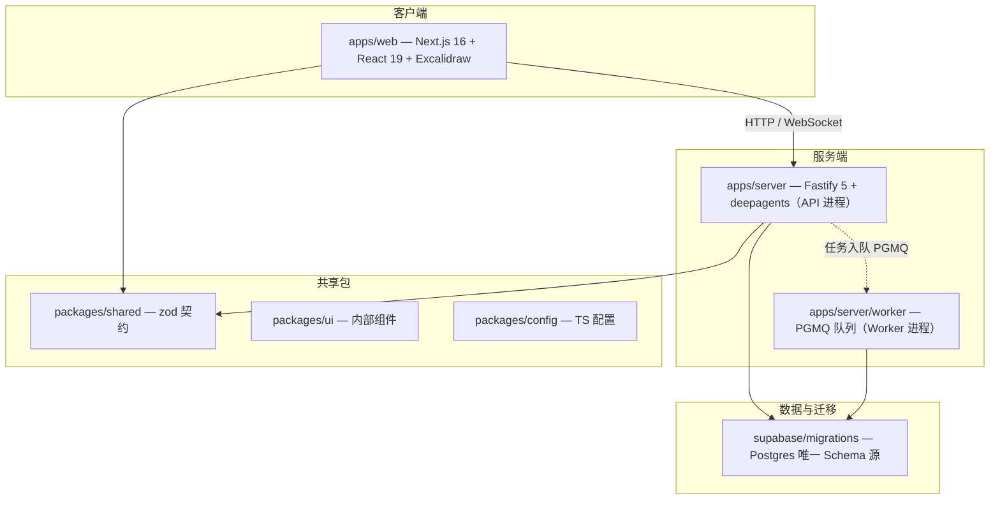
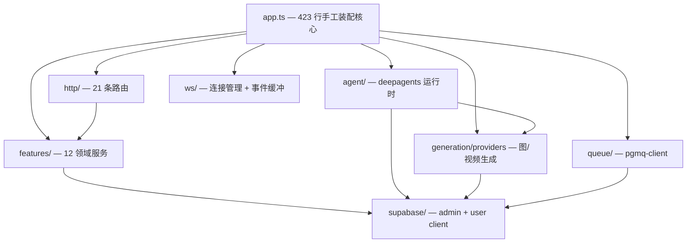
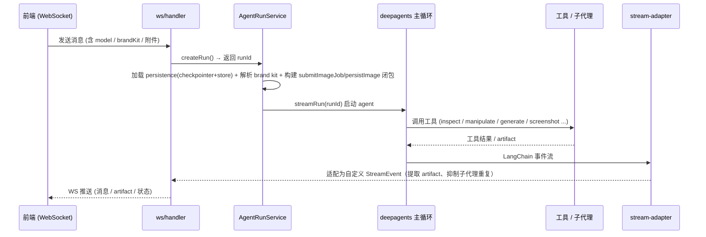
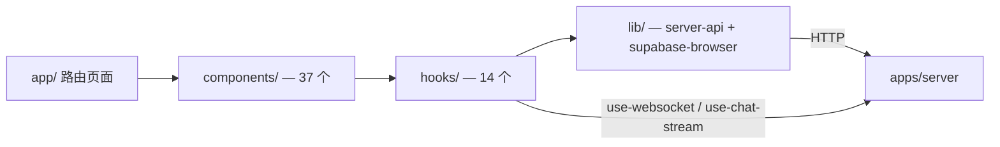
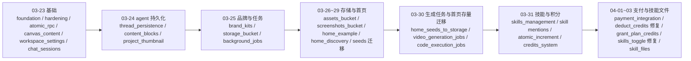

# KenFutWork 当前项目实现状态

> **角色：快照。** §11 为 2026-10-22 合并 `origin/main` 后的未完成功能专项盘点；§1–§10 保留 2026-09-11／12 历史快照，其中旧账户、计费、Supabase 及缺失能力判断不能作为当前实现结论。
> 2026-10-22 补充阅读：[GPT6Astra 检查入口](../GPT6Astra/阅读指南.md)提供更新工作区的 Harness／插件连接检查和剩余规划核对；这是源码调研，不是新增运行验收。§11 的能力组计数只对应该节声明的范围。
> 用途：记录已实现能力与尚未完成事项。产品方向见《改造计划》与《多端产品设计》；dsh研究见《01-deepseek-harness插件调研》。完整文档地图见 `docs/README.md`。
> **刷新规则**：本快照允许滞后于代码；在改造各阶段（P1–P8、D1–D7）合并时由该阶段 PR 同步刷新对应章节，日常代码 PR 不强制维护；与代码冲突时以代码为准。
> 当前产品为本地免账户的BYOK工作台。Code／Design共用Task与Harness，Flow通过插件提供；供应商配置、使用统计、MCP和权限由现有服务管理。当前身份与数据规则见《身份与账户》。

---

## 1. 技术栈与形态

| 层 | 技术 | 说明 |
| --- | --- | --- |
| Monorepo | pnpm@10 workspace + Turborepo | apps / packages / supabase / references |
| 前端 | Next.js 16（App Router, Turbopack）+ React 19 + Tailwind 4 + Base UI + Excalidraw | `output: export` 静态导出 |
| 服务端 | Fastify 5 + LangChain 1.x / deepagents + PGMQ worker | API(3001) + worker 双进程 |
| 契约 | `packages/shared` zod | HTTP / WS / job / credits / skills 跨端单一事实源 |
| 存储 | Supabase（Postgres + Auth + Storage） | migrations 为唯一 Schema 源 |
| 计费 | credits + 支付集成（Lemon Squeezy） | 订阅分级 + 积分扣减 + 水印 |

---

## 2. Monorepo 顶层结构

---

## 3. 后端架构

### 3.1 装配层现状（P8 完成后）

`apps/server/src/app.ts` 已退役为 **98 行薄封装**：选 `profiles/server.ts` → `composePlugins()` → 挂 CORS/infra 路由/WS，不 import 任何 `features/*`；`BuildAppOptions` 已删除，测试统一走 `overrides`。`worker.ts` 同样经 `profiles/worker.ts` 走内核装配。**新增 feature = features/<x>/plugin.ts + profiles 清单一行**。按 env 副作用的 `register-all.ts`（生成 provider）为迁移期遗留，随 BYOK 切换退役。

### 3.2 后端模块图

### 3.3 HTTP 路由清单（21 条，`src/http/`）

`viewer`（用户/工作区引导）、`projects`、`canvases`、`chat`、`runs`（agent 运行）、`brand-kits`、`skills` + `skills-marketplace`、`settings`、`uploads`、`fonts`、`generate`、`image-models` + `video-models` + `models`、`image-proxy`、`jobs`、`credits`、`payments` + `payments-webhook`、`health`。

### 3.4 领域服务 features（12 个，`src/features/`）

`bootstrap`、`viewer` 相关、`projects`、`canvas`、`chat`、`brand-kit`、`skills`（marketplace-service + skill-import-service）、`settings`、`uploads`、`agent-runs`（agent-run-service + types）、`jobs`（PGMQ executor 注册表）、`credits`（credit-service + tier-guard + watermark）、`payments`。

### 3.5 生成 provider（图/视频，`src/generation/providers/`）

| 能力 | provider |
| --- | --- |
| 图像 | `google-image`、`google-vertex-image`、`openai-image`、`replicate-image`、`volces-image` |
| 视频 | `google-video`、`google-vertex-video`、`metaso-video`（MiniMax H3）、`replicate-video` |
| 注册 | `registry.ts`（Map 注册表）+ `register-all.ts`（按 env 副作用批量注册） |

现状：**按服务端 env 注册**（`replicateApiToken` / `volcesApiKey` / `metasoApiKey` 等），server 和 worker 各自调用 `register-all`，靠人肉保持一致——BYOK 改造要把它变成「按用户供应商实例动态实例化」。

### 3.6 WS 与队列

- `ws/`：`connection-manager`（连接注册表）、`event-buffer`（事件缓冲/重放）、`handler`（消息处理入口）、`logger`。
- `queue/`：`pgmq-client`（PostgreSQL 原生消息队列），承载图像/视频/代码执行等异步任务。

---

## 4. Agent 运行时

### 4.1 运行流程（时序）

### 4.2 工具集（`src/agent/tools/`）

自定义工具：`project_search`（项目内检索）、`inspect_canvas`、`manipulate_canvas`（1400+ 行，10 种操作）、`generate_image`、`generate_video`、`persist_sandbox_file`、`get_brand_kit`（条件注册）、`screenshot_canvas`（条件注册，走 WS RPC）。

deepagents 内置（FilesystemMiddleware 自动注入）：`ls` / `read_file` / `write_file` / `edit_file` / `glob` / `grep` / `execute`（沙箱 shell）/ `task`（子代理分发）/ `write_todos`。

Backend 路由（CompositeBackend）：`/workspace/` → PostgresStore、`/memories/` → PostgresStore、`/skills/` → Filesystem、default → LocalShellBackend（`execute` + 临时文件）。

### 4.3 子代理（`src/agent/sub-agents.ts`）

**目前只有 1 个**：`video_generate`。deepagents 提供 `task` 工具做子代理分发，机制在，但内容极薄。

### 4.4 backend 模式与持久化

- `backends/`：按 `agentBackendMode` 在 dev（filesystem）/ prod（state）间选择。
- `persistence/`：`supabase-checkpointer`（LangGraph checkpointer，按 threadId）+ `supabase-store`（命名空间隔离存储）。
- 模型选择：`deep-agent.ts` 按 env 三选一（ChatOpenAI / ChatGoogleGenerativeAI / ChatVertexAI），`streamUsage: false`（**未采集 token 用量**）。

### 4.5 技能（skills）

已实现且较完整：`workspace-skills.ts` + SkillsMiddleware + `features/skills`（导入 + 市场）+ `skill-contracts.ts`；`skills/` 目录下 `canvas-design`（含字体库，用 `execute` 跑 Python/Pillow 生成海报）、`json-image-prompt`；`SKILL.md` 自动发现，无需改代码。迁移含 `skills_management` + `skill_files`。

---

## 5. 前端架构

### 5.1 路由（`src/app/`）

- 工作区 `(workspace)/`：`home`、`projects`、`brand-kit`、`settings`、`skills`
- 独立页：`canvas`（画布编辑器）、`login`、`register`、`auth/callback`、`pricing`（含 8 个子组件）、`loading-preview`、`not-found`

### 5.2 数据流

- **components（37）**：画布类（`canvas-editor`、`canvas-ai-toolbar`、`canvas-layers-panel`、`canvas-image-gen-panel`、`canvas-files-panel`、`canvas-tool-menu` 等）、对话类（`chat-sidebar`、`chat-input`、`chat-message`、`chat-skills`、`session-selector`）、模型/偏好（`agent-model-selector`、`image-model-preference`、`brand-kit-selector`）、首页（`home-prompt`、`home-discovery-gallery`、`home-example-browser`）、账户（`billing-section`、`profile-section`、`settings-layout`）。
- **hooks（14）**：`use-chat-stream`、`use-websocket`、`use-chat-sessions`、`use-agent-model`、`use-credits`、`use-subscription`、`use-image-attachments`、`use-image-model-preference`、`use-video-model-preference`、`use-job-fallback-polling`、`use-create-project`、`use-delete-project`、`use-generation-error-handler`、`use-breakpoint`。
- **lib（18）**：`server-api`、`auth-context`、`canvas-elements`、`canvas-image-generator`、`canvas-video-generator`、`canvas-normalize`、`brand-kit-api`、`credits-api`、`payments-api`、`font-api`、`home-discovery-*`、`home-example-*`、`supabase-browser`、`env`、`dedupe-request`、`utils`。

---

## 6. 数据模型与迁移演进（31 个迁移）

> 迁移计数与 Supabase 专有对象底账见《日志》四十六（由 `scripts/supabase-inventory.mjs` 生成，权威数字以脚本输出为准）。

存储桶：brand-kit、public-project-assets、canvas-screenshots。RPC：原子操作（`atomic_rpc_functions`、`atomic_increment_job_attempt`、`deduct_credits`、`grant_plan_credits`）。

---

## 7. 已实现功能盘点

| 域 | 功能 | 状态 |
| --- | --- | --- |
| 画布 | Excalidraw 编辑、图层、AI 工具栏、元素操作、截图 | 已实现 |
| 对话 | 聊天会话、流式输出、WS 实时、会话选择 | 已实现 |
| 生成 | 图像（5 provider）、视频（4 provider）、异步任务 + 轮询兜底 | 已实现 |
| Agent | deepagents 主循环、9 类自定义工具、代码执行沙箱、1 个子代理 | 已实现（偏薄） |
| 品牌 | brand kit CRUD + 存储 + 条件工具注入 | 已实现 |
| 技能 | SKILL.md 自动发现、导入、市场、技能文件 | 已实现 |
| 项目 | 项目 CRUD、缩略图、首页示例库/发现库 | 已实现 |
| 账户 | Supabase 认证、设置、订阅/定价页 | 已实现 |
| 计费 | 积分余额/扣减/退款、分级门禁、水印、支付 webhook | 已实现 |

---

## 8. Agent 能力现状（对照通用 agent 功能清单）

| 能力 | 现状 | 位置/证据 |
| --- | --- | --- |
| 模型配置 | 部分（硬编码目录，前端有选择器；BYOK 未落地） | `http/models.ts`、`agent-model-selector` |
| MCP | **缺失** | 代码 0 匹配 |
| Skill | 已实现（未作为插件缝设计） | `features/skills`、`workspace-skills` |
| 联网搜索 | 已实现（`web_search` 工具插件，metaso BYOK Key，`KENFUTWORK_SEARCH_API_KEY` 启用；`project_search` 仍为项目内检索） | `features/search/plugin.ts` |
| 用量统计 | **缺失**（只有 credits 余额/计费，无 token/成本统计，`streamUsage:false`） | `features/credits` |
| 文件预览 | 部分（聊天图片缩略图 + deepagents `read_file`；无富预览） | `use-image-attachments` |
| 差异分析 | **缺失** | 无 |
| 子代理 | 部分（机制在，仅 1 个 video 子代理） | `sub-agents.ts` |
| plan/goal/loop/solo 模式 | **缺失**（`write_todos` 是唯一轻量规划） | 无 |
| 权限控制（默认/自动审批/完全访问） | **缺失**（仅桌面计划里有沙箱三档设计，未实施；当前 agent 工具直接执行） | 无 |

---

## 9. 架构痛点（2026-09-12 复核）

1. ~~装配层特权核心~~ **已解决**：app.ts 98 行薄封装，profiles/ 唯一清单。
2. ~~供应商主权缺失~~ **已解决（缝层面）**：`modelProviders`/`modelCatalog` 缝 + `providers/<protocol>/` 适配器 + SecretStore 落地；聊天与生成链路按用户实例实例化。`http/models.ts` 内置目录与 `register-all.ts` env 注册作为迁移期存量并行，随 BYOK 切换（D3）退役。
3. **存储耦合（未解决）**：各 feature service 仍直接持有 Supabase client——属《多端产品设计》D1 存储缝，按其前置铁律在 P0–P8 后另行开工。
4. ~~注册清单漂移~~ **已解决**：server/worker 插件清单收敛进 profiles/。
5. ~~agent 能力层薄~~ **基本解决**：MCP（ctx.tools）、用量统计（usage 表双采集点）、执行模式（agent/plan）、权限三档（tool-pre-execute 拦截）、文件预览/差异分析工具、子代理缝（capabilities）均已落地；联网搜索工具与 plan 审批 UI 为增量项。

---

## 10. 插件化改造现状（2026-09-12：P0–P8 完成）

- **P0**：DEC-1…DEC-8 拍板（结论与理由见《改造计划》§6/§6.2；`decisions/` 目录 2026-09-13 起不再维护）。
- **P1**：`kernel/` 三文件 + 3 个 agent-run 事件缝 + `ctx.tools`/`ctx.capabilities` 注册表。
- **P2–P3**：全部 12 个 feature（brand-kit/viewer/credits/projects/canvas/chat/settings/uploads/jobs/payments/skills/agent-runs）插件化；`mounted` 阶段与 `tryGet` 按需加入内核；`app.test.ts` 装配完整性回归锁死漏挂载。
- **P4**：`provider-contracts`/`capability-contracts` 契约、`providers/<protocol>/` 适配器、`modelProviders`/`modelCatalog` 缝 + SecretStore（迁移 `20260912100000`）、usage 表 + 双采集点（迁移 `20260912130000`）、MCP 接入 ctx.tools。
- **P5**：前端供应商设置（apiKey 只写不读）+ `/api/models` 合并动态目录 + skill 发现收敛为 `ctx.tools` 缝（`list_skills`/`use_skill`，`SkillCatalogService` 与 SkillsMiddleware 同源）。
- **P6**：permissions 三档策略缝、agentModes（agent/plan）+ pre-step/turn-stopping 发射、文件预览/diff 工具。
- **P6/P7 补全（2026-09-12 第二轮）**：`agent/kernel-tools-bridge` 把 `ctx.tools`（JSON Schema→zod，按 run preset 过滤）桥接进 deepagents 模型工具列表——统一工具注册表闭环，MCP/搜索/skill 工具真正可被模型调用；chat-sidebar 会话级执行模式切换 UI（`/api/execution-modes`）；settings 权限档位/工具审批与 BYOK 用量摘要 UI；`RunCreateRequest` 增量携带 `preset`（DEC-2）。
- **P7**：`profiles/server.ts`/`worker.ts` 单一清单、worker 走内核、presets 会话级能力集。
- **P8**：app.ts 98 行薄封装、BuildAppOptions 删除、挂载树打印（`KENFUTWORK_DUMP_CONFIG=1`）。
- **仍属后续**（非 P0–P8 范围）：存储缝/去 Supabase（D1–D3）、沙箱与 toolsGateway（D4–D5）、自托管/移动端（D6–D7）、plan 审批 UI；`register-all`/`http-models`/env 三选一存量路径退役随 DEC-9 于 D3 切换核销。

---

## 11. 未完成功能专项盘点（2026-10-22）

**范围与口径**：依据 `啃啃在开发` 的 `ea52d411` 合入 `origin/main` 的 `a9d3eab3` 后的代码、能力声明及实施记录。按可独立推进的能力组计数，**共20组：7组尚未接入或完成、7组已有实现但仍需验收、6组后续规划**。统计单位为能力组；默认跳过的测试、静态能力声明和真实应用验收分别记录。本次没有重新执行的历史验收会注明日期和来源。

### 11.1 当前尚未接入或完成：7组

| # | 能力组 | 当前边界与剩余工作 | 代码／规格依据 |
| --- | --- | --- | --- |
| 1 | 定时自动化 | `supportsAutomations:false`；完整创建、调度、持久执行与恢复仍需实现。当前Goal和Task Work提供目标执行与后台工作 | `apps/web/src/components/workbench/zcode/host/platform.ts`；《现有能力接线与入口统一》功能清单 |
| 2 | 项目记忆管理与召回 | 原Memory页面的项目记忆提取／召回仍未接入；checkpoint与上下文归档用于保存执行状态 | 《现有能力接线与入口统一》“项目记忆”；当前宿主／profile服务面 |
| 3 | 插件市场源与通用配置 | 包目录／链接安装、启停等已有实现；市场源管理仍声明`marketplaceSources:false`，源刷新与通用配置验证尚未接入 | `host/platform.ts`、`features/code-ui/plugins.ts`；《现有能力接线与入口统一》 |
| 4 | MCP高级管理面 | 本机MCP CRUD／运行消费已接；项目级配置、OAuth、服务参数仍被宿主拒绝，UI的SSE／请求头编辑等也未开放。后端已有HTTP headers存取，不能误称所有MCP或请求头均不支持 | `features/mcp/code-ui-host.ts`；`host/platform.ts`的`mcpSettingsCapabilities` |
| 5 | 技能目录与项目级管理 | 已安装技能／插件只读定义／启停／运行消费已有实现；目录复制、外部目录导入与项目／插件级设置仍不可用，新建方式有用户暂缓决策 | `features/skills/code-ui-host.ts`的`externalImportAvailable:false`及复制方法501；《现有能力接线与入口统一》 |
| 6 | 设置导入与外部Agent配置同步 | `supportsSettingsImport`、`supportsExternalAgentSettingsSync`、`supportsAppRuntimePreferences`均为false；现有实例设置保存不等于这些互操作入口已接 | `host/platform.ts` |
| 7 | 更多生命周期钩子 | 当前真实消费仅`turn-start`／`turn-end`；其它上游钩子事件未接入。动态shell预展开按现行规则拒绝执行 | `features/settings/hooks.ts`；《现有能力接线与入口统一》 |

### 11.2 已有实现，仍需验收：7组

| # | 能力组 | 尚缺的验收／证据 | 依据与限制 |
| --- | --- | --- | --- |
| 8 | CAD进阶真实模型及更广操作矩阵 | FreeCAD参数化、专业工作台代表流程及自有GUI控制已有分层实证；BIM自主交付的两次GLM流180秒无输出，未调用CAD工具。其它关节／复杂BIM／物理场／任意GUI provider并未全覆盖 | 《CAD官方接口与插件接入调研》§9.25—§9.32；本次合并未重发模型请求，不把历史流失败归因给厂商或CAD |
| 9 | OpenDesign真实CLI完整生成链 | 面板、评论／标注／编辑、上下文同步和文件回写均有实现及分层测试；O3仍需真实daemon＋可用本机coding CLI的完整design-to-code交付证据，不以手写HTML或静态预览替代生成 | 《opendesgin集成规划》§6实施状态；`features/open-design/provision.ts`；《日志》OpenDesign批次 |
| 10 | OpenDesign公网静态发布 | Cloudflare Pages／Vercel代理、配置和错误路径已接；现有真机记录停在缺真实token的上游预检，尚无两家真实发布成功与访问回读证据 | `http/open-design-host.ts`的deploy路由；《日志》“二百二十、分享改静态部署” |
| 11 | HA／米家／华为真设备控制 | HA插件P1—P6已完成，已有面板与自动化检查记录；用户侧真实HA、实体开关读回、WS状态跟随仍待现场验收 | 《米家和HA插件规划》§6状态表；`plugins/ha/` |
| 12 | 媒体厂商真实能力覆盖 | 共享Job、异步图片、恢复、主动／本地取消、多图位置与播放器已有实现；APIMart等真实Key、更多参考素材／首尾帧／格式与取消支持矩阵未全部实测。GRSAI／APIMart的`local_only`是显式能力边界，不保证停止云端计费 | 《媒体生成供应商适配核验》末尾实施台账；《媒体驱动接入协议核验》；本次未调用计费模型 |
| 13 | 自托管原生PGMQ与多进程媒体恢复 | 已用真实PG验证本机服务重建与媒体生命周期；真实PGMQ、完整Docker自托管部署与多进程恢复仍需独立验收 | 《媒体生成供应商适配核验》末尾验收范围；《多端产品设计》D6 |
| 14 | 正式发行、签名与升级验收 | `release.yml`及双平台打包链已存在；仍需面向正式产物验证签名／公证条件、从旧数据目录升级和本次合并HEAD的跨平台安装体验。本机测试不能代替这些发布证据 | `.github/workflows/release.yml`、`_package-platform.yml`、`scripts/验收打包桌面端.mjs`；《CI-CD与发版方案》旧“release.yml待写”已过时 |

### 11.3 后续规划，不算本期功能缺陷：6组

| # | 能力组 | 当前阶段／进入实施的前提 | 权威方向 |
| --- | --- | --- | --- |
| 15 | 独立Work／办公编辑器 | 本期Code承接通用工作；Office／文档编辑器未接通前不展示Work空入口，第四模式仍需单独设计 | 《work模式集成规划》本轮边界；`AGENTS.md`工作域不变量 |
| 16 | 移动客户端与受限Worker | iOS／Android瘦客户端、设备能力与真机矩阵属后续D7，不能把桌面响应式页面当移动端完成 | 《多端产品设计》§8、§13 |
| 17 | 官方账户与远端服务 | 本期仅规格；多来源资源、官方权益与远端执行／授权、公共自部署认证档位仍需单独立项，不能恢复旧本地账户或计费门 | 《身份与账户》“官方账户与远端连接基础设施”；`DEC-21` |
| 18 | 局域网配对 | 后续独立阶段；传输／证书／发现、逐设备确认与撤销尚需实现。当前服务继续只监听回环 | 《身份与账户》“下一阶段局域网” |
| 19 | 外部运行时归属清单与卸载 | WSL发行版归属、删除清单与卸载向导独立确认仍是`DEC-23`前置要求；现有运行目标记录不是拥有用户发行版的证明 | 《改造计划》`DEC-23`；`features/flow/engine/install.ts`重启探测亦留后续增量 |
| 20 | AutoCAD／Blender实际控制插件 | 本轮只有官方接口／跨平台研究，未安装和实际控制验收；不阻塞已交付FreeCAD首期能力 | 《CAD官方接口与插件接入调研》；《CAD控制插件规划》 |

### 11.4 当前已有的主要能力

- 2026-10-22 统一主 Agent：普通聊天和任务共用执行流程，Plan、三种基础权限、独立审批模型与 Goal 分别持有状态；技能／插件制作和只读子任务继续使用现有能力。前向迁移停止旧待执行输入，检查范围及限制见《日志》同日“统一主 Agent 实施与验证”。
- 本地免账户／LocalActor、旧账户与计费退役已有当前实现和验收，见《身份与账户》。
- 共享Code／Design Task、真实权限与模型审批、基础真实GLM Code／Design、画布本机多标签／Agent同步及Goal冷恢复已有独立证据。具体测试范围见对应实施记录。
- 图片HTTP202、共享Job恢复／取消、多图分别排布、无扩展名视频播放均已连接现有服务，验证记录见《媒体生成供应商适配核验》末尾实施记录。
- 本次主线带入OpenDesign空态入口、受管上下文同步、保存到工作目录、设计体系切换、浏览器页面同步、评论／标注／编辑及浏览器控制台修复；这些已实现功能不混入“未接入”计数。
- `release.yml`已存在，image-proxy的域名匹配／逐次重定向SSRF修复已在`ea52d411`。
- `references/zcode`本机检出为3.15.1，但移植清单基线仍固定3.14.3。保留本机参考指针不等于完成新版本UI移植。
